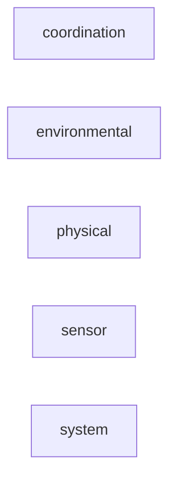

_Generated by CodeAtlas._

## Details

Owns 434 symbols across 24 file(s).

### coordination

Owns 14 symbols across 2 file(s).

**Related Classes/Methods:** _None_

**Source Files:**

- `src/analyzers/coordination/control_loop_stall.rs`
  - `src.analyzers.coordination.control_loop_stall.ControlLoopStallDetector`
  - `src.analyzers.coordination.control_loop_stall.ControlLoopStallDetector.analyze`
  - `src.analyzers.coordination.control_loop_stall.ControlLoopStallDetector.default`
  - `src.analyzers.coordination.control_loop_stall.ControlLoopStallDetector.new`
  - `src.analyzers.coordination.control_loop_stall.tests.a_large_gap_is_detected_as_a_stall`
  - `src.analyzers.coordination.control_loop_stall.tests.msg`
  - `src.analyzers.coordination.control_loop_stall.tests.regular_cadence_produces_no_finding`
  - `src.analyzers.coordination.control_loop_stall.tests.severity_scales_with_stall_duration_relative_to_mission`
  - `src.analyzers.coordination.control_loop_stall.tests.too_few_messages_is_skipped`
- `src/analyzers/coordination/mod.rs`
  - `src.analyzers.coordination.mod.CoordinationDomainAnalyzer`
  - `src.analyzers.coordination.mod.CoordinationDomainAnalyzer.analyze`
  - `src.analyzers.coordination.mod.CoordinationDomainAnalyzer.default`
  - `src.analyzers.coordination.mod.CoordinationDomainAnalyzer.domain`
  - `src.analyzers.coordination.mod.CoordinationDomainAnalyzer.new`

### environmental

Owns 24 symbols across 3 file(s).

**Related Classes/Methods:** _None_

**Source Files:**

- `src/analyzers/environmental/lighting_variability.rs`
  - `src.analyzers.environmental.lighting_variability.LightingVariabilityDetector`
  - `src.analyzers.environmental.lighting_variability.LightingVariabilityDetector.analyze`
  - `src.analyzers.environmental.lighting_variability.LightingVariabilityDetector.default`
  - `src.analyzers.environmental.lighting_variability.LightingVariabilityDetector.new`
  - `src.analyzers.environmental.lighting_variability.tests.cameras_are_analyzed_independently`
  - `src.analyzers.environmental.lighting_variability.tests.frame`
  - `src.analyzers.environmental.lighting_variability.tests.stable_entropy_produces_no_finding`
  - `src.analyzers.environmental.lighting_variability.tests.swinging_entropy_produces_a_finding_with_correct_camera_id`
  - `src.analyzers.environmental.lighting_variability.tests.too_few_frames_is_skipped_not_falsely_flagged`
- `src/analyzers/environmental/mod.rs`
  - `src.analyzers.environmental.mod.EnvironmentalDomainAnalyzer`
  - `src.analyzers.environmental.mod.EnvironmentalDomainAnalyzer.analyze`
  - `src.analyzers.environmental.mod.EnvironmentalDomainAnalyzer.default`
  - `src.analyzers.environmental.mod.EnvironmentalDomainAnalyzer.domain`
  - `src.analyzers.environmental.mod.EnvironmentalDomainAnalyzer.new`
- `src/analyzers/environmental/thermal_drift.rs`
  - `src.analyzers.environmental.thermal_drift.ThermalDriftDetector`
  - `src.analyzers.environmental.thermal_drift.ThermalDriftDetector.analyze`
  - `src.analyzers.environmental.thermal_drift.ThermalDriftDetector.default`
  - `src.analyzers.environmental.thermal_drift.ThermalDriftDetector.new`
  - `src.analyzers.environmental.thermal_drift.linear_regression`
  - `src.analyzers.environmental.thermal_drift.tests.linear_regression_recovers_known_slope`
  - `src.analyzers.environmental.thermal_drift.tests.locations_are_analyzed_independently`
  - `src.analyzers.environmental.thermal_drift.tests.reading`
  - `src.analyzers.environmental.thermal_drift.tests.stable_temperature_produces_no_finding`
  - `src.analyzers.environmental.thermal_drift.tests.sustained_drift_produces_a_finding`

### physical

Owns 31 symbols across 4 file(s).

**Related Classes/Methods:** _None_

**Source Files:**

- `src/analyzers/physical/mechanical_degradation.rs`
  - `src.analyzers.physical.mechanical_degradation.MechanicalDegradationDetector`
  - `src.analyzers.physical.mechanical_degradation.MechanicalDegradationDetector.analyze`
  - `src.analyzers.physical.mechanical_degradation.MechanicalDegradationDetector.analyze_response_time_trend`
  - `src.analyzers.physical.mechanical_degradation.MechanicalDegradationDetector.analyze_wheel_slip`
  - `src.analyzers.physical.mechanical_degradation.MechanicalDegradationDetector.compute_response_time_trend`
  - `src.analyzers.physical.mechanical_degradation.MechanicalDegradationDetector.default`
  - `src.analyzers.physical.mechanical_degradation.MechanicalDegradationDetector.domain`
  - `src.analyzers.physical.mechanical_degradation.MechanicalDegradationDetector.new`
  - `src.analyzers.physical.mechanical_degradation.tests.test_detector_creation`
  - `src.analyzers.physical.mechanical_degradation.tests.test_response_time_trend_empty`
- `src/analyzers/physical/mod.rs`
  - `src.analyzers.physical.mod.PhysicalDomainAnalyzer`
  - `src.analyzers.physical.mod.PhysicalDomainAnalyzer.analyze`
  - `src.analyzers.physical.mod.PhysicalDomainAnalyzer.default`
  - `src.analyzers.physical.mod.PhysicalDomainAnalyzer.domain`
  - `src.analyzers.physical.mod.PhysicalDomainAnalyzer.new`
  - `src.analyzers.physical.mod.tests.test_physical_analyzer_creation`
- `src/analyzers/physical/structural_dynamics.rs`
  - `src.analyzers.physical.structural_dynamics.StructuralDynamicsDetector`
  - `src.analyzers.physical.structural_dynamics.StructuralDynamicsDetector.analyze`
  - `src.analyzers.physical.structural_dynamics.StructuralDynamicsDetector.analyze_oscillation`
  - `src.analyzers.physical.structural_dynamics.StructuralDynamicsDetector.default`
  - `src.analyzers.physical.structural_dynamics.StructuralDynamicsDetector.domain`
  - `src.analyzers.physical.structural_dynamics.StructuralDynamicsDetector.new`
  - `src.analyzers.physical.structural_dynamics.tests.test_detector_creation`
- `src/analyzers/physical/thermal_effects.rs`
  - `src.analyzers.physical.thermal_effects.ThermalEffectsDetector`
  - `src.analyzers.physical.thermal_effects.ThermalEffectsDetector.analyze`
  - `src.analyzers.physical.thermal_effects.ThermalEffectsDetector.analyze_motor_efficiency`
  - `src.analyzers.physical.thermal_effects.ThermalEffectsDetector.compute_efficiency`
  - `src.analyzers.physical.thermal_effects.ThermalEffectsDetector.default`
  - `src.analyzers.physical.thermal_effects.ThermalEffectsDetector.domain`
  - `src.analyzers.physical.thermal_effects.ThermalEffectsDetector.new`
  - `src.analyzers.physical.thermal_effects.tests.test_detector_creation`

### sensor

Owns 31 symbols across 3 file(s).

**Related Classes/Methods:** _None_

**Source Files:**

- `src/analyzers/sensor/detection_robustness.rs`
  - `src.analyzers.sensor.detection_robustness.DetectionRobustnessAnalyzer`
  - `src.analyzers.sensor.detection_robustness.DetectionRobustnessAnalyzer.analyze`
  - `src.analyzers.sensor.detection_robustness.DetectionRobustnessAnalyzer.analyze_detection_confidence`
  - `src.analyzers.sensor.detection_robustness.DetectionRobustnessAnalyzer.analyze_false_positives`
  - `src.analyzers.sensor.detection_robustness.DetectionRobustnessAnalyzer.compute_confidence_trend`
  - `src.analyzers.sensor.detection_robustness.DetectionRobustnessAnalyzer.compute_correlation`
  - `src.analyzers.sensor.detection_robustness.DetectionRobustnessAnalyzer.compute_frame_confidences`
  - `src.analyzers.sensor.detection_robustness.DetectionRobustnessAnalyzer.compute_spatial_clustering`
  - `src.analyzers.sensor.detection_robustness.DetectionRobustnessAnalyzer.default`
  - `src.analyzers.sensor.detection_robustness.DetectionRobustnessAnalyzer.domain`
  - `src.analyzers.sensor.detection_robustness.DetectionRobustnessAnalyzer.extract_image_quality_trend`
  - `src.analyzers.sensor.detection_robustness.DetectionRobustnessAnalyzer.new`
  - `src.analyzers.sensor.detection_robustness.tests.test_confidence_trend_empty`
  - `src.analyzers.sensor.detection_robustness.tests.test_detector_creation`
  - `src.analyzers.sensor.detection_robustness.tests.test_frame_confidences_empty`
  - `src.analyzers.sensor.detection_robustness.tests.test_spatial_clustering`
- `src/analyzers/sensor/mod.rs`
  - `src.analyzers.sensor.mod.SensorDomainAnalyzer`
  - `src.analyzers.sensor.mod.SensorDomainAnalyzer.analyze`
  - `src.analyzers.sensor.mod.SensorDomainAnalyzer.default`
  - `src.analyzers.sensor.mod.SensorDomainAnalyzer.domain`
  - `src.analyzers.sensor.mod.SensorDomainAnalyzer.new`
- `src/analyzers/sensor/optical_contamination.rs`
  - `src.analyzers.sensor.optical_contamination.OpticalContaminationDetector`
  - `src.analyzers.sensor.optical_contamination.OpticalContaminationDetector.analyze`
  - `src.analyzers.sensor.optical_contamination.OpticalContaminationDetector.analyze_detection_confidence_trend`
  - `src.analyzers.sensor.optical_contamination.OpticalContaminationDetector.analyze_image_quality`
  - `src.analyzers.sensor.optical_contamination.OpticalContaminationDetector.compute_sharpness_trend`
  - `src.analyzers.sensor.optical_contamination.OpticalContaminationDetector.default`
  - `src.analyzers.sensor.optical_contamination.OpticalContaminationDetector.domain`
  - `src.analyzers.sensor.optical_contamination.OpticalContaminationDetector.new`
  - `src.analyzers.sensor.optical_contamination.tests.test_detector_creation`
  - `src.analyzers.sensor.optical_contamination.tests.test_sharpness_trend_empty`

### system

Owns 15 symbols across 2 file(s).

**Related Classes/Methods:** _None_

**Source Files:**

- `src/analyzers/system/clock_drift.rs`
  - `src.analyzers.system.clock_drift.ClockDriftDetector`
  - `src.analyzers.system.clock_drift.ClockDriftDetector.analyze`
  - `src.analyzers.system.clock_drift.ClockDriftDetector.analyze_sensor_timing`
  - `src.analyzers.system.clock_drift.ClockDriftDetector.analyze_timestamp_reversals`
  - `src.analyzers.system.clock_drift.ClockDriftDetector.default`
  - `src.analyzers.system.clock_drift.ClockDriftDetector.domain`
  - `src.analyzers.system.clock_drift.ClockDriftDetector.linear_regression`
  - `src.analyzers.system.clock_drift.ClockDriftDetector.new`
  - `src.analyzers.system.clock_drift.tests.test_detector_creation`
  - `src.analyzers.system.clock_drift.tests.test_linear_regression`
- `src/analyzers/system/mod.rs`
  - `src.analyzers.system.mod.SystemDomainAnalyzer`
  - `src.analyzers.system.mod.SystemDomainAnalyzer.analyze`
  - `src.analyzers.system.mod.SystemDomainAnalyzer.default`
  - `src.analyzers.system.mod.SystemDomainAnalyzer.domain`
  - `src.analyzers.system.mod.SystemDomainAnalyzer.new`
