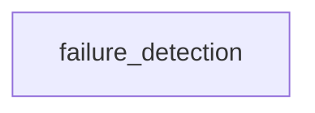

_Generated by CodeAtlas._

## Details

Owns 606 symbols across 26 file(s).

### failure_detection

Owns 63 symbols across 6 file(s).

**Related Classes/Methods:** _None_

**Source Files:**

- `src/core/failure_detection/localization.rs`
  - `src.core.failure_detection.localization.LocalizationFailureDetector`
  - `src.core.failure_detection.localization.LocalizationFailureDetector.detect`
  - `src.core.failure_detection.localization.LocalizationFailureDetector.detect_amcl_divergence`
  - `src.core.failure_detection.localization.LocalizationFailureDetector.detect_gps_dropout`
  - `src.core.failure_detection.localization.LocalizationFailureDetector.detect_pose_instability`
  - `src.core.failure_detection.localization.LocalizationFailureDetector.detect_tf_inconsistency`
  - `src.core.failure_detection.localization.LocalizationFailureDetector.domain`
  - `src.core.failure_detection.localization.tests.test_detector_creation`
  - `src.core.failure_detection.localization.tests.test_empty_events`
- `src/core/failure_detection/middleware.rs`
  - `src.core.failure_detection.middleware.MiddlewareFailureDetector`
  - `src.core.failure_detection.middleware.MiddlewareFailureDetector.detect`
  - `src.core.failure_detection.middleware.MiddlewareFailureDetector.detect_discovery_timeout`
  - `src.core.failure_detection.middleware.MiddlewareFailureDetector.detect_latency_spike`
  - `src.core.failure_detection.middleware.MiddlewareFailureDetector.detect_qos_mismatch`
  - `src.core.failure_detection.middleware.MiddlewareFailureDetector.detect_topic_starvation`
  - `src.core.failure_detection.middleware.MiddlewareFailureDetector.domain`
  - `src.core.failure_detection.middleware.tests.test_detector_creation`
- `src/core/failure_detection/mod.rs`
  - `src.core.failure_detection.mod.DetectedFailure`
  - `src.core.failure_detection.mod.DetectedFailure.new`
  - `src.core.failure_detection.mod.DetectedFailure.with_event_ids`
  - `src.core.failure_detection.mod.DetectedFailure.with_evidence`
  - `src.core.failure_detection.mod.FailureDetectionEngine`
  - `src.core.failure_detection.mod.FailureDetectionEngine.add_detector`
  - `src.core.failure_detection.mod.FailureDetectionEngine.default`
  - `src.core.failure_detection.mod.FailureDetectionEngine.detect_all`
  - `src.core.failure_detection.mod.FailureDetectionEngine.detect_by_domain`
  - `src.core.failure_detection.mod.FailureDetectionEngine.new`
  - `src.core.failure_detection.mod.FailureDetector`
  - `src.core.failure_detection.mod.FailureDomain`
  - `src.core.failure_detection.mod.FailureDomain.as_str`
  - `src.core.failure_detection.mod.FailureSeverity`
  - `src.core.failure_detection.mod.FailureSeverity.as_str`
  - `src.core.failure_detection.mod.tests.test_engine_creation`
  - `src.core.failure_detection.mod.tests.test_failure_creation`
  - `src.core.failure_detection.mod.tests.test_severity_ordering`
- `src/core/failure_detection/navigation.rs`
  - `src.core.failure_detection.navigation.NavigationFailureDetector`
  - `src.core.failure_detection.navigation.NavigationFailureDetector.detect`
  - `src.core.failure_detection.navigation.NavigationFailureDetector.detect_goal_failure`
  - `src.core.failure_detection.navigation.NavigationFailureDetector.detect_oscillation`
  - `src.core.failure_detection.navigation.NavigationFailureDetector.detect_path_deviation`
  - `src.core.failure_detection.navigation.NavigationFailureDetector.detect_planner_timeout`
  - `src.core.failure_detection.navigation.NavigationFailureDetector.detect_recovery_loop`
  - `src.core.failure_detection.navigation.NavigationFailureDetector.domain`
  - `src.core.failure_detection.navigation.tests.test_detector_creation`
  - `src.core.failure_detection.navigation.tests.test_empty_events`
  - `src.core.failure_detection.navigation.tests.test_plan_timeout_detection`
- `src/core/failure_detection/perception.rs`
  - `src.core.failure_detection.perception.PerceptionFailureDetector`
  - `src.core.failure_detection.perception.PerceptionFailureDetector.detect`
  - `src.core.failure_detection.perception.PerceptionFailureDetector.detect_low_confidence`
  - `src.core.failure_detection.perception.PerceptionFailureDetector.detect_sensor_dropout`
  - `src.core.failure_detection.perception.PerceptionFailureDetector.detect_sync_mismatch`
  - `src.core.failure_detection.perception.PerceptionFailureDetector.domain`
  - `src.core.failure_detection.perception.tests.test_detector_creation`
- `src/core/failure_detection/system.rs`
  - `src.core.failure_detection.system.SystemFailureDetector`
  - `src.core.failure_detection.system.SystemFailureDetector.detect`
  - `src.core.failure_detection.system.SystemFailureDetector.detect_cpu_saturation`
  - `src.core.failure_detection.system.SystemFailureDetector.detect_kernel_panic`
  - `src.core.failure_detection.system.SystemFailureDetector.detect_memory_pressure`
  - `src.core.failure_detection.system.SystemFailureDetector.detect_oom_kill`
  - `src.core.failure_detection.system.SystemFailureDetector.detect_thermal_throttle`
  - `src.core.failure_detection.system.SystemFailureDetector.detect_usb_device_loss`
  - `src.core.failure_detection.system.SystemFailureDetector.domain`
  - `src.core.failure_detection.system.tests.test_detector_creation`
