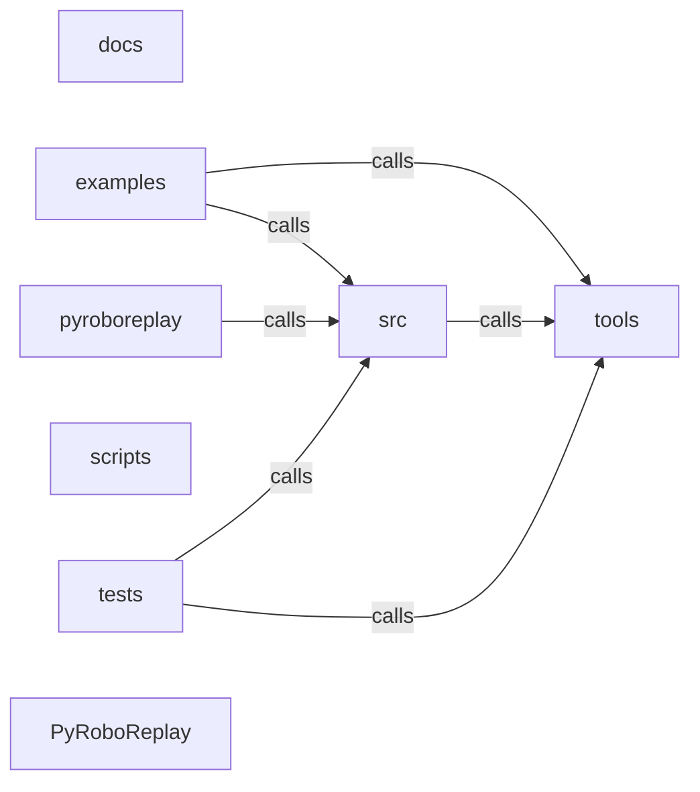

_Generated by CodeAtlas._

## Details

Architecture map of PyRoboReplay.

### docs

Owns 0 symbols across 12 file(s).

**Related Classes/Methods:** _None_

### examples

Owns 80 symbols across 28 file(s).

**Related Classes/Methods:** _None_

**Source Files:**

- `examples/camera_export_demo.rs`
  - `examples.camera_export_demo.count_camera_frames`
  - `examples.camera_export_demo.create_sample_mission`
  - `examples.camera_export_demo.main`
- `examples/causal_analysis_demo.rs`
  - `examples.causal_analysis_demo.create_demo_mission`
  - `examples.causal_analysis_demo.main`
- `examples/causal_query_engine_demo.rs`
  - `examples.causal_query_engine_demo.create_complex_mission`
  - `examples.causal_query_engine_demo.main`
- `examples/causal_visualization_demo.rs`
  - `examples.causal_visualization_demo.create_visualization_demo_mission`
  - `examples.causal_visualization_demo.main`
- `examples/compliance_report_demo.rs`
  - `examples.compliance_report_demo.main`
- `examples/correlation_analysis_demo.rs`
  - `examples.correlation_analysis_demo.create_realistic_mission`
  - `examples.correlation_analysis_demo.main`
- `examples/counterfactual_reasoning_demo.rs`
  - `examples.counterfactual_reasoning_demo.main`
- `examples/coverage_evolution_demo.rs`
  - `examples.coverage_evolution_demo.main`
- `examples/deterministic_replay_demo.rs`
  - `examples.deterministic_replay_demo.main`
- `examples/diagnostic_report_demo.rs`
  - `examples.diagnostic_report_demo.main`
- `examples/failover_demo.rs`
  - `examples.failover_demo.FlakyPrimary`
  - `examples.failover_demo.FlakyPrimary.close`
  - `examples.failover_demo.FlakyPrimary.connect`
  - `examples.failover_demo.FlakyPrimary.delete_mission`
  - `examples.failover_demo.FlakyPrimary.get_stats`
  - `examples.failover_demo.FlakyPrimary.list_missions`
  - `examples.failover_demo.FlakyPrimary.mission_exists`
  - `examples.failover_demo.FlakyPrimary.new`
  - `examples.failover_demo.FlakyPrimary.retrieve_event`
  - `examples.failover_demo.FlakyPrimary.retrieve_mission`
  - `examples.failover_demo.FlakyPrimary.retrieve_report`
  - `examples.failover_demo.FlakyPrimary.store_event`
  - `examples.failover_demo.FlakyPrimary.store_mission`
  - `examples.failover_demo.FlakyPrimary.store_report`
  - `examples.failover_demo.main`
- `examples/fleet_monitor_demo.rs`
  - `examples.fleet_monitor_demo.main`
- `examples/generate_warehouse_mission.rs`
  - `examples.generate_warehouse_mission.MissionGenerator`
  - `examples.generate_warehouse_mission.MissionGenerator.create_schema`
  - `examples.generate_warehouse_mission.MissionGenerator.estimate_event_count`
  - `examples.generate_warehouse_mission.MissionGenerator.generate_bag`
  - `examples.generate_warehouse_mission.MissionGenerator.generate_camera_data`
  - `examples.generate_warehouse_mission.MissionGenerator.generate_imu_data`
  - `examples.generate_warehouse_mission.MissionGenerator.generate_lidar_data`
  - `examples.generate_warehouse_mission.MissionGenerator.generate_mission`
  - `examples.generate_warehouse_mission.MissionGenerator.generate_odom_data`
  - `examples.generate_warehouse_mission.MissionGenerator.insert_metadata`
  - `examples.generate_warehouse_mission.MissionGenerator.insert_topics`
  - `examples.generate_warehouse_mission.MissionGenerator.new`
  - `examples.generate_warehouse_mission.main`
- `examples/imu_visualization_demo.rs`
  - `examples.imu_visualization_demo.demo_acceleration`
  - `examples.imu_visualization_demo.demo_drift`
  - `examples.imu_visualization_demo.demo_impact`
  - `examples.imu_visualization_demo.demo_rotation`
  - `examples.imu_visualization_demo.demo_stationary`
  - `examples.imu_visualization_demo.main`
- `examples/keyboard_shortcuts_demo.rs`
  - `examples.keyboard_shortcuts_demo.main`
- `examples/lidar_visualization_demo.rs`
  - `examples.lidar_visualization_demo.demo_clear_environment`
  - `examples.lidar_visualization_demo.demo_obstacle_detection`
  - `examples.lidar_visualization_demo.demo_sensor_anomalies`
  - `examples.lidar_visualization_demo.demo_signal_variation`
  - `examples.lidar_visualization_demo.demo_sparse_readings`
  - `examples.lidar_visualization_demo.main`
- `examples/multi_robot_coordination_demo.rs`
  - `examples.multi_robot_coordination_demo.main`
- `examples/phase1_complete_diagnostics.py`
  - `examples.phase1_complete_diagnostics.diagnose_mission`
  - `examples.phase1_complete_diagnostics.main`
  - `examples.phase1_complete_diagnostics.print_failure_summary`
  - `examples.phase1_complete_diagnostics.print_section`
- `examples/pyterrain_bridge_demo.rs`
  - `examples.pyterrain_bridge_demo.main`
- `examples/recommendation_engine_demo.rs`
  - `examples.recommendation_engine_demo.main`
- `examples/root_cause_analysis_demo.rs`
  - `examples.root_cause_analysis_demo.main`
- `examples/sensor_metadata_demo.rs`
  - `examples.sensor_metadata_demo.create_sample_mission`
  - `examples.sensor_metadata_demo.main`
- `examples/spatial_causality_demo.rs`
  - `examples.spatial_causality_demo.main`
- `examples/sqlite_backend_demo.rs`
  - `examples.sqlite_backend_demo.main`
- `examples/stats_dashboard_demo.rs`
  - `examples.stats_dashboard_demo.main`
- `examples/storage_backend_demo.rs`
  - `examples.storage_backend_demo.main`
- `examples/streaming_demo.rs`
  - `examples.streaming_demo.main`
- `examples/test_python_api.py`
  - `examples.test_python_api.main`
  - `examples.test_python_api.test_all_events`
  - `examples.test_python_api.test_event_statistics`
  - `examples.test_python_api.test_mission_loading`
  - `examples.test_python_api.test_multi_sensor`
  - `examples.test_python_api.test_sensor_discovery`
  - `examples.test_python_api.test_sensor_frames`

### pyroboreplay

Owns 35 symbols across 2 file(s).

**Related Classes/Methods:** _None_

**Source Files:**

- `pyroboreplay/_mcp_connector.py`
  - `pyroboreplay._mcp_connector.BaseMCPConnector`
  - `pyroboreplay._mcp_connector.BaseMCPConnector.__init__`
  - `pyroboreplay._mcp_connector.BaseMCPConnector._generate_dab_config`
  - `pyroboreplay._mcp_connector.BaseMCPConnector._start_dab_subprocess`
  - `pyroboreplay._mcp_connector.BaseMCPConnector._write_temp_config`
  - `pyroboreplay._mcp_connector.BaseMCPConnector.get_mcp_tools`
  - `pyroboreplay._mcp_connector.BaseMCPConnector.get_tool_handlers`
  - `pyroboreplay._mcp_connector.BaseMCPConnector.is_ready`
  - `pyroboreplay._mcp_connector.BaseMCPConnector.start_mcp_connector`
  - `pyroboreplay._mcp_connector.BaseMCPConnector.stop_mcp_connector`
  - `pyroboreplay._mcp_connector.ReplayAnalyzer`
  - `pyroboreplay._mcp_connector.ReplayAnalyzer.__init__`
  - `pyroboreplay._mcp_connector.ReplayAnalyzer.start_mcp_connector`
  - `pyroboreplay._mcp_connector.ReplayAnalyzer.stop_mcp_connector`
  - `pyroboreplay._mcp_connector._MCPReplayConnector`
  - `pyroboreplay._mcp_connector._MCPReplayConnector.__init__`
  - `pyroboreplay._mcp_connector._MCPReplayConnector.get_mcp_tools`
  - `pyroboreplay._mcp_connector._MCPReplayConnector.get_tool_handlers`
- `pyroboreplay/_mcp_tools.py`
  - `pyroboreplay._mcp_tools.PyRoboReplayMCPHandler`
  - `pyroboreplay._mcp_tools.PyRoboReplayMCPHandler.__init__`
  - `pyroboreplay._mcp_tools.PyRoboReplayMCPHandler.analyze_sensor_reliability`
  - `pyroboreplay._mcp_tools.PyRoboReplayMCPHandler.analyze_trajectory`
  - `pyroboreplay._mcp_tools.PyRoboReplayMCPHandler.batch_analyze_replays`
  - `pyroboreplay._mcp_tools.PyRoboReplayMCPHandler.build_causality_graph`
  - `pyroboreplay._mcp_tools.PyRoboReplayMCPHandler.compare_replays`
  - `pyroboreplay._mcp_tools.PyRoboReplayMCPHandler.detect_anomalies`
  - `pyroboreplay._mcp_tools.PyRoboReplayMCPHandler.export_replay_metadata`
  - `pyroboreplay._mcp_tools.PyRoboReplayMCPHandler.extract_failure_root_cause`
  - `pyroboreplay._mcp_tools.PyRoboReplayMCPHandler.extract_skill_demonstrations`
  - `pyroboreplay._mcp_tools.PyRoboReplayMCPHandler.load_replay`
  - `pyroboreplay._mcp_tools.PyRoboReplayMCPHandler.reconstruct_decisions`
  - `pyroboreplay._mcp_tools.PyRoboReplayMCPHandler.simulate_counterfactual`
  - `pyroboreplay._mcp_tools.PyRoboReplayMCPHandler.visualize_replay`
  - `pyroboreplay._mcp_tools.PyRoboReplayMCPTools`
  - `pyroboreplay._mcp_tools.PyRoboReplayMCPTools.get_tools`

### scripts

Owns 0 symbols across 2 file(s).

**Related Classes/Methods:** _None_

### src

Owns 74 symbols across 2 file(s).

**Related Classes/Methods:** _None_

**Source Files:**

- `src/lib.rs`
  - `src.lib.Action`
  - `src.lib.Action.__repr__`
  - `src.lib.Action.from_rust_action`
  - `src.lib.Action.get_complexity`
  - `src.lib.Action.get_description`
  - `src.lib.Action.get_impact`
  - `src.lib.Action.get_implementation`
  - `src.lib.Action.get_priority`
  - `src.lib.Event`
  - `src.lib.Event.__repr__`
  - `src.lib.Event.from_event`
  - `src.lib.Event.get_event_type`
  - `src.lib.Event.get_robot_id`
  - `src.lib.Event.get_sensor_type`
  - `src.lib.Event.get_timestamp`
  - `src.lib.Failure`
  - `src.lib.Failure.__repr__`
  - `src.lib.Failure.from_rust_failure`
  - `src.lib.Failure.get_affected_systems`
  - `src.lib.Failure.get_confidence`
  - `src.lib.Failure.get_description`
  - `src.lib.Failure.get_evidence`
  - `src.lib.Failure.get_failure_type`
  - `src.lib.Failure.get_id`
  - `src.lib.Failure.get_severity`
  - `src.lib.Failure.get_timestamp`
  - `src.lib.FleetStatistics`
  - `src.lib.FleetStatistics.__repr__`
  - `src.lib.FleetStatistics.get_failure_rate`
  - `src.lib.FleetStatistics.get_mission_count`
  - `src.lib.FleetStatistics.get_most_common_failure`
  - `src.lib.FleetStatistics.get_total_failures`
  - `src.lib.GeoHotspot`
  - `src.lib.GeoHotspot.__repr__`
  - `src.lib.GeoHotspot.get_center_x`
  - `src.lib.GeoHotspot.get_center_y`
  - `src.lib.GeoHotspot.get_dominant_failure_type`
  - `src.lib.GeoHotspot.get_failure_count`
  - `src.lib.GeoHotspot.get_radius`
  - `src.lib.GeoHotspot.get_zone_id`
  - `src.lib.Hypothesis`
  - `src.lib.Hypothesis.__repr__`
  - `src.lib.Hypothesis.get_causal_chain`
  - `src.lib.Hypothesis.get_confidence`
  - `src.lib.Hypothesis.get_description`
  - `src.lib.Mission`
  - `src.lib.Mission.analyze_failure`
  - `src.lib.Mission.detect_failures`
  - `src.lib.Mission.duration_seconds`
  - `src.lib.Mission.event_count`
  - `src.lib.Mission.explain_failure`
  - `src.lib.Mission.export_geojson`
  - `src.lib.Mission.export_geopackage_metadata`
  - `src.lib.Mission.export_geotiff_metadata`
  - `src.lib.Mission.export_kml`
  - `src.lib.Mission.from_ros_bag`
  - `src.lib.Mission.get_all_events`
  - `src.lib.Mission.get_available_sensors`
  - `src.lib.Mission.get_event_counts`
  - `src.lib.Mission.get_events_at_timestamp`
  - `src.lib.Mission.get_multi_sensor_frames`
  - `src.lib.Mission.get_sensor_frames`
  - `src.lib.Mission.mission_id`
  - `src.lib.Mission.name`
  - `src.lib.Mission.recommend_actions`
  - `src.lib.Mission.to_json`
  - `src.lib.RootCauseAnalysis`
  - `src.lib.RootCauseAnalysis.__repr__`
  - `src.lib.RootCauseAnalysis.from_rust_analysis`
  - `src.lib.RootCauseAnalysis.get_diagnostic_confidence`
  - `src.lib.RootCauseAnalysis.get_hypotheses`
  - `src.lib.RootCauseAnalysis.get_primary_hypothesis`
  - `src.lib._core`
- `src/main.rs`
  - `src.main.main`

### tests

Owns 252 symbols across 17 file(s).

**Related Classes/Methods:** _None_

**Source Files:**

- `tests/integration_tests.rs`
  - `tests.integration_tests.ensure_test_bag`
  - `tests.integration_tests.test_available_sensors`
  - `tests.integration_tests.test_empty_sensor_query`
  - `tests.integration_tests.test_event_ordering`
  - `tests.integration_tests.test_event_robot_id`
  - `tests.integration_tests.test_event_type_breakdown`
  - `tests.integration_tests.test_mission_metadata`
  - `tests.integration_tests.test_multi_sensor_query`
  - `tests.integration_tests.test_performance_parsing_latency`
  - `tests.integration_tests.test_performance_query_latency`
  - `tests.integration_tests.test_timeline_sensor_filtering`
  - `tests.integration_tests.test_warehouse_mission_parsing`
- `tests/test_actions.rs`
  - `tests.test_actions.create_collision_failure`
  - `tests.test_actions.create_navigation_deadlock_failure`
  - `tests.test_actions.create_perception_failure`
  - `tests.test_actions.test_actions_consistent_across_calls`
  - `tests.test_actions.test_actions_have_complexity`
  - `tests.test_actions.test_actions_have_description`
  - `tests.test_actions.test_actions_have_impact`
  - `tests.test_actions.test_actions_have_implementation`
  - `tests.test_actions.test_actions_have_valid_priority`
  - `tests.test_actions.test_actions_prioritized`
  - `tests.test_actions.test_all_failure_types_get_actions`
  - `tests.test_actions.test_different_failures_get_different_actions`
  - `tests.test_actions.test_easy_actions_available`
  - `tests.test_actions.test_high_impact_actions_exist`
  - `tests.test_actions.test_high_severity_gets_priority_actions`
  - `tests.test_actions.test_recommend_actions_navigation_deadlock`
  - `tests.test_actions.test_recommend_actions_near_collision`
  - `tests.test_actions.test_recommend_actions_perception_failure`
- `tests/test_anomaly_detector.rs`
  - `tests.test_anomaly_detector.create_collision_lidar`
  - `tests.test_anomaly_detector.create_empty_events`
  - `tests.test_anomaly_detector.create_single_event_lidar`
  - `tests.test_anomaly_detector.test_confidence_bounds`
  - `tests.test_anomaly_detector.test_detect_all_no_duplicates`
  - `tests.test_anomaly_detector.test_detect_all_returns_failures`
  - `tests.test_anomaly_detector.test_detect_navigation_deadlock_excessive_replanning`
  - `tests.test_anomaly_detector.test_detect_near_collision_above_threshold`
  - `tests.test_anomaly_detector.test_detect_near_collision_critical_range`
  - `tests.test_anomaly_detector.test_detect_sensor_dropout_no_gap`
  - `tests.test_anomaly_detector.test_detect_sensor_dropout_requires_minimum_events`
  - `tests.test_anomaly_detector.test_detector_independence`
  - `tests.test_anomaly_detector.test_empty_event_stream`
  - `tests.test_anomaly_detector.test_failure_has_description`
  - `tests.test_anomaly_detector.test_failure_has_timestamp`
  - `tests.test_anomaly_detector.test_near_collision_affected_systems`
  - `tests.test_anomaly_detector.test_near_collision_boundary_at_threshold`
  - `tests.test_anomaly_detector.test_near_collision_confidence_scales_with_distance`
  - `tests.test_anomaly_detector.test_near_collision_evidence_collection`
  - `tests.test_anomaly_detector.test_no_failure_when_safe_range`
  - `tests.test_anomaly_detector.test_no_navigation_deadlock_moderate_replanning`
  - `tests.test_anomaly_detector.test_severity_values`
  - `tests.test_anomaly_detector.test_single_event_mission`
- `tests/test_bigquery_backend_integration.rs`
  - `tests.test_bigquery_backend_integration.connected_backend`
  - `tests.test_bigquery_backend_integration.connection_string`
  - `tests.test_bigquery_backend_integration.test_connect_creates_schema_and_reports_stats`
  - `tests.test_bigquery_backend_integration.test_delete_missing_mission_returns_not_found`
  - `tests.test_bigquery_backend_integration.test_get_stats_counts_reflect_stores`
  - `tests.test_bigquery_backend_integration.test_list_missions_respects_limit`
  - `tests.test_bigquery_backend_integration.test_retrieve_missing_mission_returns_not_found`
  - `tests.test_bigquery_backend_integration.test_store_and_retrieve_events_and_reports`
  - `tests.test_bigquery_backend_integration.test_store_and_retrieve_mission_round_trip`
- `tests/test_codeatlas_adapter.py`
  - `tests.test_codeatlas_adapter._run`
  - `tests.test_codeatlas_adapter.test_check_reports_the_embedded_engine_available`
  - `tests.test_codeatlas_adapter.test_diagnose_summarises_the_architecture_map`
  - `tests.test_codeatlas_adapter.test_explain_reports_an_unknown_node_as_an_error`
  - `tests.test_codeatlas_adapter.test_god_nodes_are_ranked_by_degree`
- `tests/test_edge_cases.rs`
  - `tests.test_edge_cases.test_confidence_score_exactly_one`
  - `tests.test_edge_cases.test_confidence_score_exactly_zero`
  - `tests.test_edge_cases.test_empty_affected_systems`
  - `tests.test_edge_cases.test_empty_evidence_map`
  - `tests.test_edge_cases.test_empty_string_frame_id`
  - `tests.test_edge_cases.test_infinity_in_sensor_data`
  - `tests.test_edge_cases.test_lidar_range_at_threshold_exactly`
  - `tests.test_edge_cases.test_lidar_range_at_zero_meters`
  - `tests.test_edge_cases.test_lidar_range_very_small_positive`
  - `tests.test_edge_cases.test_many_affected_systems`
  - `tests.test_edge_cases.test_massive_sensor_array`
  - `tests.test_edge_cases.test_nan_in_sensor_data`
  - `tests.test_edge_cases.test_negative_confidence`
  - `tests.test_edge_cases.test_reversed_timestamp_order`
  - `tests.test_edge_cases.test_same_timestamp_events`
  - `tests.test_edge_cases.test_unicode_robot_id`
  - `tests.test_edge_cases.test_very_large_confidence_clamped`
  - `tests.test_edge_cases.test_very_large_evidence_map`
  - `tests.test_edge_cases.test_very_long_description`
  - `tests.test_edge_cases.test_very_long_robot_id`
- `tests/test_explanation.rs`
  - `tests.test_explanation.create_collision_failure`
  - `tests.test_explanation.create_navigation_deadlock_failure`
  - `tests.test_explanation.create_perception_failure`
  - `tests.test_explanation.create_sensor_dropout_failure`
  - `tests.test_explanation.test_all_failure_types_generate_explanations`
  - `tests.test_explanation.test_explain_navigation_deadlock`
  - `tests.test_explanation.test_explain_near_collision`
  - `tests.test_explanation.test_explain_perception_failure`
  - `tests.test_explanation.test_explain_sensor_dropout`
  - `tests.test_explanation.test_explanation_consistency`
  - `tests.test_explanation.test_explanation_different_for_different_failures`
  - `tests.test_explanation.test_explanation_includes_evidence`
  - `tests.test_explanation.test_explanation_includes_severity`
  - `tests.test_explanation.test_explanation_is_human_readable`
- `tests/test_geospatial_export.rs`
  - `tests.test_geospatial_export.create_test_failures`
  - `tests.test_geospatial_export.create_test_hotspots`
  - `tests.test_geospatial_export.test_all_export_formats_produce_output`
  - `tests.test_geospatial_export.test_create_coverage_raster`
  - `tests.test_geospatial_export.test_failures_to_geojson`
  - `tests.test_geospatial_export.test_geojson_empty_failures`
  - `tests.test_geospatial_export.test_geojson_features_have_properties`
  - `tests.test_geospatial_export.test_geojson_geometry_is_point`
  - `tests.test_geospatial_export.test_geopackage_includes_layers`
  - `tests.test_geospatial_export.test_geopackage_metadata_generation`
  - `tests.test_geospatial_export.test_geotiff_includes_crs`
  - `tests.test_geospatial_export.test_geotiff_metadata_generation`
  - `tests.test_geospatial_export.test_hotspots_geojson_geometry_is_polygon`
  - `tests.test_geospatial_export.test_hotspots_to_geojson`
  - `tests.test_geospatial_export.test_kml_empty_failures`
  - `tests.test_geospatial_export.test_kml_export`
  - `tests.test_geospatial_export.test_kml_has_placemarks`
  - `tests.test_geospatial_export.test_kml_includes_failure_data`
  - `tests.test_geospatial_export.test_raster_data_values`
  - `tests.test_geospatial_export.test_raster_has_crs`
  - `tests.test_geospatial_export.test_shapefile_includes_geometry_type`
  - `tests.test_geospatial_export.test_shapefile_includes_projection`
  - `tests.test_geospatial_export.test_shapefile_metadata_generation`
- `tests/test_mlrias_integration.rs`
  - `tests.test_mlrias_integration.test_communication_event_creation`
  - `tests.test_mlrias_integration.test_confidence_scoring_with_events`
  - `tests.test_mlrias_integration.test_environmental_change_event`
  - `tests.test_mlrias_integration.test_incident_bundle_manifest`
  - `tests.test_mlrias_integration.test_mission_duration_calculation`
  - `tests.test_mlrias_integration.test_mission_event_with_timestamps`
  - `tests.test_mlrias_integration.test_mission_lifecycle_events`
  - `tests.test_mlrias_integration.test_mlrias_integration_basic_flow`
  - `tests.test_mlrias_integration.test_multiple_robot_incident`
  - `tests.test_mlrias_integration.test_navigation_decision_event`
  - `tests.test_mlrias_integration.test_obstacle_detected_event`
  - `tests.test_mlrias_integration.test_recommendation_priority_ordering`
  - `tests.test_mlrias_integration.test_sensor_event_creation`
- `tests/test_ollama_integration.rs`
  - `tests.test_ollama_integration.test_model`
  - `tests.test_ollama_integration.test_ollama_generates_real_explanation`
  - `tests.test_ollama_integration.test_ollama_nonexistent_model_falls_back_gracefully`
  - `tests.test_ollama_integration.test_ollama_perception_gap_and_recommend_fix_are_real`
- `tests/test_performance.rs`
  - `tests.test_performance.generate_lidar_events`
  - `tests.test_performance.generate_mixed_events`
  - `tests.test_performance.test_detect_10000_events_latency`
  - `tests.test_performance.test_detect_1000_events_latency`
  - `tests.test_performance.test_detection_throughput`
  - `tests.test_performance.test_detector_creation_memory`
  - `tests.test_performance.test_explain_1000_failures_latency`
  - `tests.test_performance.test_explain_100_failures_latency`
  - `tests.test_performance.test_full_pipeline_1000_events_latency`
  - `tests.test_performance.test_geojson_export_1000_failures_latency`
  - `tests.test_performance.test_hotspot_export_latency`
  - `tests.test_performance.test_kml_export_1000_failures_latency`
  - `tests.test_performance.test_mixed_events_detection_latency`
  - `tests.test_performance.test_recommend_100_failures_latency`
- `tests/test_phase2_patterns.rs`
  - `tests.test_phase2_patterns.create_diverse_missions`
  - `tests.test_phase2_patterns.create_warehouse_mission_1`
  - `tests.test_phase2_patterns.create_warehouse_mission_2`
  - `tests.test_phase2_patterns.create_warehouse_mission_3`
  - `tests.test_phase2_patterns.test_analyzer_can_be_created`
  - `tests.test_phase2_patterns.test_analyzer_creation`
  - `tests.test_phase2_patterns.test_dominant_failure_in_zone`
  - `tests.test_phase2_patterns.test_failure_co_occurrence`
  - `tests.test_phase2_patterns.test_failure_rate_calculation`
  - `tests.test_phase2_patterns.test_failure_type_distribution`
  - `tests.test_phase2_patterns.test_fleet_statistics_failure_count`
  - `tests.test_phase2_patterns.test_fleet_statistics_mission_count`
  - `tests.test_phase2_patterns.test_hotspot_clustering`
  - `tests.test_phase2_patterns.test_hotspot_identification`
  - `tests.test_phase2_patterns.test_least_common_failure_type`
  - `tests.test_phase2_patterns.test_location_proximity_matching`
  - `tests.test_phase2_patterns.test_mission_comparison_metrics`
  - `tests.test_phase2_patterns.test_mission_dissimilarity_different_failures`
  - `tests.test_phase2_patterns.test_mission_similarity_same_failure_type`
  - `tests.test_phase2_patterns.test_most_common_failure_type`
  - `tests.test_phase2_patterns.test_pattern_library_can_track_patterns`
  - `tests.test_phase2_patterns.test_pattern_library_initialization`
  - `tests.test_phase2_patterns.test_recurring_failure_detection`
  - `tests.test_phase2_patterns.test_repeated_collision_at_same_location`
  - `tests.test_phase2_patterns.test_similar_failures_same_type`
  - `tests.test_phase2_patterns.test_spatial_failure_correlation`
  - `tests.test_phase2_patterns.test_temporal_failure_correlation`
- `tests/test_phase2_prediction.rs`
  - `tests.test_phase2_prediction.create_escalating_failures`
  - `tests.test_phase2_prediction.create_historical_failures`
  - `tests.test_phase2_prediction.create_recurring_pattern`
  - `tests.test_phase2_prediction.test_action_recommendation_based_on_pattern`
  - `tests.test_phase2_prediction.test_confidence_escalation`
  - `tests.test_phase2_prediction.test_deviation_from_pattern`
  - `tests.test_phase2_prediction.test_failure_consistency`
  - `tests.test_phase2_prediction.test_failure_probability_estimation`
  - `tests.test_phase2_prediction.test_failure_type_frequency`
  - `tests.test_phase2_prediction.test_failure_type_progression`
  - `tests.test_phase2_prediction.test_false_positive_rate`
  - `tests.test_phase2_prediction.test_high_risk_zone_identification`
  - `tests.test_phase2_prediction.test_location_based_frequency`
  - `tests.test_phase2_prediction.test_next_failure_location_prediction`
  - `tests.test_phase2_prediction.test_next_failure_type_prediction`
  - `tests.test_phase2_prediction.test_outlier_severity`
  - `tests.test_phase2_prediction.test_pattern_confidence_average`
  - `tests.test_phase2_prediction.test_prediction_accuracy_baseline`
  - `tests.test_phase2_prediction.test_prediction_confidence_from_pattern_strength`
  - `tests.test_phase2_prediction.test_preventive_maintenance_trigger`
  - `tests.test_phase2_prediction.test_recurring_pattern_detection`
  - `tests.test_phase2_prediction.test_severity_escalation_detection`
  - `tests.test_phase2_prediction.test_temporal_distribution`
  - `tests.test_phase2_prediction.test_temporal_spacing`
  - `tests.test_phase2_prediction.test_urgency_based_on_escalation`
- `tests/test_postgres_backend_integration.rs`
  - `tests.test_postgres_backend_integration.connected_backend`
  - `tests.test_postgres_backend_integration.connection_string`
  - `tests.test_postgres_backend_integration.test_close_disconnects_backend`
  - `tests.test_postgres_backend_integration.test_connect_creates_schema_and_reports_stats`
  - `tests.test_postgres_backend_integration.test_list_missions_respects_limit`
  - `tests.test_postgres_backend_integration.test_retrieve_missing_mission_returns_not_found`
  - `tests.test_postgres_backend_integration.test_store_and_retrieve_events_and_reports`
  - `tests.test_postgres_backend_integration.test_store_and_retrieve_mission_round_trip`
- `tests/test_python_api_integration.rs`
  - `tests.test_python_api_integration.create_clean_mission_events`
  - `tests.test_python_api_integration.create_collision_mission_events`
  - `tests.test_python_api_integration.create_multi_failure_mission_events`
  - `tests.test_python_api_integration.test_affected_systems_tracked`
  - `tests.test_python_api_integration.test_clean_mission_no_failures`
  - `tests.test_python_api_integration.test_collision_mission_detects_collision`
  - `tests.test_python_api_integration.test_confidence_distribution`
  - `tests.test_python_api_integration.test_detection_completes_quickly`
  - `tests.test_python_api_integration.test_empty_mission_handling`
  - `tests.test_python_api_integration.test_explanation_generation_completes_quickly`
  - `tests.test_python_api_integration.test_failure_count_accuracy`
  - `tests.test_python_api_integration.test_failure_evidence_preserved`
  - `tests.test_python_api_integration.test_full_pipeline_collision_failure`
  - `tests.test_python_api_integration.test_full_pipeline_with_multiple_failures`
  - `tests.test_python_api_integration.test_malformed_data_handling`
  - `tests.test_python_api_integration.test_multi_failure_mission_detects_multiple`
  - `tests.test_python_api_integration.test_recommendation_generation_completes_quickly`
  - `tests.test_python_api_integration.test_severity_distribution`
  - `tests.test_python_api_integration.test_single_event_mission`
  - `tests.test_python_api_integration.test_timestamp_consistency`
- `tests/test_ros2_cdr_decoding.rs`
  - `tests.test_ros2_cdr_decoding.all_five_real_message_types_are_present_and_distinct`
  - `tests.test_ros2_cdr_decoding.decodes_real_camera_image_with_correct_values`
  - `tests.test_ros2_cdr_decoding.decodes_real_imu_with_correct_values`
  - `tests.test_ros2_cdr_decoding.decodes_real_laser_scan_with_correct_values`
  - `tests.test_ros2_cdr_decoding.decodes_real_odometry_with_correct_values`
  - `tests.test_ros2_cdr_decoding.decodes_real_pose_and_derives_confidence_from_real_covariance`
  - `tests.test_ros2_cdr_decoding.find_event`
  - `tests.test_ros2_cdr_decoding.load_fixture_events`
  - `tests.test_ros2_cdr_decoding.real_covariance_spike_is_detected_as_a_localization_loss_failure`
- `tests/test_s3_backend_integration.rs`
  - `tests.test_s3_backend_integration.connected_backend`
  - `tests.test_s3_backend_integration.connection_string`
  - `tests.test_s3_backend_integration.test_close_disconnects_backend`
  - `tests.test_s3_backend_integration.test_connect_creates_bucket_and_reports_stats`
  - `tests.test_s3_backend_integration.test_list_missions_respects_limit`
  - `tests.test_s3_backend_integration.test_retrieve_missing_mission_returns_not_found`
  - `tests.test_s3_backend_integration.test_store_and_retrieve_events_and_report_then_delete_mission`
  - `tests.test_s3_backend_integration.test_store_and_retrieve_mission_round_trip`

### tools

Owns 0 symbols across 0 file(s).

**Related Classes/Methods:** _None_

### PyRoboReplay

Owns 1 symbols across 13 file(s).

**Related Classes/Methods:** _None_

**Source Files:**

- `build.rs`
  - `build.main`
