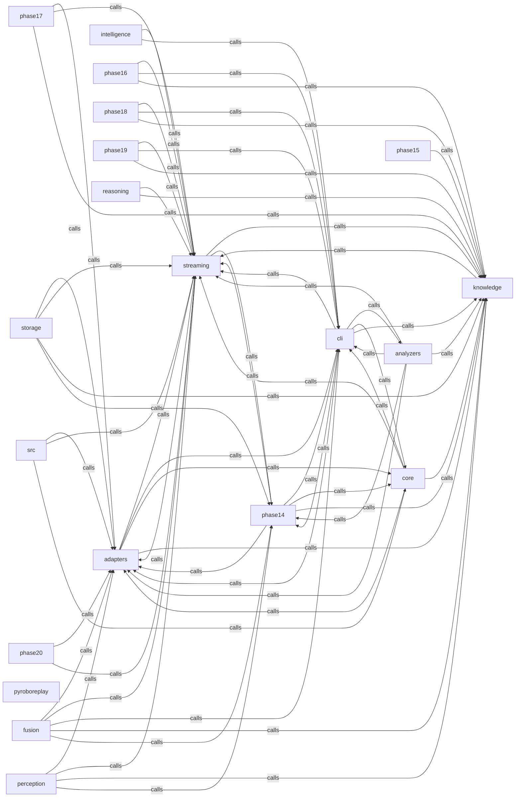

_Generated by CodeAtlas._

## Details

Owns 74 symbols across 2 file(s).

### adapters

Owns 97 symbols across 6 file(s).

**Related Classes/Methods:** _None_

**Source Files:**

- `src/adapters/cdr.rs`
  - `src.adapters.cdr.CdrReader`
  - `src.adapters.cdr.CdrReader.align`
  - `src.adapters.cdr.CdrReader.new`
  - `src.adapters.cdr.CdrReader.read_f32`
  - `src.adapters.cdr.CdrReader.read_f32_seq`
  - `src.adapters.cdr.CdrReader.read_f64`
  - `src.adapters.cdr.CdrReader.read_f64_array`
  - `src.adapters.cdr.CdrReader.read_header`
  - `src.adapters.cdr.CdrReader.read_i32`
  - `src.adapters.cdr.CdrReader.read_quaternion`
  - `src.adapters.cdr.CdrReader.read_string`
  - `src.adapters.cdr.CdrReader.read_time`
  - `src.adapters.cdr.CdrReader.read_u32`
  - `src.adapters.cdr.CdrReader.read_u8`
  - `src.adapters.cdr.CdrReader.read_u8_seq`
  - `src.adapters.cdr.CdrReader.read_vec3`
  - `src.adapters.cdr.CdrReader.take`
  - `src.adapters.cdr.tests.buffer_underrun_is_a_real_error_not_a_panic`
  - `src.adapters.cdr.tests.encode_header`
  - `src.adapters.cdr.tests.reads_f32_sequence`
  - `src.adapters.cdr.tests.reads_f64_with_8_byte_alignment_after_u32`
  - `src.adapters.cdr.tests.reads_fixed_f64_array_without_length_prefix`
  - `src.adapters.cdr.tests.reads_string_with_nul_terminator`
  - `src.adapters.cdr.tests.reads_u32_and_f32_with_correct_alignment`
  - `src.adapters.cdr.tests.reads_u8_sequence`
  - `src.adapters.cdr.tests.rejects_big_endian_representation_id`
  - `src.adapters.cdr.tests.rejects_short_buffers`
- `src/adapters/configuration.rs`
  - `src.adapters.configuration.ConfigValidationError`
  - `src.adapters.configuration.ConfigurationAdapter`
  - `src.adapters.configuration.ConfigurationAdapter.default`
  - `src.adapters.configuration.ConfigurationAdapter.detect_anti_patterns`
  - `src.adapters.configuration.ConfigurationAdapter.expected_ranges`
  - `src.adapters.configuration.ConfigurationAdapter.new`
  - `src.adapters.configuration.ConfigurationAdapter.parse_yaml`
  - `src.adapters.configuration.ConfigurationAdapter.validate_parameter`
  - `src.adapters.configuration.tests.test_adapter_creation`
  - `src.adapters.configuration.tests.test_detect_anti_patterns`
  - `src.adapters.configuration.tests.test_expected_ranges`
  - `src.adapters.configuration.tests.test_validate_low_costmap_frequency`
  - `src.adapters.configuration.tests.test_validate_low_timeout`
- `src/adapters/linux_log.rs`
  - `src.adapters.linux_log.KernelEventSeverity`
  - `src.adapters.linux_log.KernelEventSeverity.as_str`
  - `src.adapters.linux_log.KernelEventSeverity.from_log_level`
  - `src.adapters.linux_log.LinuxLogAdapter`
  - `src.adapters.linux_log.LinuxLogAdapter.default`
  - `src.adapters.linux_log.LinuxLogAdapter.detect_kernel_event`
  - `src.adapters.linux_log.LinuxLogAdapter.extract_timestamp`
  - `src.adapters.linux_log.LinuxLogAdapter.new`
  - `src.adapters.linux_log.LinuxLogAdapter.parse_dmesg`
  - `src.adapters.linux_log.LinuxLogAdapter.parse_generic_log_line`
  - `src.adapters.linux_log.LinuxLogAdapter.parse_journalctl`
  - `src.adapters.linux_log.LinuxLogAdapter.parse_syslog`
  - `src.adapters.linux_log.tests.test_adapter_creation`
  - `src.adapters.linux_log.tests.test_oom_kill_detection`
  - `src.adapters.linux_log.tests.test_parse_dmesg`
  - `src.adapters.linux_log.tests.test_severity_from_log_level`
  - `src.adapters.linux_log.tests.test_usb_disconnect_detection`
- `src/adapters/metrics.rs`
  - `src.adapters.metrics.MetricType`
  - `src.adapters.metrics.MetricType.as_str`
  - `src.adapters.metrics.MetricType.from_filename`
  - `src.adapters.metrics.MetricType.unit`
  - `src.adapters.metrics.MetricsAdapter`
  - `src.adapters.metrics.MetricsAdapter.default`
  - `src.adapters.metrics.MetricsAdapter.detect_metric_type`
  - `src.adapters.metrics.MetricsAdapter.json_to_event`
  - `src.adapters.metrics.MetricsAdapter.new`
  - `src.adapters.metrics.MetricsAdapter.parse_csv`
  - `src.adapters.metrics.MetricsAdapter.parse_iso_timestamp`
  - `src.adapters.metrics.MetricsAdapter.parse_json`
  - `src.adapters.metrics.MetricsAdapter.parse_unix_timestamp`
  - `src.adapters.metrics.tests.test_adapter_creation`
  - `src.adapters.metrics.tests.test_detect_metric_from_filename`
  - `src.adapters.metrics.tests.test_metric_type_unit`
  - `src.adapters.metrics.tests.test_parse_csv_metrics`
  - `src.adapters.metrics.tests.test_parse_iso_timestamp`
- `src/adapters/mod.rs`
  - `src.adapters.mod.AdapterError`
  - `src.adapters.mod.MissionAdapter`
- `src/adapters/ros2.rs`
  - `src.adapters.ros2.Ros2Adapter`
  - `src.adapters.ros2.Ros2Adapter.adapter_name`
  - `src.adapters.ros2.Ros2Adapter.default`
  - `src.adapters.ros2.Ros2Adapter.get_messages_for_topic`
  - `src.adapters.ros2.Ros2Adapter.get_topics`
  - `src.adapters.ros2.Ros2Adapter.new`
  - `src.adapters.ros2.Ros2Adapter.parse_bag_file`
  - `src.adapters.ros2.Ros2Adapter.parse_camera_message`
  - `src.adapters.ros2.Ros2Adapter.parse_db3_file`
  - `src.adapters.ros2.Ros2Adapter.parse_imu_message`
  - `src.adapters.ros2.Ros2Adapter.parse_lidar_message`
  - `src.adapters.ros2.Ros2Adapter.parse_message`
  - `src.adapters.ros2.Ros2Adapter.parse_odometry_message`
  - `src.adapters.ros2.Ros2Adapter.parse_pose_message`
  - `src.adapters.ros2.Ros2Adapter.read`
  - `src.adapters.ros2.RosMessage`
  - `src.adapters.ros2.RosTopic`
  - `src.adapters.ros2.tests.test_ros2_adapter_creation`
  - `src.adapters.ros2.tests.test_ros2_adapter_invalid_format`
  - `src.adapters.ros2.tests.test_ros2_adapter_missing_file`

### analyzers

Owns 434 symbols across 24 file(s).

**Related Classes/Methods:** _None_

**Source Files:**

- `src/analyzers/adaptive_recalibration.rs`
  - `src.analyzers.adaptive_recalibration.AdaptiveRecalibrationEngine`
  - `src.analyzers.adaptive_recalibration.AdaptiveRecalibrationEngine.analyze_prediction_errors`
  - `src.analyzers.adaptive_recalibration.AdaptiveRecalibrationEngine.recalibrate_model`
  - `src.analyzers.adaptive_recalibration.AdaptiveRecalibrationEngine.recalibrate_robot_profile`
  - `src.analyzers.adaptive_recalibration.AdaptiveRecalibrationEngine.update_degradation_curves`
  - `src.analyzers.adaptive_recalibration.AdaptiveRecalibrationEngine.update_gap_chains`
  - `src.analyzers.adaptive_recalibration.ErrorAnalysis`
  - `src.analyzers.adaptive_recalibration.PredictionFeedback`
  - `src.analyzers.adaptive_recalibration.RecalibrationMetrics`
  - `src.analyzers.adaptive_recalibration.RecalibrationStrategy`
  - `src.analyzers.adaptive_recalibration.tests.create_test_feedback`
  - `src.analyzers.adaptive_recalibration.tests.create_test_model`
  - `src.analyzers.adaptive_recalibration.tests.test_aggressive_learning`
  - `src.analyzers.adaptive_recalibration.tests.test_conservative_learning`
  - `src.analyzers.adaptive_recalibration.tests.test_error_analysis`
  - `src.analyzers.adaptive_recalibration.tests.test_recalibration_metrics`
- `src/analyzers/aggregation.rs`
  - `src.analyzers.aggregation.ConsolidatedFinding`
  - `src.analyzers.aggregation.EvidenceAggregator`
  - `src.analyzers.aggregation.EvidenceAggregator.aggregate`
  - `src.analyzers.aggregation.EvidenceAggregator.consolidate_group`
  - `src.analyzers.aggregation.EvidenceAggregator.generate_explanation`
  - `src.analyzers.aggregation.EvidenceAggregator.infer_root_cause`
  - `src.analyzers.aggregation.EvidenceAggregator.redundancy_factor`
  - `src.analyzers.aggregation.EvidenceAggregator.top_findings`
  - `src.analyzers.aggregation.tests.test_aggregator_empty`
  - `src.analyzers.aggregation.tests.test_confidence_boosting`
  - `src.analyzers.aggregation.tests.test_explanation_generation`
  - `src.analyzers.aggregation.tests.test_redundancy_factor`
  - `src.analyzers.aggregation.tests.test_root_cause_inference`
- `src/analyzers/drift_detection.rs`
  - `src.analyzers.drift_detection.DriftAwareScorer`
  - `src.analyzers.drift_detection.DriftAwareScorer.boost_gap_score`
  - `src.analyzers.drift_detection.DriftAwareScorer.drift_aware_confidence`
  - `src.analyzers.drift_detection.DriftDetector`
  - `src.analyzers.drift_detection.DriftDetector.detect_drift`
  - `src.analyzers.drift_detection.DriftDetector.detect_multi_metric_drift`
  - `src.analyzers.drift_detection.DriftDetector.drift_severity_multiplier`
  - `src.analyzers.drift_detection.DriftDetector.is_significant`
  - `src.analyzers.drift_detection.DriftStats`
  - `src.analyzers.drift_detection.tests.test_boost_gap_score`
  - `src.analyzers.drift_detection.tests.test_detect_downward_drift`
  - `src.analyzers.drift_detection.tests.test_detect_no_drift`
  - `src.analyzers.drift_detection.tests.test_detect_upward_drift`
  - `src.analyzers.drift_detection.tests.test_drift_aware_confidence`
  - `src.analyzers.drift_detection.tests.test_drift_severity_multiplier`
  - `src.analyzers.drift_detection.tests.test_drift_type_classification`
  - `src.analyzers.drift_detection.tests.test_is_significant`
  - `src.analyzers.drift_detection.tests.test_multi_metric_drift`
- `src/analyzers/evidence_quality_scoring.rs`
  - `src.analyzers.evidence_quality_scoring.EvidenceQualityScore`
  - `src.analyzers.evidence_quality_scoring.EvidenceQualityScorer`
  - `src.analyzers.evidence_quality_scoring.EvidenceQualityScorer.apply_quality_adjustment`
  - `src.analyzers.evidence_quality_scoring.EvidenceQualityScorer.assess_detector_agreement`
  - `src.analyzers.evidence_quality_scoring.EvidenceQualityScorer.assess_recency`
  - `src.analyzers.evidence_quality_scoring.EvidenceQualityScorer.assess_signal_to_noise`
  - `src.analyzers.evidence_quality_scoring.EvidenceQualityScorer.assess_source_quality`
  - `src.analyzers.evidence_quality_scoring.EvidenceQualityScorer.assess_temporal_consistency`
  - `src.analyzers.evidence_quality_scoring.EvidenceQualityScorer.generate_quality_report`
  - `src.analyzers.evidence_quality_scoring.EvidenceQualityScorer.score_narrative_evidence`
  - `src.analyzers.evidence_quality_scoring.QualityIssue`
  - `src.analyzers.evidence_quality_scoring.tests.create_test_gap`
  - `src.analyzers.evidence_quality_scoring.tests.create_test_narrative`
  - `src.analyzers.evidence_quality_scoring.tests.test_full_quality_scoring`
  - `src.analyzers.evidence_quality_scoring.tests.test_quality_report_generation`
  - `src.analyzers.evidence_quality_scoring.tests.test_source_quality_assessment`
  - `src.analyzers.evidence_quality_scoring.tests.test_temporal_consistency_assessment`
- `src/analyzers/feedback_loop.rs`
  - `src.analyzers.feedback_loop.FeedbackEvent`
  - `src.analyzers.feedback_loop.FeedbackLoopManager`
  - `src.analyzers.feedback_loop.FeedbackLoopManager.category_accuracy`
  - `src.analyzers.feedback_loop.FeedbackLoopManager.clear_pending_feedback`
  - `src.analyzers.feedback_loop.FeedbackLoopManager.database`
  - `src.analyzers.feedback_loop.FeedbackLoopManager.database_mut`
  - `src.analyzers.feedback_loop.FeedbackLoopManager.default`
  - `src.analyzers.feedback_loop.FeedbackLoopManager.feedback_accuracy`
  - `src.analyzers.feedback_loop.FeedbackLoopManager.feedback_summary`
  - `src.analyzers.feedback_loop.FeedbackLoopManager.new`
  - `src.analyzers.feedback_loop.FeedbackLoopManager.pending_feedback_count`
  - `src.analyzers.feedback_loop.FeedbackLoopManager.record_consolidated_findings`
  - `src.analyzers.feedback_loop.FeedbackLoopManager.record_findings`
  - `src.analyzers.feedback_loop.FeedbackLoopManager.record_mission`
  - `src.analyzers.feedback_loop.FeedbackLoopManager.submit_feedback`
  - `src.analyzers.feedback_loop.FeedbackStats`
  - `src.analyzers.feedback_loop.FindingFeedback`
  - `src.analyzers.feedback_loop.tests.create_test_finding`
  - `src.analyzers.feedback_loop.tests.create_test_mission`
  - `src.analyzers.feedback_loop.tests.test_clear_pending_feedback`
  - `src.analyzers.feedback_loop.tests.test_feedback_accuracy`
  - `src.analyzers.feedback_loop.tests.test_feedback_summary`
  - `src.analyzers.feedback_loop.tests.test_manager_creation`
  - `src.analyzers.feedback_loop.tests.test_record_findings`
  - `src.analyzers.feedback_loop.tests.test_record_mission`
  - `src.analyzers.feedback_loop.tests.test_submit_feedback`
- `src/analyzers/fleet_learning.rs`
  - `src.analyzers.fleet_learning.FleetGapStatistics`
  - `src.analyzers.fleet_learning.FleetLearningEngine`
  - `src.analyzers.fleet_learning.FleetLearningEngine.aggregate_fleet_gaps`
  - `src.analyzers.fleet_learning.FleetLearningEngine.analyze_environmental_sensitivities`
  - `src.analyzers.fleet_learning.FleetLearningEngine.calibrate_robot_type`
  - `src.analyzers.fleet_learning.FleetLearningEngine.classify_fleet_risk`
  - `src.analyzers.fleet_learning.FleetLearningEngine.compute_fleet_health`
  - `src.analyzers.fleet_learning.FleetLearningEngine.compute_predictive_chains`
  - `src.analyzers.fleet_learning.FleetLearningEngine.compute_trending_gaps`
  - `src.analyzers.fleet_learning.FleetMission`
  - `src.analyzers.fleet_learning.RobotTypeProfile`
  - `src.analyzers.fleet_learning.tests.create_test_gap`
  - `src.analyzers.fleet_learning.tests.create_test_mission`
  - `src.analyzers.fleet_learning.tests.test_fleet_aggregation`
  - `src.analyzers.fleet_learning.tests.test_predictive_chains`
  - `src.analyzers.fleet_learning.tests.test_robot_type_calibration`
  - `src.analyzers.fleet_learning.tests.test_trending_detection`
- `src/analyzers/gap_narrative_pipeline.rs`
  - `src.analyzers.gap_narrative_pipeline.GapNarrativePipeline`
  - `src.analyzers.gap_narrative_pipeline.GapNarrativePipeline.build_detector_agreement_matrix`
  - `src.analyzers.gap_narrative_pipeline.GapNarrativePipeline.classify_risk`
  - `src.analyzers.gap_narrative_pipeline.GapNarrativePipeline.generate_full_report`
  - `src.analyzers.gap_narrative_pipeline.GapNarrativePipeline.process_gaps`
  - `src.analyzers.gap_narrative_pipeline.IncidentReport`
  - `src.analyzers.gap_narrative_pipeline.IncidentSummary`
  - `src.analyzers.gap_narrative_pipeline.tests.create_test_gap`
  - `src.analyzers.gap_narrative_pipeline.tests.test_incident_report_generation`
  - `src.analyzers.gap_narrative_pipeline.tests.test_pipeline_empty_gaps`
  - `src.analyzers.gap_narrative_pipeline.tests.test_pipeline_with_gaps`
  - `src.analyzers.gap_narrative_pipeline.tests.test_risk_classification`
- `src/analyzers/gap_to_causal.rs`
  - `src.analyzers.gap_to_causal.GapCausalEvent`
  - `src.analyzers.gap_to_causal.GapCausalLink`
  - `src.analyzers.gap_to_causal.GapToCausalAdapter`
  - `src.analyzers.gap_to_causal.GapToCausalAdapter.clock_drift_chain`
  - `src.analyzers.gap_to_causal.GapToCausalAdapter.detection_robustness_chain`
  - `src.analyzers.gap_to_causal.GapToCausalAdapter.gap_to_causal_events`
  - `src.analyzers.gap_to_causal.GapToCausalAdapter.generic_gap_chain`
  - `src.analyzers.gap_to_causal.GapToCausalAdapter.infer_gap_causal_links`
  - `src.analyzers.gap_to_causal.GapToCausalAdapter.mechanical_degradation_chain`
  - `src.analyzers.gap_to_causal.GapToCausalAdapter.optical_contamination_chain`
  - `src.analyzers.gap_to_causal.GapToCausalAdapter.thermal_effects_chain`
  - `src.analyzers.gap_to_causal.tests.create_test_gap`
  - `src.analyzers.gap_to_causal.tests.test_clock_drift_chain`
  - `src.analyzers.gap_to_causal.tests.test_confidence_propagation`
  - `src.analyzers.gap_to_causal.tests.test_gap_causal_links`
  - `src.analyzers.gap_to_causal.tests.test_mechanical_degradation_chain`
  - `src.analyzers.gap_to_causal.tests.test_optical_contamination_chain`
  - `src.analyzers.gap_to_causal.tests.test_thermal_effects_chain`
- `src/analyzers/historical.rs`
  - `src.analyzers.historical.CategoryStats`
  - `src.analyzers.historical.FindingRecord`
  - `src.analyzers.historical.HistoricalDatabase`
  - `src.analyzers.historical.HistoricalDatabase.category_statistics`
  - `src.analyzers.historical.HistoricalDatabase.default`
  - `src.analyzers.historical.HistoricalDatabase.gap_frequency`
  - `src.analyzers.historical.HistoricalDatabase.is_known_gap_for_robot_type`
  - `src.analyzers.historical.HistoricalDatabase.mission_findings`
  - `src.analyzers.historical.HistoricalDatabase.most_common_gap`
  - `src.analyzers.historical.HistoricalDatabase.new`
  - `src.analyzers.historical.HistoricalDatabase.record_finding`
  - `src.analyzers.historical.HistoricalDatabase.record_mission`
  - `src.analyzers.historical.HistoricalDatabase.score_accuracy`
  - `src.analyzers.historical.HistoricalDatabase.supporting_cases`
  - `src.analyzers.historical.HistoricalDatabase.trending_gaps`
  - `src.analyzers.historical.HistoricalDatabase.verify_finding`
  - `src.analyzers.historical.MissionRecord`
  - `src.analyzers.historical.tests.test_category_statistics`
  - `src.analyzers.historical.tests.test_database_creation`
  - `src.analyzers.historical.tests.test_gap_frequency`
  - `src.analyzers.historical.tests.test_most_common_gap`
  - `src.analyzers.historical.tests.test_record_mission`
- `src/analyzers/incident_narrative.rs`
  - `src.analyzers.incident_narrative.FactorExplanation`
  - `src.analyzers.incident_narrative.IncidentNarrative`
  - `src.analyzers.incident_narrative.IncidentNarrativeGenerator`
  - `src.analyzers.incident_narrative.IncidentNarrativeGenerator.assess_escalation_risk`
  - `src.analyzers.incident_narrative.IncidentNarrativeGenerator.explain_contributing_factors`
  - `src.analyzers.incident_narrative.IncidentNarrativeGenerator.from_causal_chain`
  - `src.analyzers.incident_narrative.IncidentNarrativeGenerator.generate_executive_summary`
  - `src.analyzers.incident_narrative.IncidentNarrativeGenerator.generate_impact`
  - `src.analyzers.incident_narrative.IncidentNarrativeGenerator.generate_implementation_steps`
  - `src.analyzers.incident_narrative.IncidentNarrativeGenerator.generate_recommendations`
  - `src.analyzers.incident_narrative.IncidentNarrativeGenerator.generate_what_happened`
  - `src.analyzers.incident_narrative.IncidentNarrativeGenerator.generate_why`
  - `src.analyzers.incident_narrative.RecommendedAction`
  - `src.analyzers.incident_narrative.tests.create_test_chain`
  - `src.analyzers.incident_narrative.tests.test_factor_explanations`
  - `src.analyzers.incident_narrative.tests.test_narrative_generation`
  - `src.analyzers.incident_narrative.tests.test_recommendations_priority`
- `src/analyzers/mod.rs`
  - `src.analyzers.mod.BatteryReading`
  - `src.analyzers.mod.CameraFrame`
  - `src.analyzers.mod.ControlMessage`
  - `src.analyzers.mod.DetectionResult`
  - `src.analyzers.mod.EncoderReading`
  - `src.analyzers.mod.Evidence`
  - `src.analyzers.mod.GapDetector`
  - `src.analyzers.mod.IMUMeasurement`
  - `src.analyzers.mod.JointState`
  - `src.analyzers.mod.LidarScan`
  - `src.analyzers.mod.MessageTimestamp`
  - `src.analyzers.mod.MissionAnalysisData`
  - `src.analyzers.mod.MotorCurrent`
  - `src.analyzers.mod.OdometryMessage`
  - `src.analyzers.mod.PerceptionError`
  - `src.analyzers.mod.RealityDomain`
  - `src.analyzers.mod.RealityDomain.fmt`
  - `src.analyzers.mod.RealityGapDetector`
  - `src.analyzers.mod.RealityGapDetector.analyze_mission`
  - `src.analyzers.mod.RealityGapDetector.default`
  - `src.analyzers.mod.RealityGapDetector.new`
  - `src.analyzers.mod.RealityGapFinding`
  - `src.analyzers.mod.Severity`
  - `src.analyzers.mod.Severity.fmt`
  - `src.analyzers.mod.ThermalReading`
  - `src.analyzers.mod.tests.test_empty_mission_analysis`
  - `src.analyzers.mod.tests.test_gap_detector_creation`
  - `src.analyzers.mod.tests.test_severity_ordering`
- `src/analyzers/multi_factor_causality.rs`
  - `src.analyzers.multi_factor_causality.ChainEvent`
  - `src.analyzers.multi_factor_causality.ContributingFactor`
  - `src.analyzers.multi_factor_causality.InterventionPoint`
  - `src.analyzers.multi_factor_causality.MultiFactorCausalChain`
  - `src.analyzers.multi_factor_causality.MultiFactorInferenceEngine`
  - `src.analyzers.multi_factor_causality.MultiFactorInferenceEngine.construct_chains`
  - `src.analyzers.multi_factor_causality.MultiFactorInferenceEngine.optical_contamination_chain`
  - `src.analyzers.multi_factor_causality.MultiFactorInferenceEngine.thermal_throttle_chain`
  - `src.analyzers.multi_factor_causality.MultiFactorInferenceEngine.timing_navigation_chain`
  - `src.analyzers.multi_factor_causality.tests.create_test_drift`
  - `src.analyzers.multi_factor_causality.tests.create_test_gap`
  - `src.analyzers.multi_factor_causality.tests.test_intervention_points`
  - `src.analyzers.multi_factor_causality.tests.test_optical_contamination_chain`
  - `src.analyzers.multi_factor_causality.tests.test_thermal_chain`
- `src/analyzers/phase3_validation.rs`
  - `src.analyzers.phase3_validation.tests.create_test_finding`
  - `src.analyzers.phase3_validation.tests.create_test_mission`
  - `src.analyzers.phase3_validation.tests.test_end_to_end_detection_to_feedback`
  - `src.analyzers.phase3_validation.tests.test_end_to_end_fleet_learning`
  - `src.analyzers.phase3_validation.tests.test_end_to_end_recalibration`
  - `src.analyzers.phase3_validation.tests.test_end_to_end_robot_calibration`
  - `src.analyzers.phase3_validation.tests.test_feedback_improves_recalibration`
  - `src.analyzers.phase3_validation.tests.test_full_pipeline_accuracy_improvement`
  - `src.analyzers.phase3_validation.tests.test_severity_adjustment_by_robot_type`
- `src/analyzers/phase4_integration.rs`
  - `src.analyzers.phase4_integration.tests.create_test_finding`
  - `src.analyzers.phase4_integration.tests.test_phase4_drift_integration`
  - `src.analyzers.phase4_integration.tests.test_phase4_drift_multiple_metrics`
  - `src.analyzers.phase4_integration.tests.test_phase4_full_pipeline`
  - `src.analyzers.phase4_integration.tests.test_phase4_multi_factor_confidence_boost`
  - `src.analyzers.phase4_integration.tests.test_phase4_quality_degrades_low_signal`
  - `src.analyzers.phase4_integration.tests.test_phase4_quality_integration`
  - `src.analyzers.phase4_integration.tests.test_phase4_severity_contract_priority`
  - `src.analyzers.phase4_integration.tests.test_phase4_severity_contracts`
  - `src.analyzers.phase4_integration.tests.test_phase4_statguardian_learning_readiness`
- `src/analyzers/predictive_gaps.rs`
  - `src.analyzers.predictive_gaps.DegradationCurve`
  - `src.analyzers.predictive_gaps.PredictedGap`
  - `src.analyzers.predictive_gaps.PredictiveGapEngine`
  - `src.analyzers.predictive_gaps.PredictiveGapEngine.analyze_environmental_triggers`
  - `src.analyzers.predictive_gaps.PredictiveGapEngine.build_predictive_model`
  - `src.analyzers.predictive_gaps.PredictiveGapEngine.compute_degradation_curves`
  - `src.analyzers.predictive_gaps.PredictiveGapEngine.compute_detection_to_failure_time`
  - `src.analyzers.predictive_gaps.PredictiveGapEngine.estimate_time_to_gap`
  - `src.analyzers.predictive_gaps.PredictiveGapEngine.predict_next_gaps`
  - `src.analyzers.predictive_gaps.PredictiveModel`
  - `src.analyzers.predictive_gaps.tests.create_test_gap`
  - `src.analyzers.predictive_gaps.tests.create_test_mission`
  - `src.analyzers.predictive_gaps.tests.test_build_predictive_model`
  - `src.analyzers.predictive_gaps.tests.test_degradation_curve_computation`
  - `src.analyzers.predictive_gaps.tests.test_predict_next_gaps`
- `src/analyzers/quality_confidence.rs`
  - `src.analyzers.quality_confidence.QualityAggregator`
  - `src.analyzers.quality_confidence.QualityAggregator.aggregate_quality`
  - `src.analyzers.quality_confidence.QualityAggregator.best_quality`
  - `src.analyzers.quality_confidence.QualityAggregator.worst_quality`
  - `src.analyzers.quality_confidence.QualityAwareConfidence`
  - `src.analyzers.quality_confidence.QualityAwareConfidence.adjust_confidence`
  - `src.analyzers.quality_confidence.QualityAwareConfidence.evidence_quality_confidence`
  - `src.analyzers.quality_confidence.QualityAwareConfidence.is_acceptable_quality`
  - `src.analyzers.quality_confidence.QualityAwareConfidence.is_high_quality`
  - `src.analyzers.quality_confidence.QualityAwareConfidence.quality_assessment`
  - `src.analyzers.quality_confidence.QualityMetadata`
  - `src.analyzers.quality_confidence.QualityMetadata.compute_overall_quality`
  - `src.analyzers.quality_confidence.QualityMetadata.default`
  - `src.analyzers.quality_confidence.QualityMetadata.mark_degraded`
  - `src.analyzers.quality_confidence.QualityMetadata.mark_incomplete`
  - `src.analyzers.quality_confidence.QualityMetadata.mark_uncalibrated`
  - `src.analyzers.quality_confidence.QualityMetadata.new`
  - `src.analyzers.quality_confidence.tests.test_adjust_confidence`
  - `src.analyzers.quality_confidence.tests.test_adjust_confidence_low_quality`
  - `src.analyzers.quality_confidence.tests.test_aggregate_quality`
  - `src.analyzers.quality_confidence.tests.test_best_quality`
  - `src.analyzers.quality_confidence.tests.test_is_acceptable_quality`
  - `src.analyzers.quality_confidence.tests.test_is_high_quality`
  - `src.analyzers.quality_confidence.tests.test_mark_degraded`
  - `src.analyzers.quality_confidence.tests.test_mark_incomplete`
  - `src.analyzers.quality_confidence.tests.test_mark_uncalibrated`
  - `src.analyzers.quality_confidence.tests.test_quality_assessment`
  - `src.analyzers.quality_confidence.tests.test_quality_computation`
  - `src.analyzers.quality_confidence.tests.test_quality_metadata_creation`
  - `src.analyzers.quality_confidence.tests.test_worst_quality`
- `src/analyzers/recalibration.rs`
  - `src.analyzers.recalibration.CategoryMetrics`
  - `src.analyzers.recalibration.CategoryMetrics.compute_accuracy`
  - `src.analyzers.recalibration.RecalibrationEngine`
  - `src.analyzers.recalibration.RecalibrationEngine.all_stats`
  - `src.analyzers.recalibration.RecalibrationEngine.category_stats`
  - `src.analyzers.recalibration.RecalibrationEngine.default`
  - `src.analyzers.recalibration.RecalibrationEngine.initialize_from_scorer`
  - `src.analyzers.recalibration.RecalibrationEngine.is_ready_to_recalibrate`
  - `src.analyzers.recalibration.RecalibrationEngine.new`
  - `src.analyzers.recalibration.RecalibrationEngine.recalibrate_all`
  - `src.analyzers.recalibration.RecalibrationEngine.recalibrate_category`
  - `src.analyzers.recalibration.RecalibrationEngine.recalibration_confidence`
  - `src.analyzers.recalibration.RecalibrationEngine.record_feedback`
  - `src.analyzers.recalibration.RecalibrationEngine.reset_category`
  - `src.analyzers.recalibration.RecalibrationEngine.set_learning_rate`
  - `src.analyzers.recalibration.RecalibrationEngine.set_min_samples`
  - `src.analyzers.recalibration.tests.test_accuracy_computation`
  - `src.analyzers.recalibration.tests.test_bayesian_update`
  - `src.analyzers.recalibration.tests.test_engine_creation`
  - `src.analyzers.recalibration.tests.test_recalibration_all`
  - `src.analyzers.recalibration.tests.test_recalibration_confidence`
  - `src.analyzers.recalibration.tests.test_recalibration_threshold`
  - `src.analyzers.recalibration.tests.test_record_feedback`
  - `src.analyzers.recalibration.tests.test_reset_category`
- `src/analyzers/robot_calibration.rs`
  - `src.analyzers.robot_calibration.FleetStats`
  - `src.analyzers.robot_calibration.RobotCalibrationManager`
  - `src.analyzers.robot_calibration.RobotCalibrationManager.all_profiles`
  - `src.analyzers.robot_calibration.RobotCalibrationManager.calibrate_sensitivities`
  - `src.analyzers.robot_calibration.RobotCalibrationManager.default`
  - `src.analyzers.robot_calibration.RobotCalibrationManager.fleet_statistics`
  - `src.analyzers.robot_calibration.RobotCalibrationManager.get_profile`
  - `src.analyzers.robot_calibration.RobotCalibrationManager.learn_severity_threshold`
  - `src.analyzers.robot_calibration.RobotCalibrationManager.new`
  - `src.analyzers.robot_calibration.RobotCalibrationManager.predict_severity`
  - `src.analyzers.robot_calibration.RobotCalibrationManager.record_gap`
  - `src.analyzers.robot_calibration.RobotCalibrationManager.record_mission`
  - `src.analyzers.robot_calibration.RobotCalibrationManager.register_robot_type`
  - `src.analyzers.robot_calibration.RobotTypeProfile`
  - `src.analyzers.robot_calibration.RobotTypeProfile.failure_rate`
  - `src.analyzers.robot_calibration.RobotTypeProfile.most_common_gap`
  - `src.analyzers.robot_calibration.RobotTypeProfile.new`
  - `src.analyzers.robot_calibration.RobotTypeProfile.record_gap`
  - `src.analyzers.robot_calibration.RobotTypeProfile.record_mission`
  - `src.analyzers.robot_calibration.RobotTypeProfile.severity_pattern`
  - `src.analyzers.robot_calibration.tests.test_calibrate_sensitivities`
  - `src.analyzers.robot_calibration.tests.test_calibration_manager_creation`
  - `src.analyzers.robot_calibration.tests.test_failure_rate`
  - `src.analyzers.robot_calibration.tests.test_fleet_statistics`
  - `src.analyzers.robot_calibration.tests.test_learn_severity_threshold`
  - `src.analyzers.robot_calibration.tests.test_predict_severity`
  - `src.analyzers.robot_calibration.tests.test_profile_creation`
  - `src.analyzers.robot_calibration.tests.test_record_gap`
  - `src.analyzers.robot_calibration.tests.test_record_gap_auto_register`
  - `src.analyzers.robot_calibration.tests.test_register_robot_type`
- `src/analyzers/scoring.rs`
  - `src.analyzers.scoring.RealityGapScorer`
  - `src.analyzers.scoring.RealityGapScorer.adjust_score`
  - `src.analyzers.scoring.RealityGapScorer.base_probability`
  - `src.analyzers.scoring.RealityGapScorer.compute_confidence`
  - `src.analyzers.scoring.RealityGapScorer.default`
  - `src.analyzers.scoring.RealityGapScorer.evidence_likelihood`
  - `src.analyzers.scoring.RealityGapScorer.initialize_knowledge_base`
  - `src.analyzers.scoring.RealityGapScorer.new`
  - `src.analyzers.scoring.RealityGapScorer.robot_type_adjustment`
  - `src.analyzers.scoring.RealityGapScorer.score_finding`
  - `src.analyzers.scoring.tests.test_base_probability`
  - `src.analyzers.scoring.tests.test_robot_type_adjustment`
  - `src.analyzers.scoring.tests.test_score_adjustment`
  - `src.analyzers.scoring.tests.test_scorer_creation`
- `src/analyzers/severity.rs`
  - `src.analyzers.severity.SeverityClassifier`
  - `src.analyzers.severity.SeverityClassifier.assess_safety_risk`
  - `src.analyzers.severity.SeverityClassifier.classify`
  - `src.analyzers.severity.SeverityClassifier.compute_performance_impact`
  - `src.analyzers.severity.SeverityClassifier.estimate_recurrence`
  - `src.analyzers.severity.SeverityClassifier.mission_criticality_score`
  - `src.analyzers.severity.tests.test_classifier_creation`
  - `src.analyzers.severity.tests.test_mission_criticality`
  - `src.analyzers.severity.tests.test_performance_impact_normalization`
  - `src.analyzers.severity.tests.test_safety_risk_assessment`
- `src/analyzers/severity_contracts.rs`
  - `src.analyzers.severity_contracts.ContractOperator`
  - `src.analyzers.severity_contracts.SeverityContract`
  - `src.analyzers.severity_contracts.SeverityContract.add_condition`
  - `src.analyzers.severity_contracts.SeverityContract.matches`
  - `src.analyzers.severity_contracts.SeverityContract.matching_conditions`
  - `src.analyzers.severity_contracts.SeverityContract.new`
  - `src.analyzers.severity_contracts.SeverityContractCatalog`
  - `src.analyzers.severity_contracts.SeverityContractCatalog.add_contract`
  - `src.analyzers.severity_contracts.SeverityContractCatalog.add_critical_contract_performance_catastrophic`
  - `src.analyzers.severity_contracts.SeverityContractCatalog.add_critical_contract_safety_collision`
  - `src.analyzers.severity_contracts.SeverityContractCatalog.add_critical_contract_timestamp_reversal`
  - `src.analyzers.severity_contracts.SeverityContractCatalog.add_high_contract_detection_confidence_drop`
  - `src.analyzers.severity_contracts.SeverityContractCatalog.add_high_contract_efficiency_decline`
  - `src.analyzers.severity_contracts.SeverityContractCatalog.add_high_contract_response_degradation`
  - `src.analyzers.severity_contracts.SeverityContractCatalog.add_low_contract_minor_quality`
  - `src.analyzers.severity_contracts.SeverityContractCatalog.add_medium_contract_environmental_correlation`
  - `src.analyzers.severity_contracts.SeverityContractCatalog.add_medium_contract_thermal_gradual`
  - `src.analyzers.severity_contracts.SeverityContractCatalog.default`
  - `src.analyzers.severity_contracts.SeverityContractCatalog.determine_severity`
  - `src.analyzers.severity_contracts.SeverityContractCatalog.evaluate`
  - `src.analyzers.severity_contracts.SeverityContractCatalog.get_contract`
  - `src.analyzers.severity_contracts.SeverityContractCatalog.new`
  - `src.analyzers.severity_contracts.tests.test_catalog_creation`
  - `src.analyzers.severity_contracts.tests.test_catalog_evaluate_critical`
  - `src.analyzers.severity_contracts.tests.test_contract_creation`
  - `src.analyzers.severity_contracts.tests.test_contract_matches_and`
  - `src.analyzers.severity_contracts.tests.test_contract_matches_or`
  - `src.analyzers.severity_contracts.tests.test_contract_no_match`
  - `src.analyzers.severity_contracts.tests.test_contract_priority`
  - `src.analyzers.severity_contracts.tests.test_determine_severity`
  - `src.analyzers.severity_contracts.tests.test_matching_conditions`
- `src/analyzers/telemetry.rs`
  - `src.analyzers.telemetry.GapTelemetry`
  - `src.analyzers.telemetry.GapTelemetry.compute_false_positive_rate`
  - `src.analyzers.telemetry.GapTelemetry.compute_frame_confidences`
  - `src.analyzers.telemetry.GapTelemetry.compute_message_timing`
  - `src.analyzers.telemetry.GapTelemetry.compute_response_times`
  - `src.analyzers.telemetry.GapTelemetry.correlate`
  - `src.analyzers.telemetry.GapTelemetry.fit_trend`
  - `src.analyzers.telemetry.GapTelemetry.from_mission`
  - `src.analyzers.telemetry.GapTelemetry.load_cache`
  - `src.analyzers.telemetry.GapTelemetry.save_cache`
  - `src.analyzers.telemetry.TrendLine`
  - `src.analyzers.telemetry.tests.load_cache_returns_none_not_an_error_when_file_is_missing`
  - `src.analyzers.telemetry.tests.sample_telemetry`
  - `src.analyzers.telemetry.tests.save_and_load_cache_round_trips_exactly`
  - `src.analyzers.telemetry.tests.test_correlation`
  - `src.analyzers.telemetry.tests.test_no_correlation`
  - `src.analyzers.telemetry.tests.test_trend_fitting`
- `src/analyzers/test_data.rs`
  - `src.analyzers.test_data.TestDataGenerator`
  - `src.analyzers.test_data.TestDataGenerator.clock_drift_mission`
  - `src.analyzers.test_data.TestDataGenerator.detection_failure_mission`
  - `src.analyzers.test_data.TestDataGenerator.healthy_mission`
  - `src.analyzers.test_data.TestDataGenerator.mechanical_degradation_mission`
  - `src.analyzers.test_data.TestDataGenerator.optical_contamination_mission`
  - `src.analyzers.test_data.TestDataGenerator.thermal_effects_mission`
  - `src.analyzers.test_data.tests.test_clock_drift_generation`
  - `src.analyzers.test_data.tests.test_detection_failure_generation`
  - `src.analyzers.test_data.tests.test_healthy_mission_generation`
  - `src.analyzers.test_data.tests.test_mechanical_degradation_generation`
  - `src.analyzers.test_data.tests.test_optical_contamination_generation`
  - `src.analyzers.test_data.tests.test_thermal_effects_generation`
- `src/analyzers/validation.rs`
  - `src.analyzers.validation.ValidationResult`
  - `src.analyzers.validation.ValidationSuite`
  - `src.analyzers.validation.ValidationSuite.is_test_passed`
  - `src.analyzers.validation.ValidationSuite.print_results`
  - `src.analyzers.validation.ValidationSuite.validate_all`
  - `src.analyzers.validation.ValidationSuite.validate_clock_drift`
  - `src.analyzers.validation.ValidationSuite.validate_detection_failure`
  - `src.analyzers.validation.ValidationSuite.validate_healthy_mission`
  - `src.analyzers.validation.ValidationSuite.validate_mechanical_degradation`
  - `src.analyzers.validation.ValidationSuite.validate_optical_contamination`
  - `src.analyzers.validation.ValidationSuite.validate_thermal_effects`
  - `src.analyzers.validation.tests.test_mechanical_degradation_detected`
  - `src.analyzers.validation.tests.test_validation_suite_runs`

### cli

Owns 214 symbols across 14 file(s).

**Related Classes/Methods:** _None_

**Source Files:**

- `src/cli/args.rs`
  - `src.cli.args.Cli`
  - `src.cli.args.Commands`
- `src/cli/camera_export.rs`
  - `src.cli.camera_export.CameraExportConfig`
  - `src.cli.camera_export.CameraExportConfig.default`
  - `src.cli.camera_export.FrameManifest`
  - `src.cli.camera_export.FrameMetadata`
  - `src.cli.camera_export.export_camera_to_html`
  - `src.cli.camera_export.generate_timeline_html`
  - `src.cli.camera_export.tests.test_config_default`
  - `src.cli.camera_export.tests.test_frame_manifest_serialization`
  - `src.cli.camera_export.tests.test_frame_metadata_creation`
- `src/cli/causal_viz.rs`
  - `src.cli.causal_viz.CausalFlowChart`
  - `src.cli.causal_viz.CausalViz`
  - `src.cli.causal_viz.CausalViz._compute_stats`
  - `src.cli.causal_viz.CausalViz._confidence_to_level`
  - `src.cli.causal_viz.CausalViz._create_event_box`
  - `src.cli.causal_viz.CausalViz._event_short_name`
  - `src.cli.causal_viz.CausalViz._render_chain`
  - `src.cli.causal_viz.CausalViz._render_confidence_bar`
  - `src.cli.causal_viz.CausalViz.render_comparison`
  - `src.cli.causal_viz.CausalViz.render_confidence_timeline`
  - `src.cli.causal_viz.CausalViz.render_query`
  - `src.cli.causal_viz.CausalViz.render_summary`
  - `src.cli.causal_viz.FlowChartStats`
  - `src.cli.causal_viz.tests.test_confidence_bar_rendering`
  - `src.cli.causal_viz.tests.test_confidence_to_level`
  - `src.cli.causal_viz.tests.test_event_short_name`
  - `src.cli.causal_viz.tests.test_flowchart_creation`
- `src/cli/consolidated_output.rs`
  - `src.cli.consolidated_output.ConsolidatedFormatter`
  - `src.cli.consolidated_output.ConsolidatedFormatter.avg_detector_count`
  - `src.cli.consolidated_output.ConsolidatedFormatter.format_consolidated_finding`
  - `src.cli.consolidated_output.ConsolidatedFormatter.format_html`
  - `src.cli.consolidated_output.ConsolidatedFormatter.format_json`
  - `src.cli.consolidated_output.ConsolidatedFormatter.format_text`
  - `src.cli.consolidated_output.ConsolidatedFormatter.new`
  - `src.cli.consolidated_output.ConsolidatedFormatter.redundancy_factor`
  - `src.cli.consolidated_output.tests.test_empty_consolidated_findings`
  - `src.cli.consolidated_output.tests.test_formatter_creation`
  - `src.cli.consolidated_output.tests.test_html_generation`
  - `src.cli.consolidated_output.tests.test_json_format_empty`
- `src/cli/gap_analysis.rs`
  - `src.cli.gap_analysis.GapFormatter`
  - `src.cli.gap_analysis.GapFormatter.format_finding`
  - `src.cli.gap_analysis.GapFormatter.format_html`
  - `src.cli.gap_analysis.GapFormatter.format_json`
  - `src.cli.gap_analysis.GapFormatter.format_text`
  - `src.cli.gap_analysis.GapFormatter.new`
  - `src.cli.gap_analysis.tests.test_empty_findings`
  - `src.cli.gap_analysis.tests.test_formatter_creation`
- `src/cli/imu_viz.rs`
  - `src.cli.imu_viz.IMUVisualization`
  - `src.cli.imu_viz.IMUVisualization.add_reading`
  - `src.cli.imu_viz.IMUVisualization.default`
  - `src.cli.imu_viz.IMUVisualization.detect_peaks`
  - `src.cli.imu_viz.IMUVisualization.drift`
  - `src.cli.imu_viz.IMUVisualization.find_data_range`
  - `src.cli.imu_viz.IMUVisualization.find_peaks`
  - `src.cli.imu_viz.IMUVisualization.mean`
  - `src.cli.imu_viz.IMUVisualization.new`
  - `src.cli.imu_viz.IMUVisualization.peak`
  - `src.cli.imu_viz.IMUVisualization.render_accel`
  - `src.cli.imu_viz.IMUVisualization.render_dashboard`
  - `src.cli.imu_viz.IMUVisualization.render_graph`
  - `src.cli.imu_viz.IMUVisualization.render_gyro`
  - `src.cli.imu_viz.IMUVisualization.render_mag`
  - `src.cli.imu_viz.IMUVisualization.stats`
  - `src.cli.imu_viz.IMUVizConfig`
  - `src.cli.imu_viz.IMUVizConfig.default`
  - `src.cli.imu_viz.Peak`
  - `src.cli.imu_viz.tests.test_add_reading`
  - `src.cli.imu_viz.tests.test_config_default`
  - `src.cli.imu_viz.tests.test_imu_viz_creation`
  - `src.cli.imu_viz.tests.test_peak_detection`
  - `src.cli.imu_viz.tests.test_render_accel`
  - `src.cli.imu_viz.tests.test_statistics`
- `src/cli/json_output.rs`
  - `src.cli.json_output.EventJson`
  - `src.cli.json_output.EventJson.from_event`
  - `src.cli.json_output.EventTypeCount`
  - `src.cli.json_output.JsonResponse`
  - `src.cli.json_output.JsonResponse.error`
  - `src.cli.json_output.JsonResponse.success`
  - `src.cli.json_output.MissionAnalysisJson`
  - `src.cli.json_output.MissionAnalysisJson.from_mission`
  - `src.cli.json_output.MissionTimelineJson`
  - `src.cli.json_output.MissionTimelineJson.from_mission`
  - `src.cli.json_output.SensorFramesJson`
  - `src.cli.json_output.SensorFramesJson.from_events`
  - `src.cli.json_output.SensorStatsJson`
  - `src.cli.json_output.SensorStatsJson.from_events`
  - `src.cli.json_output.tests.test_json_response`
  - `src.cli.json_output.tests.test_json_response_error`
  - `src.cli.json_output.tests.test_mission_analysis_json`
- `src/cli/keyboard.rs`
  - `src.cli.keyboard.HelpPanel`
  - `src.cli.keyboard.HelpPanel.random_tip`
  - `src.cli.keyboard.HelpPanel.render_category`
  - `src.cli.keyboard.HelpPanel.render_context`
  - `src.cli.keyboard.HelpPanel.render_full`
  - `src.cli.keyboard.HelpPanel.render_quick`
  - `src.cli.keyboard.KeyboardShortcuts`
  - `src.cli.keyboard.KeyboardShortcuts.all`
  - `src.cli.keyboard.KeyboardShortcuts.by_category`
  - `src.cli.keyboard.KeyboardShortcuts.categories`
  - `src.cli.keyboard.KeyboardShortcuts.find`
  - `src.cli.keyboard.Shortcut`
  - `src.cli.keyboard.ShortcutCategory`
  - `src.cli.keyboard.ShortcutCategory.fmt`
  - `src.cli.keyboard.tests.test_category_count`
  - `src.cli.keyboard.tests.test_find_shortcut`
  - `src.cli.keyboard.tests.test_help_context`
  - `src.cli.keyboard.tests.test_help_panel_full`
  - `src.cli.keyboard.tests.test_help_panel_quick`
  - `src.cli.keyboard.tests.test_random_tip`
  - `src.cli.keyboard.tests.test_shortcuts_by_category`
  - `src.cli.keyboard.tests.test_shortcuts_count`
- `src/cli/lidar_viz.rs`
  - `src.cli.lidar_viz.LidarVisualization`
  - `src.cli.lidar_viz.LidarVisualization.add_reading`
  - `src.cli.lidar_viz.LidarVisualization.draw_grid`
  - `src.cli.lidar_viz.LidarVisualization.mark_anomaly`
  - `src.cli.lidar_viz.LidarVisualization.new`
  - `src.cli.lidar_viz.LidarVisualization.render`
  - `src.cli.lidar_viz.LidarVisualization.render_with_legend`
  - `src.cli.lidar_viz.LidarVizConfig`
  - `src.cli.lidar_viz.LidarVizConfig.default`
  - `src.cli.lidar_viz.tests.test_anomaly_detection`
  - `src.cli.lidar_viz.tests.test_lidar_reading`
  - `src.cli.lidar_viz.tests.test_lidar_viz_creation`
  - `src.cli.lidar_viz.tests.test_render_with_legend`
- `src/cli/mod.rs`
  - `src.cli.mod.run`
- `src/cli/replay_ui.rs`
  - `src.cli.replay_ui.LidarRenderRequest`
  - `src.cli.replay_ui.LidarRenderResult`
  - `src.cli.replay_ui.ReplayState`
  - `src.cli.replay_ui.ReplayState.draw_event_details`
  - `src.cli.replay_ui.ReplayState.draw_footer`
  - `src.cli.replay_ui.ReplayState.draw_header`
  - `src.cli.replay_ui.ReplayState.draw_lidar_visualization`
  - `src.cli.replay_ui.ReplayState.draw_progress`
  - `src.cli.replay_ui.ReplayState.draw_timeline`
  - `src.cli.replay_ui.ReplayState.draw_ui`
  - `src.cli.replay_ui.ReplayState.handle_key`
  - `src.cli.replay_ui.ReplayState.new`
  - `src.cli.replay_ui.ReplayState.next_event`
  - `src.cli.replay_ui.ReplayState.previous_event`
  - `src.cli.replay_ui.ReplayState.run`
  - `src.cli.replay_ui.ReplayState.ui_loop`
  - `src.cli.replay_ui.spawn_lidar_worker`
  - `src.cli.replay_ui.tests.draw_ui_renders_normal_layout_above_minimum_terminal_size`
  - `src.cli.replay_ui.tests.draw_ui_shows_warning_below_minimum_terminal_size`
  - `src.cli.replay_ui.tests.handle_key_quit_returns_false`
  - `src.cli.replay_ui.tests.handle_key_toggles_play_state_and_clamps_speed`
  - `src.cli.replay_ui.tests.lidar_worker_exits_cleanly_when_sender_is_dropped`
  - `src.cli.replay_ui.tests.lidar_worker_handles_multiple_sequential_requests_without_deadlock`
  - `src.cli.replay_ui.tests.lidar_worker_renders_a_frame_off_the_calling_thread`
  - `src.cli.replay_ui.tests.mission_with_events`
  - `src.cli.replay_ui.tests.nav_event`
  - `src.cli.replay_ui.tests.next_and_previous_event_clamp_at_bounds`
- `src/cli/sensor_stats.rs`
  - `src.cli.sensor_stats.EventTimestamp`
  - `src.cli.sensor_stats.MissionEvent.timestamp_str`
  - `src.cli.sensor_stats.SensorMetadataPanel`
  - `src.cli.sensor_stats.SensorMetadataPanel.from_mission`
  - `src.cli.sensor_stats.SensorMetadataPanel.get_stats`
  - `src.cli.sensor_stats.SensorMetadataPanel.render`
  - `src.cli.sensor_stats.SensorMetadataPanel.render_compact`
  - `src.cli.sensor_stats.SensorMetadataPanel.render_sensor_stats`
  - `src.cli.sensor_stats.SensorMetadataPanel.sensor_names`
  - `src.cli.sensor_stats.SensorMetadataPanel.summary`
  - `src.cli.sensor_stats.SensorStats`
  - `src.cli.sensor_stats.SensorStats.calculate_quality`
  - `src.cli.sensor_stats.SensorStats.new`
  - `src.cli.sensor_stats.SensorStats.quality_bar`
  - `src.cli.sensor_stats.SensorStats.quality_emoji`
  - `src.cli.sensor_stats.tests.test_compact_render`
  - `src.cli.sensor_stats.tests.test_metadata_panel_creation`
  - `src.cli.sensor_stats.tests.test_quality_bar`
  - `src.cli.sensor_stats.tests.test_quality_calculation`
  - `src.cli.sensor_stats.tests.test_quality_emoji`
  - `src.cli.sensor_stats.tests.test_sensor_stats_creation`
  - `src.cli.sensor_stats.tests.test_summary`
- `src/cli/stats_dashboard.rs`
  - `src.cli.stats_dashboard.DashboardStats`
  - `src.cli.stats_dashboard.DashboardStats.export_history_csv`
  - `src.cli.stats_dashboard.DashboardStats.export_history_json`
  - `src.cli.stats_dashboard.Platform`
  - `src.cli.stats_dashboard.Platform.detect`
  - `src.cli.stats_dashboard.Platform.display`
  - `src.cli.stats_dashboard.StatsDashboard`
  - `src.cli.stats_dashboard.StatsDashboard.dashboard_loop`
  - `src.cli.stats_dashboard.StatsDashboard.draw_dashboard`
  - `src.cli.stats_dashboard.StatsDashboard.draw_stats_panel`
  - `src.cli.stats_dashboard.StatsDashboard.handle_key`
  - `src.cli.stats_dashboard.StatsDashboard.new`
  - `src.cli.stats_dashboard.StatsDashboard.run_dashboard`
  - `src.cli.stats_dashboard.TerminalLauncher`
  - `src.cli.stats_dashboard.TerminalLauncher.default`
  - `src.cli.stats_dashboard.TerminalLauncher.launch`
  - `src.cli.stats_dashboard.TerminalLauncher.launch_linux`
  - `src.cli.stats_dashboard.TerminalLauncher.launch_macos`
  - `src.cli.stats_dashboard.TerminalLauncher.launch_windows`
  - `src.cli.stats_dashboard.TerminalLauncher.new`
  - `src.cli.stats_dashboard.applescript_escape`
  - `src.cli.stats_dashboard.launch_stats_dashboard_window`
  - `src.cli.stats_dashboard.shell_single_quote`
  - `src.cli.stats_dashboard.tests.test_applescript_escape_handles_backslash`
  - `src.cli.stats_dashboard.tests.test_applescript_escape_neutralizes_quote_and_backslash`
  - `src.cli.stats_dashboard.tests.test_dashboard_history_export_csv_and_json`
  - `src.cli.stats_dashboard.tests.test_dashboard_stats_creation`
  - `src.cli.stats_dashboard.tests.test_launch_stats_dashboard_window_script_is_safe_with_malicious_mission_name`
  - `src.cli.stats_dashboard.tests.test_platform_detection`
  - `src.cli.stats_dashboard.tests.test_shell_single_quote_handles_command_substitution_and_semicolons`
  - `src.cli.stats_dashboard.tests.test_shell_single_quote_neutralizes_quote_breakout`
  - `src.cli.stats_dashboard.tests.test_terminal_launcher_creation`
- `src/cli/tests_consolidation_integration.rs`
  - `src.cli.tests_consolidation_integration.tests.create_test_finding`
  - `src.cli.tests_consolidation_integration.tests.test_confidence_boosting_in_output`
  - `src.cli.tests_consolidation_integration.tests.test_empty_findings_output`
  - `src.cli.tests_consolidation_integration.tests.test_end_to_end_aggregation_to_text_output`
  - `src.cli.tests_consolidation_integration.tests.test_html_output_with_detector_badges`
  - `src.cli.tests_consolidation_integration.tests.test_multiple_root_causes_independent`
  - `src.cli.tests_consolidation_integration.tests.test_redundancy_calculation`

### core

Owns 606 symbols across 26 file(s).

**Related Classes/Methods:** _None_

**Source Files:**

- `src/core/anomaly_detector.rs`
  - `src.core.anomaly_detector.AnomalyDetector`
  - `src.core.anomaly_detector.AnomalyDetector.detect_all`
  - `src.core.anomaly_detector.AnomalyDetector.detect_communication_loss`
  - `src.core.anomaly_detector.AnomalyDetector.detect_costmap_anomaly`
  - `src.core.anomaly_detector.AnomalyDetector.detect_localization_loss`
  - `src.core.anomaly_detector.AnomalyDetector.detect_navigation_deadlock`
  - `src.core.anomaly_detector.AnomalyDetector.detect_near_collision`
  - `src.core.anomaly_detector.AnomalyDetector.detect_oscillation`
  - `src.core.anomaly_detector.AnomalyDetector.detect_perception_failure`
  - `src.core.anomaly_detector.AnomalyDetector.detect_sensor_dropout`
  - `src.core.anomaly_detector.AnomalyDetector.new`
  - `src.core.anomaly_detector.Failure`
  - `src.core.anomaly_detector.Failure.new`
  - `src.core.anomaly_detector.Failure.with_evidence`
  - `src.core.anomaly_detector.Failure.with_system`
  - `src.core.anomaly_detector.tests.test_detector_creation`
  - `src.core.anomaly_detector.tests.test_empty_events`
- `src/core/causality.rs`
  - `src.core.causality.CausalChain`
  - `src.core.causality.CausalChain.length`
  - `src.core.causality.CausalChain.new`
  - `src.core.causality.CausalGraph`
  - `src.core.causality.CausalGraph._generate_explanation`
  - `src.core.causality.CausalGraph._generate_explanation_forward`
  - `src.core.causality.CausalGraph._trace_causes_recursive`
  - `src.core.causality.CausalGraph.add_link`
  - `src.core.causality.CausalGraph.causality_window_ms`
  - `src.core.causality.CausalGraph.default`
  - `src.core.causality.CausalGraph.get_direct_causes`
  - `src.core.causality.CausalGraph.get_direct_effects`
  - `src.core.causality.CausalGraph.links`
  - `src.core.causality.CausalGraph.new`
  - `src.core.causality.CausalGraph.query_what_caused`
  - `src.core.causality.CausalGraph.query_what_effects`
  - `src.core.causality.CausalGraph.trace_causes`
  - `src.core.causality.CausalGraph.with_window`
  - `src.core.causality.CausalGraphBuilder`
  - `src.core.causality.CausalGraphBuilder._infer_causal_link`
  - `src.core.causality.CausalGraphBuilder.build`
  - `src.core.causality.CausalGraphBuilder.new`
  - `src.core.causality.CausalGraphBuilder.with_window`
  - `src.core.causality.CausalHypothesis`
  - `src.core.causality.CausalLink`
  - `src.core.causality.CausalLink.new`
  - `src.core.causality.CausalQuery`
  - `src.core.causality.tests.test_add_link`
  - `src.core.causality.tests.test_causal_chain`
  - `src.core.causality.tests.test_causal_graph_creation`
  - `src.core.causality.tests.test_causal_hypothesis_creation`
  - `src.core.causality.tests.test_causal_link_creation`
  - `src.core.causality.tests.test_confidence_clamping`
  - `src.core.causality.tests.test_graph_builder_window`
  - `src.core.causality.tests.test_hypothesis_ranking`
  - `src.core.causality.tests.test_query_what_caused`
  - `src.core.causality.tests.test_query_what_effects`
  - `src.core.causality.tests.test_trace_causes_empty_chain`
- `src/core/compliance.rs`
  - `src.core.compliance.ComplianceConfig`
  - `src.core.compliance.ComplianceConfig.default`
  - `src.core.compliance.ComplianceEvent`
  - `src.core.compliance.ComplianceEvent.robot_id`
  - `src.core.compliance.ComplianceEvent.timestamp`
  - `src.core.compliance.ComplianceReport`
  - `src.core.compliance.ComplianceReportGenerator`
  - `src.core.compliance.ComplianceReportGenerator.check_emergency_stop_violations`
  - `src.core.compliance.ComplianceReportGenerator.check_operator_presence_violations`
  - `src.core.compliance.ComplianceReportGenerator.check_proximity_violations`
  - `src.core.compliance.ComplianceReportGenerator.check_speed_violations`
  - `src.core.compliance.ComplianceReportGenerator.generate_report`
  - `src.core.compliance.ComplianceReportGenerator.new`
  - `src.core.compliance.ComplianceViolation`
  - `src.core.compliance.EmergencyStopEvent`
  - `src.core.compliance.OperatorPresenceEvent`
  - `src.core.compliance.ProximityZoneEvent`
  - `src.core.compliance.ProximityZoneType`
  - `src.core.compliance.SpeedComplianceEvent`
  - `src.core.compliance.ViolationSeverity`
  - `src.core.compliance.ViolationType`
  - `src.core.compliance.ViolationType.fmt`
  - `src.core.compliance.tests.create_generator`
  - `src.core.compliance.tests.test_emergency_stop_acknowledged_no_violation`
  - `src.core.compliance.tests.test_emergency_stop_unacknowledged_violation`
  - `src.core.compliance.tests.test_empty_events_no_violations`
  - `src.core.compliance.tests.test_multiple_violations_counted_by_type`
  - `src.core.compliance.tests.test_operator_absent_during_motion_violation`
  - `src.core.compliance.tests.test_operator_present_no_violation`
  - `src.core.compliance.tests.test_proximity_violation_at_minimum_not_violated`
  - `src.core.compliance.tests.test_proximity_violation_below_minimum`
  - `src.core.compliance.tests.test_report_summary_compliant`
  - `src.core.compliance.tests.test_report_summary_non_compliant`
  - `src.core.compliance.tests.test_speed_compliant_no_violation`
  - `src.core.compliance.tests.test_speed_over_limit_violation`
- `src/core/confidence_scoring.rs`
  - `src.core.confidence_scoring.ConfidenceChain`
  - `src.core.confidence_scoring.ConfidenceChain.add_contradicting_factor`
  - `src.core.confidence_scoring.ConfidenceChain.add_corroborating_factor`
  - `src.core.confidence_scoring.ConfidenceChain.add_evidence`
  - `src.core.confidence_scoring.ConfidenceChain.new`
  - `src.core.confidence_scoring.ConfidenceChain.strength_summary`
  - `src.core.confidence_scoring.ConfidenceScoringEngine`
  - `src.core.confidence_scoring.ConfidenceScoringEngine.aggregate_confidence`
  - `src.core.confidence_scoring.ConfidenceScoringEngine.calculate_corroboration_boost`
  - `src.core.confidence_scoring.ConfidenceScoringEngine.find_contradicting_evidence`
  - `src.core.confidence_scoring.ConfidenceScoringEngine.get_all_chains`
  - `src.core.confidence_scoring.ConfidenceScoringEngine.get_confidence_chain`
  - `src.core.confidence_scoring.ConfidenceScoringEngine.new`
  - `src.core.confidence_scoring.ConfidenceScoringEngine.score_failure`
  - `src.core.confidence_scoring.ConfidenceScoringEngine.score_failures`
  - `src.core.confidence_scoring.ConfidenceTier`
  - `src.core.confidence_scoring.ConfidenceTier.classify`
  - `src.core.confidence_scoring.ConfidenceTier.range`
  - `src.core.confidence_scoring.EvidenceItem`
  - `src.core.confidence_scoring.tests.test_aggregate_confidence_empty`
  - `src.core.confidence_scoring.tests.test_confidence_chain_corroboration`
  - `src.core.confidence_scoring.tests.test_confidence_chain_creation`
  - `src.core.confidence_scoring.tests.test_confidence_chain_evidence_addition`
  - `src.core.confidence_scoring.tests.test_confidence_scoring_engine_creation`
  - `src.core.confidence_scoring.tests.test_confidence_tier_classification`
  - `src.core.confidence_scoring.tests.test_confidence_tier_ranges`
  - `src.core.confidence_scoring.tests.test_strength_summary`
- `src/core/correlation.rs`
  - `src.core.correlation.AnomalyPattern`
  - `src.core.correlation.CorrelationAnalyzer`
  - `src.core.correlation.CorrelationAnalyzer._compute_correlation`
  - `src.core.correlation.CorrelationAnalyzer._find_chain`
  - `src.core.correlation.CorrelationAnalyzer._get_correlations_for_chain`
  - `src.core.correlation.CorrelationAnalyzer.analyze`
  - `src.core.correlation.CorrelationAnalyzer.compute_stats`
  - `src.core.correlation.CorrelationAnalyzer.default`
  - `src.core.correlation.CorrelationAnalyzer.detect_anomaly_patterns`
  - `src.core.correlation.CorrelationAnalyzer.find_event_chains`
  - `src.core.correlation.CorrelationAnalyzer.new`
  - `src.core.correlation.CorrelationAnalyzer.with_anomaly_threshold`
  - `src.core.correlation.CorrelationAnalyzer.with_window`
  - `src.core.correlation.CorrelationStats`
  - `src.core.correlation.EventChain`
  - `src.core.correlation.EventCorrelation`
  - `src.core.correlation.tests.test_analyzer_creation`
  - `src.core.correlation.tests.test_anomaly_detection`
  - `src.core.correlation.tests.test_correlation_creation`
  - `src.core.correlation.tests.test_correlation_stats`
  - `src.core.correlation.tests.test_threshold_clamping`
  - `src.core.correlation.tests.test_with_anomaly_threshold`
  - `src.core.correlation.tests.test_with_window`
- `src/core/counterfactual.rs`
  - `src.core.counterfactual.CounterfactualAnalysis`
  - `src.core.counterfactual.CounterfactualAnalyzer`
  - `src.core.counterfactual.CounterfactualAnalyzer._compute_stats`
  - `src.core.counterfactual.CounterfactualAnalyzer._count_alternative_paths`
  - `src.core.counterfactual.CounterfactualAnalyzer._estimate_failure_prevention`
  - `src.core.counterfactual.CounterfactualAnalyzer._find_downstream_events`
  - `src.core.counterfactual.CounterfactualAnalyzer._identify_new_risks`
  - `src.core.counterfactual.CounterfactualAnalyzer.analyze`
  - `src.core.counterfactual.CounterfactualAnalyzer.identify_critical_links`
  - `src.core.counterfactual.CounterfactualAnalyzer.new`
  - `src.core.counterfactual.CounterfactualAnalyzer.scenario_remove_event`
  - `src.core.counterfactual.CounterfactualAnalyzer.scenario_replace_event`
  - `src.core.counterfactual.CounterfactualAnalyzer.with_causal_graph`
  - `src.core.counterfactual.CounterfactualScenario`
  - `src.core.counterfactual.CounterfactualStats`
  - `src.core.counterfactual.CriticalCausalLink`
  - `src.core.counterfactual.ScenarioImpact`
  - `src.core.counterfactual.tests.test_analyzer_creation`
  - `src.core.counterfactual.tests.test_counterfactual_scenario_structure`
  - `src.core.counterfactual.tests.test_counterfactual_stats`
  - `src.core.counterfactual.tests.test_critical_link_structure`
  - `src.core.counterfactual.tests.test_scenario_impact_metrics`
  - `src.core.counterfactual.tests.test_scenario_remove_event`
  - `src.core.counterfactual.tests.test_scenario_replace_event`
  - `src.core.counterfactual.tests.test_scenario_types`
- `src/core/coverage_evolution.rs`
  - `src.core.coverage_evolution.CoverageEvolutionAnalyzer`
  - `src.core.coverage_evolution.CoverageEvolutionAnalyzer._calculate_covered_area`
  - `src.core.coverage_evolution.CoverageEvolutionAnalyzer._calculate_total_area`
  - `src.core.coverage_evolution.CoverageEvolutionAnalyzer._compute_stats`
  - `src.core.coverage_evolution.CoverageEvolutionAnalyzer._flood_fill_gap`
  - `src.core.coverage_evolution.CoverageEvolutionAnalyzer._is_gap_cell`
  - `src.core.coverage_evolution.CoverageEvolutionAnalyzer.add_snapshot`
  - `src.core.coverage_evolution.CoverageEvolutionAnalyzer.add_spatial_context`
  - `src.core.coverage_evolution.CoverageEvolutionAnalyzer.analyze`
  - `src.core.coverage_evolution.CoverageEvolutionAnalyzer.coverage_at_time`
  - `src.core.coverage_evolution.CoverageEvolutionAnalyzer.coverage_timeline`
  - `src.core.coverage_evolution.CoverageEvolutionAnalyzer.default`
  - `src.core.coverage_evolution.CoverageEvolutionAnalyzer.growth_rate`
  - `src.core.coverage_evolution.CoverageEvolutionAnalyzer.identify_gaps`
  - `src.core.coverage_evolution.CoverageEvolutionAnalyzer.identify_hotspots`
  - `src.core.coverage_evolution.CoverageEvolutionAnalyzer.new`
  - `src.core.coverage_evolution.CoverageEvolutionQuery`
  - `src.core.coverage_evolution.CoverageEvolutionStats`
  - `src.core.coverage_evolution.CoverageGap`
  - `src.core.coverage_evolution.CoverageHotspot`
  - `src.core.coverage_evolution.CoverageSnapshot`
  - `src.core.coverage_evolution.tests.test_add_snapshot`
  - `src.core.coverage_evolution.tests.test_analyze_full_query`
  - `src.core.coverage_evolution.tests.test_analyzer_creation`
  - `src.core.coverage_evolution.tests.test_coverage_at_time`
  - `src.core.coverage_evolution.tests.test_coverage_timeline`
  - `src.core.coverage_evolution.tests.test_coverage_type_detection`
  - `src.core.coverage_evolution.tests.test_growth_rate`
  - `src.core.coverage_evolution.tests.test_identify_hotspots`
- `src/core/cross_mission.rs`
  - `src.core.cross_mission.CrossMissionAnalyzer`
  - `src.core.cross_mission.CrossMissionAnalyzer.default`
  - `src.core.cross_mission.CrossMissionAnalyzer.learn_from_mission`
  - `src.core.cross_mission.CrossMissionAnalyzer.new`
  - `src.core.cross_mission.CrossMissionAnalyzer.predict_failure`
  - `src.core.cross_mission.CrossMissionAnalyzer.score_event_sequence_against_pattern`
  - `src.core.cross_mission.MissionOccurrence`
  - `src.core.cross_mission.MissionPattern`
  - `src.core.cross_mission.PatternLibrary`
  - `src.core.cross_mission.PatternLibrary.add_pattern`
  - `src.core.cross_mission.PatternLibrary.all_patterns`
  - `src.core.cross_mission.PatternLibrary.default`
  - `src.core.cross_mission.PatternLibrary.get_pattern`
  - `src.core.cross_mission.PatternLibrary.load_from_storage`
  - `src.core.cross_mission.PatternLibrary.most_frequent`
  - `src.core.cross_mission.PatternLibrary.new`
  - `src.core.cross_mission.PatternLibrary.patterns_by_type`
  - `src.core.cross_mission.PatternLibrary.serialize_for_storage`
  - `src.core.cross_mission.PatternMatch`
  - `src.core.cross_mission.tests.test_add_pattern`
  - `src.core.cross_mission.tests.test_all_patterns`
  - `src.core.cross_mission.tests.test_analyzer_creation`
  - `src.core.cross_mission.tests.test_get_pattern`
  - `src.core.cross_mission.tests.test_library_creation`
  - `src.core.cross_mission.tests.test_library_serialization`
  - `src.core.cross_mission.tests.test_mission_occurrence_fields`
  - `src.core.cross_mission.tests.test_most_frequent`
  - `src.core.cross_mission.tests.test_pattern_confidence_averaging`
  - `src.core.cross_mission.tests.test_pattern_frequency_increments`
  - `src.core.cross_mission.tests.test_patterns_by_type`
  - `src.core.cross_mission.tests.test_predict_failure_empty_patterns`
  - `src.core.cross_mission.tests.test_predict_failure_with_matches`
- `src/core/deterministic_replay.rs`
  - `src.core.deterministic_replay.DeterministicReplay`
  - `src.core.deterministic_replay.DeterministicReplay.assert_identical_to`
  - `src.core.deterministic_replay.DeterministicReplay.events`
  - `src.core.deterministic_replay.DeterministicReplay.from_mission`
  - `src.core.deterministic_replay.DeterministicReplay.manifest`
  - `src.core.deterministic_replay.DeterministicReplay.run_causal_analysis`
  - `src.core.deterministic_replay.DeterministicReplay.verify_manifest`
  - `src.core.deterministic_replay.DeterministicReplayError`
  - `src.core.deterministic_replay.EventHasher`
  - `src.core.deterministic_replay.EventHasher.canonical_json`
  - `src.core.deterministic_replay.EventHasher.chain_hash`
  - `src.core.deterministic_replay.EventHasher.hash_event`
  - `src.core.deterministic_replay.EventHasher.sort_json_keys`
  - `src.core.deterministic_replay.ReplayManifest`
  - `src.core.deterministic_replay.tests.create_test_mission`
  - `src.core.deterministic_replay.tests.test_canonical_json_key_ordering`
  - `src.core.deterministic_replay.tests.test_canonical_json_stable_across_calls`
  - `src.core.deterministic_replay.tests.test_chain_hash_changes_if_one_event_changes`
  - `src.core.deterministic_replay.tests.test_hash_event_deterministic`
  - `src.core.deterministic_replay.tests.test_hash_event_differs_for_different_events`
  - `src.core.deterministic_replay.tests.test_replay_chain_hash_deterministic`
  - `src.core.deterministic_replay.tests.test_replay_event_count_correct`
  - `src.core.deterministic_replay.tests.test_replay_manifest_created_from_mission`
  - `src.core.deterministic_replay.tests.test_replay_manifest_event_count_matches`
  - `src.core.deterministic_replay.tests.test_two_replays_of_same_mission_are_identical`
  - `src.core.deterministic_replay.tests.test_verify_manifest_fails_if_event_mutated`
  - `src.core.deterministic_replay.tests.test_verify_manifest_passes_unmodified`
- `src/core/diagnostic_report.rs`
  - `src.core.diagnostic_report.DiagnosticReport`
  - `src.core.diagnostic_report.DiagnosticReportGenerator`
  - `src.core.diagnostic_report.DiagnosticReportGenerator._assess_severity`
  - `src.core.diagnostic_report.DiagnosticReportGenerator._format_html`
  - `src.core.diagnostic_report.DiagnosticReportGenerator._format_json`
  - `src.core.diagnostic_report.DiagnosticReportGenerator._format_markdown`
  - `src.core.diagnostic_report.DiagnosticReportGenerator._format_plain_text`
  - `src.core.diagnostic_report.DiagnosticReportGenerator._generate_appendix`
  - `src.core.diagnostic_report.DiagnosticReportGenerator._generate_impact_analysis`
  - `src.core.diagnostic_report.DiagnosticReportGenerator._generate_roadmap`
  - `src.core.diagnostic_report.DiagnosticReportGenerator.generate`
  - `src.core.diagnostic_report.DiagnosticReportGenerator.generate_formatted`
  - `src.core.diagnostic_report.DiagnosticReportGenerator.new`
  - `src.core.diagnostic_report.DiagnosticReportGenerator.with_counterfactual`
  - `src.core.diagnostic_report.DiagnosticReportGenerator.with_recommendations`
  - `src.core.diagnostic_report.DiagnosticReportGenerator.with_root_cause`
  - `src.core.diagnostic_report.DiagnosticSection`
  - `src.core.diagnostic_report.ExecutiveSummary`
  - `src.core.diagnostic_report.ReportFormat`
  - `src.core.diagnostic_report.tests.test_format_markdown`
  - `src.core.diagnostic_report.tests.test_format_plain_text`
  - `src.core.diagnostic_report.tests.test_generate_report`
  - `src.core.diagnostic_report.tests.test_report_generator_creation`
  - `src.core.diagnostic_report.tests.test_severity_assessment`
  - `src.core.diagnostic_report.tests.test_with_counterfactual`
  - `src.core.diagnostic_report.tests.test_with_recommendations`
  - `src.core.diagnostic_report.tests.test_with_root_cause`
- `src/core/event.rs`
  - `src.core.event.CameraFrame`
  - `src.core.event.Costmap`
  - `src.core.event.IMUData`
  - `src.core.event.LidarData`
  - `src.core.event.Location`
  - `src.core.event.MissionEvent`
  - `src.core.event.MissionEvent.event_type`
  - `src.core.event.MissionEvent.robot_id`
  - `src.core.event.MissionEvent.sensor_type`
  - `src.core.event.MissionEvent.timestamp`
  - `src.core.event.MissionRecord`
  - `src.core.event.MissionRecord.add_event`
  - `src.core.event.MissionRecord.duration`
  - `src.core.event.MissionRecord.event_count`
  - `src.core.event.MissionRecord.new`
  - `src.core.event.MissionRecord.sort_by_timestamp`
  - `src.core.event.Odometry`
  - `src.core.event.Pose`
  - `src.core.event.tests.test_add_event`
  - `src.core.event.tests.test_camera_event`
  - `src.core.event.tests.test_event_timestamp`
  - `src.core.event.tests.test_lidar_event`
  - `src.core.event.tests.test_mission_record_creation`
- `src/core/evidence_discovery.rs`
  - `src.core.evidence_discovery.EvidenceDiscovery`
  - `src.core.evidence_discovery.EvidenceDiscovery.detect_quick_issues`
  - `src.core.evidence_discovery.EvidenceDiscovery.discover`
  - `src.core.evidence_discovery.EvidenceDiscovery.discover_layer1`
  - `src.core.evidence_discovery.EvidenceDiscovery.discover_layer2`
  - `src.core.evidence_discovery.EvidenceDiscovery.discover_layer3`
  - `src.core.evidence_discovery.EvidenceDiscovery.discover_layer4`
  - `src.core.evidence_discovery.EvidenceDiscovery.extract_robot_ids`
  - `src.core.evidence_discovery.EvidenceDiscovery.extract_time_range`
  - `src.core.evidence_discovery.tests.test_layer1_discovery`
  - `src.core.evidence_discovery.tests.test_robot_id_extraction`
- `src/core/explanation.rs`
  - `src.core.explanation.ExplanationGenerator`
  - `src.core.explanation.ExplanationGenerator.explain`
  - `src.core.explanation.ExplanationGenerator.explain_communication_loss`
  - `src.core.explanation.ExplanationGenerator.explain_costmap_anomaly`
  - `src.core.explanation.ExplanationGenerator.explain_localization_loss`
  - `src.core.explanation.ExplanationGenerator.explain_navigation_deadlock`
  - `src.core.explanation.ExplanationGenerator.explain_near_collision`
  - `src.core.explanation.ExplanationGenerator.explain_oscillation`
  - `src.core.explanation.ExplanationGenerator.explain_perception_failure`
  - `src.core.explanation.ExplanationGenerator.explain_sensor_dropout`
  - `src.core.explanation.tests.test_all_failure_types_have_explanations`
  - `src.core.explanation.tests.test_explain_includes_severity`
  - `src.core.explanation.tests.test_explain_near_collision`
- `src/core/failure_actions.rs`
  - `src.core.failure_actions.Action`
  - `src.core.failure_actions.ActionRecommender`
  - `src.core.failure_actions.ActionRecommender.actions_communication_loss`
  - `src.core.failure_actions.ActionRecommender.actions_costmap_anomaly`
  - `src.core.failure_actions.ActionRecommender.actions_localization_loss`
  - `src.core.failure_actions.ActionRecommender.actions_navigation_deadlock`
  - `src.core.failure_actions.ActionRecommender.actions_near_collision`
  - `src.core.failure_actions.ActionRecommender.actions_oscillation`
  - `src.core.failure_actions.ActionRecommender.actions_perception_failure`
  - `src.core.failure_actions.ActionRecommender.actions_sensor_dropout`
  - `src.core.failure_actions.ActionRecommender.recommend`
  - `src.core.failure_actions.tests.test_action_priorities_valid`
  - `src.core.failure_actions.tests.test_all_failure_types_have_actions`
  - `src.core.failure_actions.tests.test_near_collision_recommendations`
- `src/core/geospatial_export.rs`
  - `src.core.geospatial_export.CoverageRaster`
  - `src.core.geospatial_export.GeoHotspot`
  - `src.core.geospatial_export.GeoJsonExport`
  - `src.core.geospatial_export.GeoJsonFeature`
  - `src.core.geospatial_export.GeoJsonGeometry`
  - `src.core.geospatial_export.GeospatialExporter`
  - `src.core.geospatial_export.GeospatialExporter.create_coverage_raster`
  - `src.core.geospatial_export.GeospatialExporter.failures_to_geojson`
  - `src.core.geospatial_export.GeospatialExporter.hotspots_to_geojson`
  - `src.core.geospatial_export.GeospatialExporter.to_geopackage_metadata`
  - `src.core.geospatial_export.GeospatialExporter.to_geotiff_metadata`
  - `src.core.geospatial_export.GeospatialExporter.to_kml`
  - `src.core.geospatial_export.GeospatialExporter.to_shapefile_metadata`
  - `src.core.geospatial_export.tests.test_coverage_raster_creation`
  - `src.core.geospatial_export.tests.test_failures_to_geojson`
  - `src.core.geospatial_export.tests.test_kml_export`
- `src/core/incident_analysis.rs`
  - `src.core.incident_analysis.AnalysisResult`
  - `src.core.incident_analysis.AnalysisResult.print_summary`
  - `src.core.incident_analysis.AnalysisResult.to_json`
  - `src.core.incident_analysis.AnalysisSummary`
  - `src.core.incident_analysis.FailureReport`
  - `src.core.incident_analysis.IncidentAnalysisOrchestrator`
  - `src.core.incident_analysis.IncidentAnalysisOrchestrator.analyze`
  - `src.core.incident_analysis.IncidentAnalysisOrchestrator.build_report`
  - `src.core.incident_analysis.IncidentAnalysisOrchestrator.get_failures`
  - `src.core.incident_analysis.IncidentAnalysisOrchestrator.get_recommendations`
  - `src.core.incident_analysis.IncidentAnalysisOrchestrator.new`
  - `src.core.incident_analysis.IncidentAnalysisReport`
  - `src.core.incident_analysis.RecommendationReport`
  - `src.core.incident_analysis.tests.test_analysis_summary_creation`
  - `src.core.incident_analysis.tests.test_failure_report_creation`
  - `src.core.incident_analysis.tests.test_orchestrator_creation`
  - `src.core.incident_analysis.tests.test_recommendation_report_creation`
- `src/core/incident_bundle.rs`
  - `src.core.incident_bundle.BundleError`
  - `src.core.incident_bundle.BundleError.fmt`
  - `src.core.incident_bundle.BundleManifest`
  - `src.core.incident_bundle.IncidentBundle`
  - `src.core.incident_bundle.IncidentBundle.analysis_level`
  - `src.core.incident_bundle.IncidentBundle.analyze_layers`
  - `src.core.incident_bundle.IncidentBundle.from_zip`
  - `src.core.incident_bundle.IncidentBundle.get_layer_path`
  - `src.core.incident_bundle.IncidentBundle.summary`
  - `src.core.incident_bundle.Layer1Files`
  - `src.core.incident_bundle.Layer2Files`
  - `src.core.incident_bundle.Layer3Files`
  - `src.core.incident_bundle.Layer4Files`
  - `src.core.incident_bundle.LayerAvailability`
  - `src.core.incident_bundle.LayerAvailability.analysis_level`
  - `src.core.incident_bundle.LayerAvailability.available_layer_count`
  - `src.core.incident_bundle.LayerFileInventory`
  - `src.core.incident_bundle.TimeRange`
  - `src.core.incident_bundle.TimeRange.duration_seconds`
  - `src.core.incident_bundle.tests.test_bundle_creation`
  - `src.core.incident_bundle.tests.test_layer_availability_count`
  - `src.core.incident_bundle.tests.test_time_range_duration`
- `src/core/multi_robot.rs`
  - `src.core.multi_robot.CommunicationLink`
  - `src.core.multi_robot.CoordinationEvent`
  - `src.core.multi_robot.CoordinationPattern`
  - `src.core.multi_robot.FleetSnapshot`
  - `src.core.multi_robot.InterRobotCausalLink`
  - `src.core.multi_robot.MultiRobotCoordinationAnalyzer`
  - `src.core.multi_robot.MultiRobotCoordinationAnalyzer.active_robots`
  - `src.core.multi_robot.MultiRobotCoordinationAnalyzer.add_communication_link`
  - `src.core.multi_robot.MultiRobotCoordinationAnalyzer.add_coordination_event`
  - `src.core.multi_robot.MultiRobotCoordinationAnalyzer.add_fleet_snapshot`
  - `src.core.multi_robot.MultiRobotCoordinationAnalyzer.add_inter_robot_link`
  - `src.core.multi_robot.MultiRobotCoordinationAnalyzer.causality_links`
  - `src.core.multi_robot.MultiRobotCoordinationAnalyzer.compute_stats`
  - `src.core.multi_robot.MultiRobotCoordinationAnalyzer.coordination_events`
  - `src.core.multi_robot.MultiRobotCoordinationAnalyzer.default`
  - `src.core.multi_robot.MultiRobotCoordinationAnalyzer.detect_patterns`
  - `src.core.multi_robot.MultiRobotCoordinationAnalyzer.events_between`
  - `src.core.multi_robot.MultiRobotCoordinationAnalyzer.fleet_centroid`
  - `src.core.multi_robot.MultiRobotCoordinationAnalyzer.new`
  - `src.core.multi_robot.MultiRobotCoordinationAnalyzer.pairwise_distance`
  - `src.core.multi_robot.MultiRobotCoordinationAnalyzer.patterns`
  - `src.core.multi_robot.MultiRobotCoordinationAnalyzer.query_inter_robot_causality`
  - `src.core.multi_robot.MultiRobotCoordinationStats`
  - `src.core.multi_robot.RobotState`
  - `src.core.multi_robot.tests.test_active_robots`
  - `src.core.multi_robot.tests.test_add_coordination_event`
  - `src.core.multi_robot.tests.test_add_fleet_snapshot`
  - `src.core.multi_robot.tests.test_add_inter_robot_link`
  - `src.core.multi_robot.tests.test_analyzer_creation`
  - `src.core.multi_robot.tests.test_compute_stats`
  - `src.core.multi_robot.tests.test_detect_patterns`
  - `src.core.multi_robot.tests.test_events_between`
- `src/core/pyterrain_bridge.rs`
  - `src.core.pyterrain_bridge.CoverageEvolution`
  - `src.core.pyterrain_bridge.CoverageMap`
  - `src.core.pyterrain_bridge.CoverageMap.get_coverage`
  - `src.core.pyterrain_bridge.CoverageMap.new`
  - `src.core.pyterrain_bridge.CoverageMap.total_coverage_percentage`
  - `src.core.pyterrain_bridge.CoverageMap.update_coverage`
  - `src.core.pyterrain_bridge.Obstacle`
  - `src.core.pyterrain_bridge.PyTerrainBridge`
  - `src.core.pyterrain_bridge.PyTerrainBridge._extract_position`
  - `src.core.pyterrain_bridge.PyTerrainBridge.apply_to_analyzer`
  - `src.core.pyterrain_bridge.PyTerrainBridge.default`
  - `src.core.pyterrain_bridge.PyTerrainBridge.enrich_spatial_context`
  - `src.core.pyterrain_bridge.PyTerrainBridge.generate_report`
  - `src.core.pyterrain_bridge.PyTerrainBridge.new`
  - `src.core.pyterrain_bridge.TerrainKnowledgeGraph`
  - `src.core.pyterrain_bridge.TerrainKnowledgeGraph.add_obstacle`
  - `src.core.pyterrain_bridge.TerrainKnowledgeGraph.add_traversability_zone`
  - `src.core.pyterrain_bridge.TerrainKnowledgeGraph.coverage_evolution`
  - `src.core.pyterrain_bridge.TerrainKnowledgeGraph.default`
  - `src.core.pyterrain_bridge.TerrainKnowledgeGraph.new`
  - `src.core.pyterrain_bridge.TerrainKnowledgeGraph.query_obstacles_at_time`
  - `src.core.pyterrain_bridge.TerrainKnowledgeGraph.query_obstacles_near_position`
  - `src.core.pyterrain_bridge.TerrainKnowledgeGraph.query_traversability_at_position`
  - `src.core.pyterrain_bridge.TraversabilityZone`
  - `src.core.pyterrain_bridge.tests.test_add_obstacle`
  - `src.core.pyterrain_bridge.tests.test_bridge_creation`
  - `src.core.pyterrain_bridge.tests.test_coverage_map_creation`
  - `src.core.pyterrain_bridge.tests.test_coverage_percentage`
  - `src.core.pyterrain_bridge.tests.test_coverage_update`
  - `src.core.pyterrain_bridge.tests.test_query_obstacles_near_position`
  - `src.core.pyterrain_bridge.tests.test_terrain_graph_creation`
- `src/core/recommendation.rs`
  - `src.core.recommendation.Recommendation`
  - `src.core.recommendation.RecommendationEngine`
  - `src.core.recommendation.RecommendationEngine._compute_stats`
  - `src.core.recommendation.RecommendationEngine._recommend_battery_optimization`
  - `src.core.recommendation.RecommendationEngine._recommend_collision_prevention`
  - `src.core.recommendation.RecommendationEngine._recommend_communication_improvement`
  - `src.core.recommendation.RecommendationEngine._recommend_coverage_improvement`
  - `src.core.recommendation.RecommendationEngine._recommend_deadlock_mitigation`
  - `src.core.recommendation.RecommendationEngine._recommend_generic`
  - `src.core.recommendation.RecommendationEngine.create_recommendation_set`
  - `src.core.recommendation.RecommendationEngine.default`
  - `src.core.recommendation.RecommendationEngine.generate_for_failure`
  - `src.core.recommendation.RecommendationEngine.new`
  - `src.core.recommendation.RecommendationEngine.recommendations`
  - `src.core.recommendation.RecommendationSet`
  - `src.core.recommendation.RecommendationStats`
  - `src.core.recommendation.tests.test_engine_creation`
  - `src.core.recommendation.tests.test_generate_battery_recommendations`
  - `src.core.recommendation.tests.test_generate_deadlock_recommendations`
  - `src.core.recommendation.tests.test_quick_wins_categorization`
  - `src.core.recommendation.tests.test_recommendation_priority_levels`
  - `src.core.recommendation.tests.test_recommendation_roi_calculation`
  - `src.core.recommendation.tests.test_recommendation_set_creation`
  - `src.core.recommendation.tests.test_recommendation_stats`
- `src/core/recommendations_engine.rs`
  - `src.core.recommendations_engine.MLRIASRecommendation`
  - `src.core.recommendations_engine.MLRIASRecommendation.new`
  - `src.core.recommendations_engine.MLRIASRecommendation.with_details`
  - `src.core.recommendations_engine.MLRIASRecommendation.with_evidence`
  - `src.core.recommendations_engine.MLRIASRecommendation.with_parameters`
  - `src.core.recommendations_engine.MLRIASRecommendationsEngine`
  - `src.core.recommendations_engine.MLRIASRecommendationsEngine.generate_for_failure`
  - `src.core.recommendations_engine.MLRIASRecommendationsEngine.generate_recommendations`
  - `src.core.recommendations_engine.MLRIASRecommendationsEngine.loc_recommendations`
  - `src.core.recommendations_engine.MLRIASRecommendationsEngine.mw_recommendations`
  - `src.core.recommendations_engine.MLRIASRecommendationsEngine.nav_recommendations`
  - `src.core.recommendations_engine.MLRIASRecommendationsEngine.new`
  - `src.core.recommendations_engine.MLRIASRecommendationsEngine.perc_recommendations`
  - `src.core.recommendations_engine.MLRIASRecommendationsEngine.sys_recommendations`
  - `src.core.recommendations_engine.Priority`
  - `src.core.recommendations_engine.Priority.as_str`
  - `src.core.recommendations_engine.Priority.from_severity`
  - `src.core.recommendations_engine.tests.test_mlrias_recommendation_builder_pattern`
  - `src.core.recommendations_engine.tests.test_mlrias_recommendation_creation`
  - `src.core.recommendations_engine.tests.test_mlrias_recommendation_roi_calculation`
  - `src.core.recommendations_engine.tests.test_mlrias_recommendations_engine_creation`
  - `src.core.recommendations_engine.tests.test_priority_as_str`
  - `src.core.recommendations_engine.tests.test_priority_from_severity`
  - `src.core.recommendations_engine.tests.test_priority_ordering`
- `src/core/root_cause.rs`
  - `src.core.root_cause.DiagnosticStats`
  - `src.core.root_cause.FailureMode`
  - `src.core.root_cause.RootCauseAnalysis`
  - `src.core.root_cause.RootCauseAnalyzer`
  - `src.core.root_cause.RootCauseAnalyzer._calculate_criticality`
  - `src.core.root_cause.RootCauseAnalyzer._compute_stats`
  - `src.core.root_cause.RootCauseAnalyzer._create_hypothesis`
  - `src.core.root_cause.RootCauseAnalyzer._explain_causality`
  - `src.core.root_cause.RootCauseAnalyzer._find_alternatives`
  - `src.core.root_cause.RootCauseAnalyzer._trace_root_causes`
  - `src.core.root_cause.RootCauseAnalyzer.add_failure_mode`
  - `src.core.root_cause.RootCauseAnalyzer.analyze_failure`
  - `src.core.root_cause.RootCauseAnalyzer.detect_failure_modes`
  - `src.core.root_cause.RootCauseAnalyzer.failure_modes`
  - `src.core.root_cause.RootCauseAnalyzer.new`
  - `src.core.root_cause.RootCauseAnalyzer.with_causal_graph`
  - `src.core.root_cause.RootCauseHypothesis`
  - `src.core.root_cause.tests.test_add_failure_mode`
  - `src.core.root_cause.tests.test_analyzer_creation`
  - `src.core.root_cause.tests.test_calculate_criticality`
  - `src.core.root_cause.tests.test_compute_stats`
  - `src.core.root_cause.tests.test_detect_failure_modes`
  - `src.core.root_cause.tests.test_explain_causality`
  - `src.core.root_cause.tests.test_find_alternatives`
  - `src.core.root_cause.tests.test_hypothesis_creation`
- `src/core/spatial_causality.rs`
  - `src.core.spatial_causality.SpatialCausalLink`
  - `src.core.spatial_causality.SpatialCausalQuery`
  - `src.core.spatial_causality.SpatialCausalStats`
  - `src.core.spatial_causality.SpatialCausalityAnalyzer`
  - `src.core.spatial_causality.SpatialCausalityAnalyzer._calculate_spatial_impact`
  - `src.core.spatial_causality.SpatialCausalityAnalyzer._default_traversability_map`
  - `src.core.spatial_causality.SpatialCausalityAnalyzer.add_spatial_context`
  - `src.core.spatial_causality.SpatialCausalityAnalyzer.analyze_spatial_causality`
  - `src.core.spatial_causality.SpatialCausalityAnalyzer.compute_stats`
  - `src.core.spatial_causality.SpatialCausalityAnalyzer.default`
  - `src.core.spatial_causality.SpatialCausalityAnalyzer.find_hotspot`
  - `src.core.spatial_causality.SpatialCausalityAnalyzer.new`
  - `src.core.spatial_causality.SpatialCausalityAnalyzer.query_obstacles_in_causality`
  - `src.core.spatial_causality.SpatialContext`
  - `src.core.spatial_causality.SpatialContext.high_traversability`
  - `src.core.spatial_causality.SpatialContext.near_obstacle`
  - `src.core.spatial_causality.SpatialContext.new`
  - `src.core.spatial_causality.SpatialContext.with_terrain`
  - `src.core.spatial_causality.SpatialContext.with_traversability`
  - `src.core.spatial_causality.SpatialRegion`
  - `src.core.spatial_causality.tests.test_add_spatial_context`
  - `src.core.spatial_causality.tests.test_analyzer_creation`
  - `src.core.spatial_causality.tests.test_find_hotspot`
  - `src.core.spatial_causality.tests.test_near_obstacle`
  - `src.core.spatial_causality.tests.test_spatial_context_creation`
  - `src.core.spatial_causality.tests.test_stats_computation`
  - `src.core.spatial_causality.tests.test_traversability_clamping`
- `src/core/timeline.rs`
  - `src.core.timeline.Timeline`
  - `src.core.timeline.Timeline.add_mission`
  - `src.core.timeline.Timeline.current_event`
  - `src.core.timeline.Timeline.default`
  - `src.core.timeline.Timeline.get_available_sensors`
  - `src.core.timeline.Timeline.get_events_at_timestamp`
  - `src.core.timeline.Timeline.get_events_by_robot`
  - `src.core.timeline.Timeline.get_events_by_type`
  - `src.core.timeline.Timeline.get_events_in_time_range`
  - `src.core.timeline.Timeline.get_mission`
  - `src.core.timeline.Timeline.get_multi_sensor_frames`
  - `src.core.timeline.Timeline.get_sensor_frames`
  - `src.core.timeline.Timeline.get_sensor_frames_in_range`
  - `src.core.timeline.Timeline.jump_to_event`
  - `src.core.timeline.Timeline.mission_count`
  - `src.core.timeline.Timeline.new`
  - `src.core.timeline.Timeline.next_event`
  - `src.core.timeline.Timeline.previous_event`
  - `src.core.timeline.TimelineError`
  - `src.core.timeline.tests.create_test_mission`
  - `src.core.timeline.tests.test_add_mission`
  - `src.core.timeline.tests.test_cursor_resets_per_mission`
  - `src.core.timeline.tests.test_get_available_sensors`
  - `src.core.timeline.tests.test_get_events_by_type`
  - `src.core.timeline.tests.test_get_sensor_frames`
  - `src.core.timeline.tests.test_independent_cursors_two_missions`
  - `src.core.timeline.tests.test_next_previous_event`
  - `src.core.timeline.tests.test_timeline_creation`
- `src/core/timeline_correlation.rs`
  - `src.core.timeline_correlation.ClockSyncState`
  - `src.core.timeline_correlation.MLRIASCausalLink`
  - `src.core.timeline_correlation.NormalizedEvent`
  - `src.core.timeline_correlation.TimelineCorrelationEngine`
  - `src.core.timeline_correlation.TimelineCorrelationEngine.apply_clock_corrections`
  - `src.core.timeline_correlation.TimelineCorrelationEngine.build_causal_chains`
  - `src.core.timeline_correlation.TimelineCorrelationEngine.compute_clock_correction`
  - `src.core.timeline_correlation.TimelineCorrelationEngine.detect_layer`
  - `src.core.timeline_correlation.TimelineCorrelationEngine.find_sync_anchors`
  - `src.core.timeline_correlation.TimelineCorrelationEngine.get_causal_chain_to`
  - `src.core.timeline_correlation.TimelineCorrelationEngine.get_events_by_layer`
  - `src.core.timeline_correlation.TimelineCorrelationEngine.get_events_in_range`
  - `src.core.timeline_correlation.TimelineCorrelationEngine.infer_causal_link`
  - `src.core.timeline_correlation.TimelineCorrelationEngine.new`
  - `src.core.timeline_correlation.TimelineCorrelationEngine.select_reference_robot`
  - `src.core.timeline_correlation.TimelineCorrelationEngine.synchronize_clocks`
  - `src.core.timeline_correlation.tests.test_engine_creation`
  - `src.core.timeline_correlation.tests.test_layer_detection`
  - `src.core.timeline_correlation.tests.test_reference_robot_selection`

### fusion

Owns 68 symbols across 5 file(s).

**Related Classes/Methods:** _None_

**Source Files:**

- `src/fusion/forensic_reporter.rs`
  - `src.fusion.forensic_reporter.ForensicReport`
  - `src.fusion.forensic_reporter.ForensicReporter`
  - `src.fusion.forensic_reporter.ForensicReporter.add_disagreement`
  - `src.fusion.forensic_reporter.ForensicReporter.add_fusion_stats`
  - `src.fusion.forensic_reporter.ForensicReporter.add_invisible_persons`
  - `src.fusion.forensic_reporter.ForensicReporter.add_missed_detection`
  - `src.fusion.forensic_reporter.ForensicReporter.add_root_cause`
  - `src.fusion.forensic_reporter.ForensicReporter.generate_detailed_report`
  - `src.fusion.forensic_reporter.ForensicReporter.generate_executive_summary`
  - `src.fusion.forensic_reporter.ForensicReporter.new`
  - `src.fusion.forensic_reporter.MissedDetectionIncident`
  - `src.fusion.forensic_reporter.RootCauseAnalysis`
  - `src.fusion.forensic_reporter.SensorDisagreementFinding`
  - `src.fusion.forensic_reporter.tests.test_add_root_cause`
  - `src.fusion.forensic_reporter.tests.test_detailed_report_generation`
  - `src.fusion.forensic_reporter.tests.test_executive_summary_generation`
  - `src.fusion.forensic_reporter.tests.test_forensic_reporter_creation`
- `src/fusion/invisible_person_detector.rs`
  - `src.fusion.invisible_person_detector.InvisiblePersonDetection`
  - `src.fusion.invisible_person_detector.InvisiblePersonDetector`
  - `src.fusion.invisible_person_detector.InvisiblePersonDetector.analyze_thermal_frame`
  - `src.fusion.invisible_person_detector.InvisiblePersonDetector.default`
  - `src.fusion.invisible_person_detector.InvisiblePersonDetector.generate_report`
  - `src.fusion.invisible_person_detector.InvisiblePersonDetector.get_summary`
  - `src.fusion.invisible_person_detector.InvisiblePersonDetector.new`
  - `src.fusion.invisible_person_detector.InvisiblePersonScenario`
  - `src.fusion.invisible_person_detector.InvisiblePersonScenario.fmt`
  - `src.fusion.invisible_person_detector.InvisiblePersonSummary`
  - `src.fusion.invisible_person_detector.tests.test_get_summary`
  - `src.fusion.invisible_person_detector.tests.test_invisible_person_detector_creation`
  - `src.fusion.invisible_person_detector.tests.test_report_generation`
  - `src.fusion.invisible_person_detector.tests.test_scenario_display`
- `src/fusion/rgb_thermal_fusion.rs`
  - `src.fusion.rgb_thermal_fusion.FusedDetection`
  - `src.fusion.rgb_thermal_fusion.FusionStatistics`
  - `src.fusion.rgb_thermal_fusion.RGBThermalFusionEngine`
  - `src.fusion.rgb_thermal_fusion.RGBThermalFusionEngine.default`
  - `src.fusion.rgb_thermal_fusion.RGBThermalFusionEngine.fuse`
  - `src.fusion.rgb_thermal_fusion.RGBThermalFusionEngine.generate_report`
  - `src.fusion.rgb_thermal_fusion.RGBThermalFusionEngine.get_statistics`
  - `src.fusion.rgb_thermal_fusion.RGBThermalFusionEngine.load_rgb_detections`
  - `src.fusion.rgb_thermal_fusion.RGBThermalFusionEngine.load_thermal_frame`
  - `src.fusion.rgb_thermal_fusion.RGBThermalFusionEngine.new`
  - `src.fusion.rgb_thermal_fusion.SensorDisagreement`
  - `src.fusion.rgb_thermal_fusion.ThermalOnlyDetection`
  - `src.fusion.rgb_thermal_fusion.tests.test_fusion_engine_creation`
  - `src.fusion.rgb_thermal_fusion.tests.test_fusion_report`
  - `src.fusion.rgb_thermal_fusion.tests.test_load_rgb_detections`
  - `src.fusion.rgb_thermal_fusion.tests.test_statistics_generation`
- `src/fusion/thermal_model.rs`
  - `src.fusion.thermal_model.ThermalCameraConfig`
  - `src.fusion.thermal_model.ThermalCameraConfig.default`
  - `src.fusion.thermal_model.ThermalFrame`
  - `src.fusion.thermal_model.ThermalFrame.detect_hotspots`
  - `src.fusion.thermal_model.ThermalFrame.estimate_human_likelihood`
  - `src.fusion.thermal_model.ThermalFrame.extract_hotspot`
  - `src.fusion.thermal_model.ThermalFrame.get_pixel_temp`
  - `src.fusion.thermal_model.ThermalFrame.get_region_avg`
  - `src.fusion.thermal_model.ThermalFrame.get_region_max`
  - `src.fusion.thermal_model.ThermalHotspot`
  - `src.fusion.thermal_model.ThermalHotspot.estimate_source`
  - `src.fusion.thermal_model.ThermalHotspot.source_confidence`
  - `src.fusion.thermal_model.ThermalSource`
  - `src.fusion.thermal_model.ThermalSource.fmt`
  - `src.fusion.thermal_model.tests.create_test_thermal_frame`
  - `src.fusion.thermal_model.tests.test_get_pixel_temp`
  - `src.fusion.thermal_model.tests.test_hotspot_detection`
  - `src.fusion.thermal_model.tests.test_hotspot_source_estimation`
  - `src.fusion.thermal_model.tests.test_human_likelihood`
  - `src.fusion.thermal_model.tests.test_region_average`
  - `src.fusion.thermal_model.tests.test_thermal_frame_creation`

### intelligence

Owns 68 symbols across 6 file(s).

**Related Classes/Methods:** _None_

**Source Files:**

- `src/intelligence/agent_friendly_output.rs`
  - `src.intelligence.agent_friendly_output.AgentEvent`
  - `src.intelligence.agent_friendly_output.AgentMission`
  - `src.intelligence.agent_friendly_output.AgentOutputGenerator`
  - `src.intelligence.agent_friendly_output.AgentOutputGenerator.generate_agent_summary`
  - `src.intelligence.agent_friendly_output.tests.test_agent_summary_generation`
- `src/intelligence/event_extraction.rs`
  - `src.intelligence.event_extraction.EventExtractor`
  - `src.intelligence.event_extraction.EventExtractor.extract_events`
  - `src.intelligence.event_extraction.EventStream`
  - `src.intelligence.event_extraction.StructuredEvent`
  - `src.intelligence.event_extraction.tests.test_event_extraction`
- `src/intelligence/hidden_explanations.rs`
  - `src.intelligence.hidden_explanations.AlternativeExplanation`
  - `src.intelligence.hidden_explanations.CausalNarrative`
  - `src.intelligence.hidden_explanations.CausalNarrativeGenerator`
  - `src.intelligence.hidden_explanations.CausalNarrativeGenerator.compute_confidence`
  - `src.intelligence.hidden_explanations.CausalNarrativeGenerator.explain_action`
  - `src.intelligence.hidden_explanations.CausalNarrativeGenerator.generate_alternatives`
  - `src.intelligence.hidden_explanations.CausalNarrativeGenerator.generate_explanation`
  - `src.intelligence.hidden_explanations.HiddenFact`
  - `src.intelligence.hidden_explanations.RobotSensorState`
  - `src.intelligence.hidden_explanations.TimelineEvent`
  - `src.intelligence.hidden_explanations.examples.example_invisible_pallet_collision`
  - `src.intelligence.hidden_explanations.examples.example_invisible_pedestrian`
  - `src.intelligence.hidden_explanations.tests.test_alternative_explanations`
  - `src.intelligence.hidden_explanations.tests.test_example_pallet_collision`
  - `src.intelligence.hidden_explanations.tests.test_example_pedestrian_explanation`
- `src/intelligence/perception_gap_analysis.rs`
  - `src.intelligence.perception_gap_analysis.GapAnalysis`
  - `src.intelligence.perception_gap_analysis.GapStatistics`
  - `src.intelligence.perception_gap_analysis.GapType`
  - `src.intelligence.perception_gap_analysis.GapType.fmt`
  - `src.intelligence.perception_gap_analysis.PerceptionGap`
  - `src.intelligence.perception_gap_analysis.PerceptionGapAnalyzer`
  - `src.intelligence.perception_gap_analysis.PerceptionGapAnalyzer.analyze_mission`
  - `src.intelligence.perception_gap_analysis.PerceptionGapAnalyzer.analyze_perception_gaps`
  - `src.intelligence.perception_gap_analysis.PerceptionGapAnalyzer.assess_behavioral_impact`
  - `src.intelligence.perception_gap_analysis.PerceptionGapAnalyzer.compute_severity`
  - `src.intelligence.perception_gap_analysis.PerceptionGapAnalyzer.explain_root_cause`
  - `src.intelligence.perception_gap_analysis.PerceptionGapAnalyzer.find_critical_gaps`
  - `src.intelligence.perception_gap_analysis.RobotBehaviorSnapshot`
  - `src.intelligence.perception_gap_analysis.RobotOperatingData`
  - `src.intelligence.perception_gap_analysis.RobotOperatingData.behavior_at_time`
  - `src.intelligence.perception_gap_analysis.RobotSensorData`
  - `src.intelligence.perception_gap_analysis.tests.test_critical_gap_filtering`
  - `src.intelligence.perception_gap_analysis.tests.test_gap_severity_calculation`
  - `src.intelligence.perception_gap_analysis.tests.test_perception_gap_detection`
- `src/intelligence/scene_reconstruction.rs`
  - `src.intelligence.scene_reconstruction.CameraFrameAnalysis`
  - `src.intelligence.scene_reconstruction.CameraFrameAnalysis.estimate_distance`
  - `src.intelligence.scene_reconstruction.CameraFrameAnalysis.is_in_fov`
  - `src.intelligence.scene_reconstruction.DetectedEntity`
  - `src.intelligence.scene_reconstruction.DetectedObject`
  - `src.intelligence.scene_reconstruction.EntityPosition`
  - `src.intelligence.scene_reconstruction.EnvironmentalState`
  - `src.intelligence.scene_reconstruction.RetrospectiveScene`
  - `src.intelligence.scene_reconstruction.RobotPerception`
  - `src.intelligence.scene_reconstruction.RobotState`
  - `src.intelligence.scene_reconstruction.SceneContext`
  - `src.intelligence.scene_reconstruction.SceneReconstructionEngine`
  - `src.intelligence.scene_reconstruction.SceneReconstructionEngine.analyze_environment`
  - `src.intelligence.scene_reconstruction.SceneReconstructionEngine.build_timeline`
  - `src.intelligence.scene_reconstruction.SceneReconstructionEngine.classify_object_type`
  - `src.intelligence.scene_reconstruction.SceneReconstructionEngine.compute_confidence`
  - `src.intelligence.scene_reconstruction.SceneReconstructionEngine.detect_entities`
  - `src.intelligence.scene_reconstruction.SceneReconstructionEngine.generate_narrative`
  - `src.intelligence.scene_reconstruction.SceneReconstructionEngine.infer_scene_context`
  - `src.intelligence.scene_reconstruction.SceneReconstructionEngine.reconstruct_scene`
  - `src.intelligence.scene_reconstruction.SceneTimeline`
  - `src.intelligence.scene_reconstruction.TimeMoment`
  - `src.intelligence.scene_reconstruction.tests.test_scene_reconstruction`
  - `src.intelligence.scene_reconstruction.tests.test_timeline_building`

### knowledge

Owns 147 symbols across 10 file(s).

**Related Classes/Methods:** _None_

**Source Files:**

- `src/knowledge/change_detection.rs`
  - `src.knowledge.change_detection.ChangeDetector`
  - `src.knowledge.change_detection.ChangeDetector.analyze_change_impact`
  - `src.knowledge.change_detection.ChangeDetector.assess_move_severity`
  - `src.knowledge.change_detection.ChangeDetector.detect_changes`
  - `src.knowledge.change_detection.ChangeDetector.is_expected_move`
  - `src.knowledge.change_detection.ChangeImpactAnalysis`
  - `src.knowledge.change_detection.ChangeType`
  - `src.knowledge.change_detection.ChangeType.fmt`
  - `src.knowledge.change_detection.EnvironmentChange`
  - `src.knowledge.change_detection.tests.create_test_world`
  - `src.knowledge.change_detection.tests.test_change_impact_analysis`
  - `src.knowledge.change_detection.tests.test_entity_disappeared_detection`
  - `src.knowledge.change_detection.tests.test_entity_moved_detection`
- `src/knowledge/fleet_terrain_learning.rs`
  - `src.knowledge.fleet_terrain_learning.FleetTerrainModel`
  - `src.knowledge.fleet_terrain_learning.FleetTerrainModel.find_anomalies`
  - `src.knowledge.fleet_terrain_learning.FleetTerrainModel.get_consensus`
  - `src.knowledge.fleet_terrain_learning.FleetTerrainModel.new`
  - `src.knowledge.fleet_terrain_learning.FleetTerrainModel.recommend_threshold`
  - `src.knowledge.fleet_terrain_learning.FleetTerrainModel.record_observation`
  - `src.knowledge.fleet_terrain_learning.FleetTerrainModel.register_robot`
  - `src.knowledge.fleet_terrain_learning.FleetTerrainModel.update_consensus`
  - `src.knowledge.fleet_terrain_learning.FleetTerrainModel.zone_summary`
  - `src.knowledge.fleet_terrain_learning.RobotProfile`
  - `src.knowledge.fleet_terrain_learning.RobotProfile.observation_weight`
  - `src.knowledge.fleet_terrain_learning.RobotProfile.reputation_score`
  - `src.knowledge.fleet_terrain_learning.RobotTraversabilityObservation`
  - `src.knowledge.fleet_terrain_learning.TerrainConsensus`
  - `src.knowledge.fleet_terrain_learning.tests.test_anomaly_detection`
  - `src.knowledge.fleet_terrain_learning.tests.test_consensus_computation`
  - `src.knowledge.fleet_terrain_learning.tests.test_fleet_model_creation`
  - `src.knowledge.fleet_terrain_learning.tests.test_observation_recording`
  - `src.knowledge.fleet_terrain_learning.tests.test_observation_weight`
  - `src.knowledge.fleet_terrain_learning.tests.test_robot_profile_reputation`
  - `src.knowledge.fleet_terrain_learning.tests.test_robot_registration`
  - `src.knowledge.fleet_terrain_learning.tests.test_zone_summary`
- `src/knowledge/knowledge_graph.rs`
  - `src.knowledge.knowledge_graph.KnowledgeGraph`
  - `src.knowledge.knowledge_graph.KnowledgeGraph.add_relationship`
  - `src.knowledge.knowledge_graph.KnowledgeGraph.default`
  - `src.knowledge.knowledge_graph.KnowledgeGraph.new`
  - `src.knowledge.knowledge_graph.KnowledgeGraph.query_relationships`
  - `src.knowledge.knowledge_graph.Relationship`
  - `src.knowledge.knowledge_graph.tests.test_add_relationship`
  - `src.knowledge.knowledge_graph.tests.test_knowledge_graph_creation`
- `src/knowledge/longitudinal_reasoning.rs`
  - `src.knowledge.longitudinal_reasoning.LongitudinalAnalyzer`
  - `src.knowledge.longitudinal_reasoning.LongitudinalAnalyzer.compare_to_baseline`
  - `src.knowledge.longitudinal_reasoning.LongitudinalAnalyzer.predict_based_on_history`
  - `src.knowledge.longitudinal_reasoning.LongitudinalInsight`
  - `src.knowledge.longitudinal_reasoning.tests.create_test_world`
  - `src.knowledge.longitudinal_reasoning.tests.test_baseline_comparison`
- `src/knowledge/multi_mission_learning.rs`
  - `src.knowledge.multi_mission_learning.LearningProgression`
  - `src.knowledge.multi_mission_learning.LearningProgression.add_mission`
  - `src.knowledge.multi_mission_learning.LearningProgression.learning_summary`
  - `src.knowledge.multi_mission_learning.LearningProgression.new`
  - `src.knowledge.multi_mission_learning.MissionContext`
  - `src.knowledge.multi_mission_learning.MissionTrace`
  - `src.knowledge.multi_mission_learning.MultiMissionLearner`
  - `src.knowledge.multi_mission_learning.MultiMissionLearner.default`
  - `src.knowledge.multi_mission_learning.MultiMissionLearner.get_progression_summary`
  - `src.knowledge.multi_mission_learning.MultiMissionLearner.new`
  - `src.knowledge.multi_mission_learning.MultiMissionLearner.predict_entity_location`
  - `src.knowledge.multi_mission_learning.MultiMissionLearner.process_mission`
  - `src.knowledge.multi_mission_learning.tests.test_learning_progression_creation`
  - `src.knowledge.multi_mission_learning.tests.test_longitudinal_prediction`
  - `src.knowledge.multi_mission_learning.tests.test_multi_mission_learner_creation`
  - `src.knowledge.multi_mission_learning.tests.test_multi_mission_learning`
  - `src.knowledge.multi_mission_learning.tests.test_progression_summary`
  - `src.knowledge.multi_mission_learning.tests.test_single_mission_processing`
- `src/knowledge/spatial_grounding.rs`
  - `src.knowledge.spatial_grounding.GroundedEntity`
  - `src.knowledge.spatial_grounding.GroundedEntity.from_entity`
  - `src.knowledge.spatial_grounding.GroundedEntity.movement_description`
  - `src.knowledge.spatial_grounding.GroundedEntity.update_position`
  - `src.knowledge.spatial_grounding.SpatialAnomaly`
  - `src.knowledge.spatial_grounding.SpatialCoordinates`
  - `src.knowledge.spatial_grounding.SpatialCoordinates.bearing_to`
  - `src.knowledge.spatial_grounding.SpatialCoordinates.direction_name`
  - `src.knowledge.spatial_grounding.SpatialCoordinates.distance_to`
  - `src.knowledge.spatial_grounding.SpatialGroundingEngine`
  - `src.knowledge.spatial_grounding.SpatialGroundingEngine.default`
  - `src.knowledge.spatial_grounding.SpatialGroundingEngine.detect_anomalies`
  - `src.knowledge.spatial_grounding.SpatialGroundingEngine.new`
  - `src.knowledge.spatial_grounding.SpatialGroundingEngine.record_trajectory`
  - `src.knowledge.spatial_grounding.SpatialGroundingEngine.update_entity`
  - `src.knowledge.spatial_grounding.SpatialTemporalTrend`
  - `src.knowledge.spatial_grounding.SpatialTemporalTrend.from_trajectory`
  - `src.knowledge.spatial_grounding.tests.test_bearing_calculation`
  - `src.knowledge.spatial_grounding.tests.test_direction_name`
  - `src.knowledge.spatial_grounding.tests.test_grounded_entity_movement`
  - `src.knowledge.spatial_grounding.tests.test_spatial_anomaly_detection`
  - `src.knowledge.spatial_grounding.tests.test_spatial_coordinates`
  - `src.knowledge.spatial_grounding.tests.test_spatial_grounding_engine`
  - `src.knowledge.spatial_grounding.tests.test_spatial_temporal_trend`
- `src/knowledge/temporal_analysis.rs`
  - `src.knowledge.temporal_analysis.TemporalAnalyzer`
  - `src.knowledge.temporal_analysis.TemporalAnalyzer.analyze_trend`
  - `src.knowledge.temporal_analysis.TemporalTrend`
  - `src.knowledge.temporal_analysis.tests.test_trend_detection`
- `src/knowledge/terrain_integration.rs`
  - `src.knowledge.terrain_integration.EntityTerrainContext`
  - `src.knowledge.terrain_integration.TerrainIntegrationEngine`
  - `src.knowledge.terrain_integration.TerrainIntegrationEngine.assess_entity_risk`
  - `src.knowledge.terrain_integration.TerrainIntegrationEngine.create_mission_context`
  - `src.knowledge.terrain_integration.TerrainIntegrationEngine.default`
  - `src.knowledge.terrain_integration.TerrainIntegrationEngine.detect_zone_changes`
  - `src.knowledge.terrain_integration.TerrainIntegrationEngine.get_zone_trend`
  - `src.knowledge.terrain_integration.TerrainIntegrationEngine.new`
  - `src.knowledge.terrain_integration.TerrainIntegrationEngine.register_obstacle`
  - `src.knowledge.terrain_integration.TerrainIntegrationEngine.register_zone`
  - `src.knowledge.terrain_integration.TerrainIntegrationEngine.update_entity_context`
  - `src.knowledge.terrain_integration.TerrainMissionContext`
  - `src.knowledge.terrain_integration.TerrainObstacle`
  - `src.knowledge.terrain_integration.TerrainZone`
  - `src.knowledge.terrain_integration.TerrainZone.contains`
  - `src.knowledge.terrain_integration.TerrainZone.distance_from`
  - `src.knowledge.terrain_integration.TerrainZone.is_entity_safe`
  - `src.knowledge.terrain_integration.TerrainZone.success_rate`
  - `src.knowledge.terrain_integration.tests.create_test_zone`
  - `src.knowledge.terrain_integration.tests.test_entity_risk_assessment`
  - `src.knowledge.terrain_integration.tests.test_entity_safety`
  - `src.knowledge.terrain_integration.tests.test_entity_terrain_context`
  - `src.knowledge.terrain_integration.tests.test_integration_engine`
  - `src.knowledge.terrain_integration.tests.test_mission_context`
  - `src.knowledge.terrain_integration.tests.test_success_rate`
  - `src.knowledge.terrain_integration.tests.test_terrain_zone_creation`
  - `src.knowledge.terrain_integration.tests.test_zone_contains`
  - `src.knowledge.terrain_integration.tests.test_zone_trend`
- `src/knowledge/world_model.rs`
  - `src.knowledge.world_model.AnomalyRecord`
  - `src.knowledge.world_model.AnomalyRecord.default`
  - `src.knowledge.world_model.Entity`
  - `src.knowledge.world_model.EntityState`
  - `src.knowledge.world_model.EventRecord`
  - `src.knowledge.world_model.Location`
  - `src.knowledge.world_model.LocationHistory`
  - `src.knowledge.world_model.Observation`
  - `src.knowledge.world_model.Observation.default`
  - `src.knowledge.world_model.TemporalFact`
  - `src.knowledge.world_model.WorldModelManager`
  - `src.knowledge.world_model.WorldModelManager.default`
  - `src.knowledge.world_model.WorldModelManager.get_entity`
  - `src.knowledge.world_model.WorldModelManager.get_environment`
  - `src.knowledge.world_model.WorldModelManager.get_location`
  - `src.knowledge.world_model.WorldModelManager.get_or_create_environment`
  - `src.knowledge.world_model.WorldModelManager.new`
  - `src.knowledge.world_model.WorldModelManager.record_fact`
  - `src.knowledge.world_model.WorldModelManager.record_observation`
  - `src.knowledge.world_model.WorldState`
  - `src.knowledge.world_model.tests.test_entity_recording`
  - `src.knowledge.world_model.tests.test_multiple_observations`
  - `src.knowledge.world_model.tests.test_temporal_facts`
  - `src.knowledge.world_model.tests.test_world_model_creation`

### perception

Owns 172 symbols across 9 file(s).

**Related Classes/Methods:** _None_

**Source Files:**

- `src/perception/detection_backends.rs`
  - `src.perception.detection_backends.DetectionBackend`
  - `src.perception.detection_backends.DetectionBackendType`
  - `src.perception.detection_backends.DetectionBackendType.as_backend`
  - `src.perception.detection_backends.DetectionBackendType.as_backend_mut`
  - `src.perception.detection_backends.DetectionBackendType.name`
  - `src.perception.detection_backends.SAMBackend`
  - `src.perception.detection_backends.SAMBackend.backend_name`
  - `src.perception.detection_backends.SAMBackend.confidence_threshold`
  - `src.perception.detection_backends.SAMBackend.detect`
  - `src.perception.detection_backends.SAMBackend.new`
  - `src.perception.detection_backends.SAMBackend.set_confidence_threshold`
  - `src.perception.detection_backends.SAMConfig`
  - `src.perception.detection_backends.SAMConfig.default`
  - `src.perception.detection_backends.TemplateBackend`
  - `src.perception.detection_backends.TemplateBackend.backend_name`
  - `src.perception.detection_backends.TemplateBackend.confidence_threshold`
  - `src.perception.detection_backends.TemplateBackend.default`
  - `src.perception.detection_backends.TemplateBackend.detect`
  - `src.perception.detection_backends.TemplateBackend.get_template`
  - `src.perception.detection_backends.TemplateBackend.new`
  - `src.perception.detection_backends.TemplateBackend.register_template`
  - `src.perception.detection_backends.TemplateBackend.set_confidence_threshold`
  - `src.perception.detection_backends.YOLOBackend`
  - `src.perception.detection_backends.YOLOBackend.backend_name`
  - `src.perception.detection_backends.YOLOBackend.confidence_threshold`
  - `src.perception.detection_backends.YOLOBackend.detect`
  - `src.perception.detection_backends.YOLOBackend.map_class`
  - `src.perception.detection_backends.YOLOBackend.new`
  - `src.perception.detection_backends.YOLOBackend.set_confidence_threshold`
  - `src.perception.detection_backends.YOLOConfig`
  - `src.perception.detection_backends.YOLOConfig.default`
  - `src.perception.detection_backends.tests.test_backend_type_selection`
  - `src.perception.detection_backends.tests.test_confidence_threshold`
  - `src.perception.detection_backends.tests.test_sam_backend_creation`
  - `src.perception.detection_backends.tests.test_template_backend`
  - `src.perception.detection_backends.tests.test_yolo_backend_creation`
  - `src.perception.detection_backends.tests.test_yolo_class_mapping`
  - `src.perception.detection_backends.tests.test_yolo_config_default`
  - `src.perception.detection_backends.tests.test_yolo_detect`
- `src/perception/detection_orchestrator.rs`
  - `src.perception.detection_orchestrator.DetectionOrchestrationStats`
  - `src.perception.detection_orchestrator.DetectionOrchestrator`
  - `src.perception.detection_orchestrator.DetectionOrchestrator.backend_summary`
  - `src.perception.detection_orchestrator.DetectionOrchestrator.detect_with_fallback`
  - `src.perception.detection_orchestrator.DetectionOrchestrator.get_stats`
  - `src.perception.detection_orchestrator.DetectionOrchestrator.new_sam_primary`
  - `src.perception.detection_orchestrator.DetectionOrchestrator.new_template_only`
  - `src.perception.detection_orchestrator.DetectionOrchestrator.new_yolo_primary`
  - `src.perception.detection_orchestrator.DetectionOrchestrator.register_template`
  - `src.perception.detection_orchestrator.DetectionOrchestrator.try_cascade`
  - `src.perception.detection_orchestrator.DetectionOrchestrator.try_sam_then_fallback`
  - `src.perception.detection_orchestrator.DetectionOrchestrator.try_yolo_then_fallback`
  - `src.perception.detection_orchestrator.DetectionOrchestrator.with_primary`
  - `src.perception.detection_orchestrator.DetectionOrchestrator.with_secondary`
  - `src.perception.detection_orchestrator.DetectionStrategy`
  - `src.perception.detection_orchestrator.tests.test_backend_summary`
  - `src.perception.detection_orchestrator.tests.test_cascade_strategy`
  - `src.perception.detection_orchestrator.tests.test_detect_with_fallback`
  - `src.perception.detection_orchestrator.tests.test_orchestrator_sam_primary`
  - `src.perception.detection_orchestrator.tests.test_orchestrator_template_only`
  - `src.perception.detection_orchestrator.tests.test_orchestrator_yolo_primary`
  - `src.perception.detection_orchestrator.tests.test_statistics_tracking`
- `src/perception/gap_context_analyzer.rs`
  - `src.perception.gap_context_analyzer.ContextualGap`
  - `src.perception.gap_context_analyzer.GapContextAnalysis`
  - `src.perception.gap_context_analyzer.GapContextAnalyzer`
  - `src.perception.gap_context_analyzer.GapContextAnalyzer.analyze_gap`
  - `src.perception.gap_context_analyzer.GapContextAnalyzer.assess_severity`
  - `src.perception.gap_context_analyzer.GapContextAnalyzer.default`
  - `src.perception.gap_context_analyzer.GapContextAnalyzer.generate_report`
  - `src.perception.gap_context_analyzer.GapContextAnalyzer.identify_patterns`
  - `src.perception.gap_context_analyzer.GapContextAnalyzer.new`
  - `src.perception.gap_context_analyzer.GapPattern`
  - `src.perception.gap_context_analyzer.GapSeverityAssessment`
  - `src.perception.gap_context_analyzer.tests.create_test_gap`
  - `src.perception.gap_context_analyzer.tests.test_analyze_gap`
  - `src.perception.gap_context_analyzer.tests.test_gap_context_analyzer_creation`
  - `src.perception.gap_context_analyzer.tests.test_patterns_identification`
  - `src.perception.gap_context_analyzer.tests.test_report_generation`
  - `src.perception.gap_context_analyzer.tests.test_severity_assessment`
- `src/perception/object_detection.rs`
  - `src.perception.object_detection.BoundingBox`
  - `src.perception.object_detection.DetectedObject`
  - `src.perception.object_detection.DetectionFrame`
  - `src.perception.object_detection.DetectionStatistics`
  - `src.perception.object_detection.DetectionStatistics.from_frames`
  - `src.perception.object_detection.FrameMetadata`
  - `src.perception.object_detection.ObjectClass`
  - `src.perception.object_detection.ObjectClass.fmt`
  - `src.perception.object_detection.ObjectDetector`
  - `src.perception.object_detection.ObjectDetector.detect`
  - `src.perception.object_detection.ObjectDetector.filter_by_confidence`
  - `src.perception.object_detection.ObjectDetector.limit_detections`
  - `src.perception.object_detection.ObjectDetector.new`
  - `src.perception.object_detection.tests.test_detection_frame_creation`
  - `src.perception.object_detection.tests.test_detection_statistics`
  - `src.perception.object_detection.tests.test_object_detector_creation`
- `src/perception/object_tracking.rs`
  - `src.perception.object_tracking.ObjectPosition`
  - `src.perception.object_tracking.TrackedObject`
  - `src.perception.object_tracking.TrackingEngine`
  - `src.perception.object_tracking.TrackingEngine.default`
  - `src.perception.object_tracking.TrackingEngine.find_best_track`
  - `src.perception.object_tracking.TrackingEngine.get_active_tracks`
  - `src.perception.object_tracking.TrackingEngine.get_completed_tracks`
  - `src.perception.object_tracking.TrackingEngine.get_track`
  - `src.perception.object_tracking.TrackingEngine.new`
  - `src.perception.object_tracking.TrackingEngine.process_frame`
  - `src.perception.object_tracking.TrackingEngine.prune_tracks`
  - `src.perception.object_tracking.TrajectoryStatistics`
  - `src.perception.object_tracking.TrajectoryStatistics.from_engine`
  - `src.perception.object_tracking.tests.create_test_frame`
  - `src.perception.object_tracking.tests.test_multiple_object_tracking`
  - `src.perception.object_tracking.tests.test_single_object_tracking`
  - `src.perception.object_tracking.tests.test_tracking_engine_creation`
- `src/perception/perception_analysis.rs`
  - `src.perception.perception_analysis.FailureStatistics`
  - `src.perception.perception_analysis.FailureType`
  - `src.perception.perception_analysis.FailureType.fmt`
  - `src.perception.perception_analysis.PerceptionAnalyzer`
  - `src.perception.perception_analysis.PerceptionAnalyzer.compute_failure_stats`
  - `src.perception.perception_analysis.PerceptionAnalyzer.detect_confidence_drops`
  - `src.perception.perception_analysis.PerceptionAnalyzer.detect_false_positives`
  - `src.perception.perception_analysis.PerceptionAnalyzer.detect_missed_detections`
  - `src.perception.perception_analysis.PerceptionAnalyzer.is_same_object`
  - `src.perception.perception_analysis.PerceptionFailure`
  - `src.perception.perception_analysis.tests.create_test_detection`
  - `src.perception.perception_analysis.tests.test_confidence_drop`
  - `src.perception.perception_analysis.tests.test_failure_statistics`
  - `src.perception.perception_analysis.tests.test_missed_detection`
- `src/perception/retrospective_detection.rs`
  - `src.perception.retrospective_detection.DINOConfig`
  - `src.perception.retrospective_detection.DINOConfig.default`
  - `src.perception.retrospective_detection.DINODetection`
  - `src.perception.retrospective_detection.DINODetection.to_object_class`
  - `src.perception.retrospective_detection.DetectionGap`
  - `src.perception.retrospective_detection.InvisibilityFactor`
  - `src.perception.retrospective_detection.InvisibilityFactor.description`
  - `src.perception.retrospective_detection.InvisibilityFactor.severity_weight`
  - `src.perception.retrospective_detection.RetrospectiveDetectionEngine`
  - `src.perception.retrospective_detection.RetrospectiveDetectionEngine.analyze_gaps`
  - `src.perception.retrospective_detection.RetrospectiveDetectionEngine.assess_invisibility`
  - `src.perception.retrospective_detection.RetrospectiveDetectionEngine.compute_severity`
  - `src.perception.retrospective_detection.RetrospectiveDetectionEngine.gap_summary`
  - `src.perception.retrospective_detection.RetrospectiveDetectionEngine.generate_recommendation`
  - `src.perception.retrospective_detection.RetrospectiveDetectionEngine.get_stats`
  - `src.perception.retrospective_detection.RetrospectiveDetectionEngine.load_yolo_detections`
  - `src.perception.retrospective_detection.RetrospectiveDetectionEngine.new`
  - `src.perception.retrospective_detection.RetrospectiveDetectionEngine.run_dino_detection`
  - `src.perception.retrospective_detection.RetrospectiveDetectionEngine.run_sam_segmentation`
  - `src.perception.retrospective_detection.RetrospectiveDetectionStats`
  - `src.perception.retrospective_detection.SAMSegmentation`
  - `src.perception.retrospective_detection.tests.test_dino_config_default`
  - `src.perception.retrospective_detection.tests.test_dino_detection`
  - `src.perception.retrospective_detection.tests.test_dino_detection_to_class`
  - `src.perception.retrospective_detection.tests.test_gap_analysis`
  - `src.perception.retrospective_detection.tests.test_gap_summary`
  - `src.perception.retrospective_detection.tests.test_invisibility_factor_severity`
  - `src.perception.retrospective_detection.tests.test_load_yolo_detections`
  - `src.perception.retrospective_detection.tests.test_retrospective_engine_creation`
  - `src.perception.retrospective_detection.tests.test_sam_segmentation`
  - `src.perception.retrospective_detection.tests.test_statistics`
- `src/perception/scene_understanding.rs`
  - `src.perception.scene_understanding.EnvironmentalCondition`
  - `src.perception.scene_understanding.SceneUnderstanding`
  - `src.perception.scene_understanding.SceneUnderstandingEngine`
  - `src.perception.scene_understanding.SceneUnderstandingEngine.analyze_scene`
  - `src.perception.scene_understanding.SceneUnderstandingEngine.compute_complexity`
  - `src.perception.scene_understanding.SceneUnderstandingEngine.infer_context`
  - `src.perception.scene_understanding.SceneUnderstandingEngine.is_approaching`
  - `src.perception.scene_understanding.SceneUnderstandingEngine.is_blocking_path`
  - `src.perception.scene_understanding.SceneUnderstandingEngine.is_crossing_path`
  - `src.perception.scene_understanding.SemanticContext`
  - `src.perception.scene_understanding.SemanticContext.fmt`
  - `src.perception.scene_understanding.SpatialRelationship`
  - `src.perception.scene_understanding.SpatialRelationship.fmt`
  - `src.perception.scene_understanding.tests.test_crowded_scene_context`
  - `src.perception.scene_understanding.tests.test_scene_analysis_empty`
  - `src.perception.scene_understanding.tests.test_scene_analysis_with_pedestrian`

### phase14

Owns 329 symbols across 7 file(s).

**Related Classes/Methods:** _None_

**Source Files:**

- `src/phase14/analyzer_capabilities.rs`
  - `src.phase14.analyzer_capabilities.AnalysisCapability`
  - `src.phase14.analyzer_capabilities.AnalysisCapability.controller`
  - `src.phase14.analyzer_capabilities.AnalysisCapability.costmap`
  - `src.phase14.analyzer_capabilities.AnalysisCapability.dynamic_obstacles`
  - `src.phase14.analyzer_capabilities.AnalysisCapability.environmental_context`
  - `src.phase14.analyzer_capabilities.AnalysisCapability.localization`
  - `src.phase14.analyzer_capabilities.AnalysisCapability.planner`
  - `src.phase14.analyzer_capabilities.AnalysisCapability.semantic_gaps`
  - `src.phase14.analyzer_capabilities.AnalyzerCapabilitiesV2`
  - `src.phase14.analyzer_capabilities.AnalyzerCapabilitiesV2.add_confidence_boost`
  - `src.phase14.analyzer_capabilities.AnalyzerCapabilitiesV2.can_run_with`
  - `src.phase14.analyzer_capabilities.AnalyzerCapabilitiesV2.compute_confidence`
  - `src.phase14.analyzer_capabilities.AnalyzerCapabilitiesV2.improvement_suggestions`
  - `src.phase14.analyzer_capabilities.AnalyzerCapabilitiesV2.missing_sources`
  - `src.phase14.analyzer_capabilities.AnalyzerCapabilitiesV2.new`
  - `src.phase14.analyzer_capabilities.AnalyzerCapabilitiesV2.with_base_confidence`
  - `src.phase14.analyzer_capabilities.AnalyzerCapabilitiesV2.with_description`
  - `src.phase14.analyzer_capabilities.AnalyzerCapabilitiesV2.with_optional_modality`
  - `src.phase14.analyzer_capabilities.AnalyzerCapabilitiesV2.with_optional_source`
  - `src.phase14.analyzer_capabilities.AnalyzerCapabilitiesV2.with_required_modality`
  - `src.phase14.analyzer_capabilities.AnalyzerCapabilitiesV2.with_required_source`
  - `src.phase14.analyzer_capabilities.AnalyzerCapabilitiesV2.with_video_context`
  - `src.phase14.analyzer_capabilities.AnalyzerCapabilitiesV2.with_video_processing`
  - `src.phase14.analyzer_capabilities.AnalyzerRegistry`
  - `src.phase14.analyzer_capabilities.AnalyzerRegistry.all`
  - `src.phase14.analyzer_capabilities.AnalyzerRegistry.default`
  - `src.phase14.analyzer_capabilities.AnalyzerRegistry.enabled_for`
  - `src.phase14.analyzer_capabilities.AnalyzerRegistry.get`
  - `src.phase14.analyzer_capabilities.AnalyzerRegistry.new`
  - `src.phase14.analyzer_capabilities.AnalyzerRegistry.register`
  - `src.phase14.analyzer_capabilities.AnalyzerRegistry.sorted_by_confidence`
  - `src.phase14.analyzer_capabilities.PerformanceProfile`
  - `src.phase14.analyzer_capabilities.VideoProcessingType`
  - `src.phase14.analyzer_capabilities.tests.test_analyzer_capabilities_creation`
  - `src.phase14.analyzer_capabilities.tests.test_analyzer_registry`
  - `src.phase14.analyzer_capabilities.tests.test_can_run_with_required_sources`
  - `src.phase14.analyzer_capabilities.tests.test_compute_confidence`
  - `src.phase14.analyzer_capabilities.tests.test_enabled_analyzers`
  - `src.phase14.analyzer_capabilities.tests.test_missing_sources`
  - `src.phase14.analyzer_capabilities.tests.test_sorted_by_confidence`
- `src/phase14/mod.rs`
  - `src.phase14.mod.tests.test_phase14_modules_accessible`
- `src/phase14/modality_adapters.rs`
  - `src.phase14.modality_adapters.AdapterError`
  - `src.phase14.modality_adapters.AnnotationAdapter`
  - `src.phase14.modality_adapters.AnnotationAdapter.available_topics`
  - `src.phase14.modality_adapters.AnnotationAdapter.extract_stream`
  - `src.phase14.modality_adapters.AnnotationAdapter.load`
  - `src.phase14.modality_adapters.AnnotationAdapter.metadata`
  - `src.phase14.modality_adapters.AnnotationAdapter.new`
  - `src.phase14.modality_adapters.AnnotationAdapter.source_type`
  - `src.phase14.modality_adapters.AnnotationFormat`
  - `src.phase14.modality_adapters.DataSource`
  - `src.phase14.modality_adapters.DataSourceType`
  - `src.phase14.modality_adapters.DataSourceType.fmt`
  - `src.phase14.modality_adapters.DiagnosticArrayMsg`
  - `src.phase14.modality_adapters.DiagnosticArrayMsg.timestamp_ns`
  - `src.phase14.modality_adapters.DiagnosticHeader`
  - `src.phase14.modality_adapters.DiagnosticStamp`
  - `src.phase14.modality_adapters.DiagnosticStatusMsg`
  - `src.phase14.modality_adapters.EnvironmentMapAdapter`
  - `src.phase14.modality_adapters.EnvironmentMapAdapter.available_topics`
  - `src.phase14.modality_adapters.EnvironmentMapAdapter.default`
  - `src.phase14.modality_adapters.EnvironmentMapAdapter.extract_stream`
  - `src.phase14.modality_adapters.EnvironmentMapAdapter.load`
  - `src.phase14.modality_adapters.EnvironmentMapAdapter.metadata`
  - `src.phase14.modality_adapters.EnvironmentMapAdapter.new`
  - `src.phase14.modality_adapters.EnvironmentMapAdapter.source_type`
  - `src.phase14.modality_adapters.FfprobeFormat`
  - `src.phase14.modality_adapters.FfprobeOutput`
  - `src.phase14.modality_adapters.FfprobeStream`
  - `src.phase14.modality_adapters.LinuxLogsAdapter`
  - `src.phase14.modality_adapters.LinuxLogsAdapter.available_topics`
  - `src.phase14.modality_adapters.LinuxLogsAdapter.extract_stream`
  - `src.phase14.modality_adapters.LinuxLogsAdapter.load`
  - `src.phase14.modality_adapters.LinuxLogsAdapter.metadata`
  - `src.phase14.modality_adapters.LinuxLogsAdapter.new`
  - `src.phase14.modality_adapters.LinuxLogsAdapter.source_type`
  - `src.phase14.modality_adapters.LogRecord`
  - `src.phase14.modality_adapters.LogType`
  - `src.phase14.modality_adapters.Nav2ExportAdapter`
  - `src.phase14.modality_adapters.Nav2ExportAdapter.available_topics`
  - `src.phase14.modality_adapters.Nav2ExportAdapter.default`
  - `src.phase14.modality_adapters.Nav2ExportAdapter.extract_stream`
  - `src.phase14.modality_adapters.Nav2ExportAdapter.load`
  - `src.phase14.modality_adapters.Nav2ExportAdapter.metadata`
  - `src.phase14.modality_adapters.Nav2ExportAdapter.new`
  - `src.phase14.modality_adapters.Nav2ExportAdapter.source_type`
  - `src.phase14.modality_adapters.ParsedNav2Export`
  - `src.phase14.modality_adapters.ParsedRosBag`
  - `src.phase14.modality_adapters.PointCloudAdapter`
  - `src.phase14.modality_adapters.PointCloudAdapter.available_topics`
  - `src.phase14.modality_adapters.PointCloudAdapter.extract_stream`
  - `src.phase14.modality_adapters.PointCloudAdapter.load`
  - `src.phase14.modality_adapters.PointCloudAdapter.metadata`
  - `src.phase14.modality_adapters.PointCloudAdapter.new`
  - `src.phase14.modality_adapters.PointCloudAdapter.source_type`
  - `src.phase14.modality_adapters.PointCloudFormat`
  - `src.phase14.modality_adapters.RobotModelAdapter`
  - `src.phase14.modality_adapters.RobotModelAdapter.available_topics`
  - `src.phase14.modality_adapters.RobotModelAdapter.default`
  - `src.phase14.modality_adapters.RobotModelAdapter.extract_stream`
  - `src.phase14.modality_adapters.RobotModelAdapter.load`
  - `src.phase14.modality_adapters.RobotModelAdapter.metadata`
  - `src.phase14.modality_adapters.RobotModelAdapter.new`
  - `src.phase14.modality_adapters.RobotModelAdapter.source_type`
  - `src.phase14.modality_adapters.RosBagAdapter`
  - `src.phase14.modality_adapters.RosBagAdapter.available_topics`
  - `src.phase14.modality_adapters.RosBagAdapter.default`
  - `src.phase14.modality_adapters.RosBagAdapter.extract_stream`
  - `src.phase14.modality_adapters.RosBagAdapter.load`
  - `src.phase14.modality_adapters.RosBagAdapter.metadata`
  - `src.phase14.modality_adapters.RosBagAdapter.new`
  - `src.phase14.modality_adapters.RosBagAdapter.source_type`
  - `src.phase14.modality_adapters.RosBagFormat`
  - `src.phase14.modality_adapters.RosBagFormat.fmt`
  - `src.phase14.modality_adapters.SensorCalibrationAdapter`
  - `src.phase14.modality_adapters.SensorCalibrationAdapter.available_topics`
  - `src.phase14.modality_adapters.SensorCalibrationAdapter.default`
  - `src.phase14.modality_adapters.SensorCalibrationAdapter.extract_stream`
  - `src.phase14.modality_adapters.SensorCalibrationAdapter.load`
  - `src.phase14.modality_adapters.SensorCalibrationAdapter.metadata`
  - `src.phase14.modality_adapters.SensorCalibrationAdapter.new`
  - `src.phase14.modality_adapters.SensorCalibrationAdapter.source_type`
  - `src.phase14.modality_adapters.SourceData`
  - `src.phase14.modality_adapters.TimeSeriesPoint`
  - `src.phase14.modality_adapters.Topic`
  - `src.phase14.modality_adapters.VideoAdapter`
  - `src.phase14.modality_adapters.VideoAdapter.available_topics`
  - `src.phase14.modality_adapters.VideoAdapter.extract_stream`
  - `src.phase14.modality_adapters.VideoAdapter.load`
  - `src.phase14.modality_adapters.VideoAdapter.metadata`
  - `src.phase14.modality_adapters.VideoAdapter.new`
  - `src.phase14.modality_adapters.VideoAdapter.source_type`
  - `src.phase14.modality_adapters.VideoFormat`
  - `src.phase14.modality_adapters.detect_rosbag_format`
  - `src.phase14.modality_adapters.dmesg_bracket_regex`
  - `src.phase14.modality_adapters.extract_mcap_stream`
  - `src.phase14.modality_adapters.extract_sqlite_stream`
  - `src.phase14.modality_adapters.image_dimensions_any`
  - `src.phase14.modality_adapters.month_name_to_number`
  - `src.phase14.modality_adapters.ns_to_datetime`
  - `src.phase14.modality_adapters.open_rosbag2_sqlite`
  - `src.phase14.modality_adapters.parse_dmesg_line`
  - `src.phase14.modality_adapters.parse_log_line`
  - `src.phase14.modality_adapters.parse_log_lines`
  - `src.phase14.modality_adapters.parse_mcap_bag`
  - `src.phase14.modality_adapters.parse_nav2_export_dir`
  - `src.phase14.modality_adapters.parse_rosbag`
  - `src.phase14.modality_adapters.parse_sqlite_bag`
  - `src.phase14.modality_adapters.parse_syslog_line`
  - `src.phase14.modality_adapters.probe_video_metadata`
  - `src.phase14.modality_adapters.read_pgm_dimensions`
  - `src.phase14.modality_adapters.rfc3164_regex`
  - `src.phase14.modality_adapters.rfc5424_regex`
  - `src.phase14.modality_adapters.severity_name`
  - `src.phase14.modality_adapters.tests.temp_path`
  - `src.phase14.modality_adapters.tests.test_dmesg_ctime_real_parse`
  - `src.phase14.modality_adapters.tests.test_dmesg_monotonic_real_parse`
  - `src.phase14.modality_adapters.tests.test_linux_logs_adapter_creation`
  - `src.phase14.modality_adapters.tests.test_missing_file_error`
  - `src.phase14.modality_adapters.tests.test_nav2_export_real_parse`
  - `src.phase14.modality_adapters.tests.test_ros_bag_adapter_creation`
  - `src.phase14.modality_adapters.tests.test_rosbag_mcap_real_parse`
  - `src.phase14.modality_adapters.tests.test_rosbag_sqlite_real_parse`
  - `src.phase14.modality_adapters.tests.test_syslog_rfc3164_real_parse`
  - `src.phase14.modality_adapters.tests.test_syslog_rfc5424_real_parse`
  - `src.phase14.modality_adapters.tests.test_video_adapter_metadata`
  - `src.phase14.modality_adapters.tests.test_video_adapter_real_ffprobe_metadata`
- `src/phase14/navigation_session.rs`
  - `src.phase14.navigation_session.DataSource`
  - `src.phase14.navigation_session.NavigationSession`
  - `src.phase14.navigation_session.NavigationSession.completeness_percentage`
  - `src.phase14.navigation_session.NavigationSession.find_failure_time`
  - `src.phase14.navigation_session.NavigationSession.has_modality`
  - `src.phase14.navigation_session.NavigationSession.modalities`
  - `src.phase14.navigation_session.NavigationSession.query_at`
  - `src.phase14.navigation_session.NavigationSession.query_modality`
  - `src.phase14.navigation_session.NavigationSession.query_range`
  - `src.phase14.navigation_session.NavigationSession.reconstruct_3d`
  - `src.phase14.navigation_session.NavigationSession.reconstruct_3d_with`
  - `src.phase14.navigation_session.NavigationSession.summary_stats`
  - `src.phase14.navigation_session.SceneReconstructor`
  - `src.phase14.navigation_session.SessionBuilder`
  - `src.phase14.navigation_session.SessionBuilder.build`
  - `src.phase14.navigation_session.SessionBuilder.new`
  - `src.phase14.navigation_session.SessionBuilder.with_annotation`
  - `src.phase14.navigation_session.SessionBuilder.with_linux_logs`
  - `src.phase14.navigation_session.SessionBuilder.with_metadata`
  - `src.phase14.navigation_session.SessionBuilder.with_nav2_export`
  - `src.phase14.navigation_session.SessionBuilder.with_point_cloud`
  - `src.phase14.navigation_session.SessionBuilder.with_ros_bag`
  - `src.phase14.navigation_session.SessionBuilder.with_sync_engine`
  - `src.phase14.navigation_session.SessionBuilder.with_video`
  - `src.phase14.navigation_session.SessionError`
  - `src.phase14.navigation_session.SessionMetadata`
  - `src.phase14.navigation_session.SummaryStats`
  - `src.phase14.navigation_session.datasource_to_modality`
  - `src.phase14.navigation_session.tests.test_session_builder_creation`
  - `src.phase14.navigation_session.tests.test_session_metadata`
  - `src.phase14.navigation_session.tests.test_session_modality_check`
  - `src.phase14.navigation_session.tests.test_summary_stats`
- `src/phase14/temporal_sync.rs`
  - `src.phase14.temporal_sync.AlignmentStats`
  - `src.phase14.temporal_sync.ClockOffset`
  - `src.phase14.temporal_sync.IssueSeverity`
  - `src.phase14.temporal_sync.NtpIssue`
  - `src.phase14.temporal_sync.OffsetComputer`
  - `src.phase14.temporal_sync.OffsetComputer.compute_reference_offset`
  - `src.phase14.temporal_sync.OffsetComputer.detect_ntp_drift`
  - `src.phase14.temporal_sync.OffsetComputer.from_frame_number`
  - `src.phase14.temporal_sync.OffsetComputer.from_syslog`
  - `src.phase14.temporal_sync.OffsetMethod`
  - `src.phase14.temporal_sync.OffsetMethod.fmt`
  - `src.phase14.temporal_sync.SyncError`
  - `src.phase14.temporal_sync.SyncReport`
  - `src.phase14.temporal_sync.TemporalSyncEngine`
  - `src.phase14.temporal_sync.TemporalSyncEngine.alignment_stats`
  - `src.phase14.temporal_sync.TemporalSyncEngine.from_unified_time`
  - `src.phase14.temporal_sync.TemporalSyncEngine.new`
  - `src.phase14.temporal_sync.TemporalSyncEngine.register_source`
  - `src.phase14.temporal_sync.TemporalSyncEngine.report`
  - `src.phase14.temporal_sync.TemporalSyncEngine.to_unified_time`
  - `src.phase14.temporal_sync.TimeModel`
  - `src.phase14.temporal_sync.TimeModel.fmt`
  - `src.phase14.temporal_sync.TimeModelDetector`
  - `src.phase14.temporal_sync.TimeModelDetector.detect`
  - `src.phase14.temporal_sync.TimeModelDetector.detect_wall_clock`
  - `src.phase14.temporal_sync.tests.test_clock_offset_reference`
  - `src.phase14.temporal_sync.tests.test_from_unified_time`
  - `src.phase14.temporal_sync.tests.test_sync_report_generation`
  - `src.phase14.temporal_sync.tests.test_temporal_sync_engine_creation`
  - `src.phase14.temporal_sync.tests.test_temporal_sync_engine_register_source`
  - `src.phase14.temporal_sync.tests.test_time_model_detection_frame_number`
  - `src.phase14.temporal_sync.tests.test_time_model_detection_ros_nanoseconds`
  - `src.phase14.temporal_sync.tests.test_to_unified_time`
- `src/phase14/timeline_indexing.rs`
  - `src.phase14.timeline_indexing.EventIndex`
  - `src.phase14.timeline_indexing.EventIndex.default`
  - `src.phase14.timeline_indexing.EventIndex.get_sensor_events`
  - `src.phase14.timeline_indexing.EventIndex.get_topic_events`
  - `src.phase14.timeline_indexing.EventIndex.index_sensor`
  - `src.phase14.timeline_indexing.EventIndex.index_topic`
  - `src.phase14.timeline_indexing.EventIndex.new`
  - `src.phase14.timeline_indexing.FrameMetadata`
  - `src.phase14.timeline_indexing.LogLevel`
  - `src.phase14.timeline_indexing.Modality`
  - `src.phase14.timeline_indexing.Modality.fmt`
  - `src.phase14.timeline_indexing.TimeSlice`
  - `src.phase14.timeline_indexing.TimeSlice.annotations`
  - `src.phase14.timeline_indexing.TimeSlice.log_entries`
  - `src.phase14.timeline_indexing.TimeSlice.ros_events`
  - `src.phase14.timeline_indexing.TimeSlice.video_frames`
  - `src.phase14.timeline_indexing.TimeSliceQuery`
  - `src.phase14.timeline_indexing.TimeSliceQuery.new`
  - `src.phase14.timeline_indexing.TimeSliceQuery.with_modalities`
  - `src.phase14.timeline_indexing.Timeline`
  - `src.phase14.timeline_indexing.Timeline.available_modalities`
  - `src.phase14.timeline_indexing.Timeline.default`
  - `src.phase14.timeline_indexing.Timeline.event_count`
  - `src.phase14.timeline_indexing.Timeline.get_at`
  - `src.phase14.timeline_indexing.Timeline.insert`
  - `src.phase14.timeline_indexing.Timeline.modality_count`
  - `src.phase14.timeline_indexing.Timeline.nearest_after`
  - `src.phase14.timeline_indexing.Timeline.nearest_before`
  - `src.phase14.timeline_indexing.Timeline.new`
  - `src.phase14.timeline_indexing.Timeline.query_modality`
  - `src.phase14.timeline_indexing.Timeline.query_range`
  - `src.phase14.timeline_indexing.Timeline.query_slice`
  - `src.phase14.timeline_indexing.Timeline.time_range`
  - `src.phase14.timeline_indexing.TimelineError`
  - `src.phase14.timeline_indexing.TimelineEvent`
  - `src.phase14.timeline_indexing.tests.test_event_index`
  - `src.phase14.timeline_indexing.tests.test_nearest_neighbors`
  - `src.phase14.timeline_indexing.tests.test_query_modality`
  - `src.phase14.timeline_indexing.tests.test_timeline_creation`
  - `src.phase14.timeline_indexing.tests.test_timeline_get_at`
  - `src.phase14.timeline_indexing.tests.test_timeline_insert`
  - `src.phase14.timeline_indexing.tests.test_timeline_time_range`
- `src/phase14/video_processing.rs`
  - `src.phase14.video_processing.BoundingBox`
  - `src.phase14.video_processing.DepthEstimate`
  - `src.phase14.video_processing.FrameCache`
  - `src.phase14.video_processing.FrameCache.clear`
  - `src.phase14.video_processing.FrameCache.get`
  - `src.phase14.video_processing.FrameCache.insert`
  - `src.phase14.video_processing.FrameCache.new`
  - `src.phase14.video_processing.FrameCache.size`
  - `src.phase14.video_processing.FrameData`
  - `src.phase14.video_processing.LightingAnalysis`
  - `src.phase14.video_processing.ObjectDetection`
  - `src.phase14.video_processing.OpticalFlowFrame`
  - `src.phase14.video_processing.VideoError`
  - `src.phase14.video_processing.VideoProcessor`
  - `src.phase14.video_processing.VideoProcessor.analyze_lighting`
  - `src.phase14.video_processing.VideoProcessor.compute_optical_flow`
  - `src.phase14.video_processing.VideoProcessor.detect_objects`
  - `src.phase14.video_processing.VideoProcessor.enable_depth`
  - `src.phase14.video_processing.VideoProcessor.enable_lighting`
  - `src.phase14.video_processing.VideoProcessor.enable_optical_flow`
  - `src.phase14.video_processing.VideoProcessor.enable_yolo`
  - `src.phase14.video_processing.VideoProcessor.estimate_depth`
  - `src.phase14.video_processing.VideoProcessor.frame_to_timestamp`
  - `src.phase14.video_processing.VideoProcessor.get_frame`
  - `src.phase14.video_processing.VideoProcessor.new`
  - `src.phase14.video_processing.VideoProcessor.probe_resolution`
  - `src.phase14.video_processing.VideoProcessor.timestamp_to_frame`
  - `src.phase14.video_processing.VideoProcessor.with_video_path`
  - `src.phase14.video_processing.VideoStreamProcessor`
  - `src.phase14.video_processing.VideoStreamProcessor.cameras`
  - `src.phase14.video_processing.VideoStreamProcessor.default`
  - `src.phase14.video_processing.VideoStreamProcessor.get_camera`
  - `src.phase14.video_processing.VideoStreamProcessor.get_camera_mut`
  - `src.phase14.video_processing.VideoStreamProcessor.new`
  - `src.phase14.video_processing.VideoStreamProcessor.register_camera`
  - `src.phase14.video_processing.best_match`
  - `src.phase14.video_processing.block_matching_flow`
  - `src.phase14.video_processing.block_sad`
  - `src.phase14.video_processing.tests.block_matching_flow_detects_pure_horizontal_shift`
  - `src.phase14.video_processing.tests.block_matching_flow_is_near_zero_for_static_frames`
  - `src.phase14.video_processing.tests.detect_objects_returns_empty_not_error_when_disabled`
  - `src.phase14.video_processing.tests.detect_objects_returns_not_implemented_not_fake_detections`
  - `src.phase14.video_processing.tests.estimate_depth_returns_not_implemented_not_fake_depth`
  - `src.phase14.video_processing.tests.get_frame_without_video_path_errors_clearly_not_fake_data`
  - `src.phase14.video_processing.tests.noise_texture`
  - `src.phase14.video_processing.tests.real_ffmpeg_decode_end_to_end`
  - `src.phase14.video_processing.tests.shift_texture`
  - `src.phase14.video_processing.tests.test_enable_pipelines`
  - `src.phase14.video_processing.tests.test_frame_cache`
  - `src.phase14.video_processing.tests.test_frame_time_conversion`
  - `src.phase14.video_processing.tests.test_timestamp_to_frame_conversion`
  - `src.phase14.video_processing.tests.test_video_processor_creation`
  - `src.phase14.video_processing.tests.test_video_stream_processor`
  - `src.phase14.video_processing.tests.to_grayscale_uses_rec601_luminance`
  - `src.phase14.video_processing.to_grayscale`

### phase15

Owns 80 symbols across 10 file(s).

**Related Classes/Methods:** _None_

**Source Files:**

- `src/phase15/costmap_analyzer.rs`
  - `src.phase15.costmap_analyzer.CostmapAnalyzer`
  - `src.phase15.costmap_analyzer.CostmapAnalyzer.analyze_inflation`
  - `src.phase15.costmap_analyzer.CostmapAnalyzer.summarize_costmap`
  - `src.phase15.costmap_analyzer.CostmapCause`
  - `src.phase15.costmap_analyzer.CostmapIssue`
  - `src.phase15.costmap_analyzer.tests.test_excessive_inflation_detection`
  - `src.phase15.costmap_analyzer.tests.test_summarize_costmap`
- `src/phase15/dynamic_obstacle_analyzer.rs`
  - `src.phase15.dynamic_obstacle_analyzer.DynamicObstacleAnalyzer`
  - `src.phase15.dynamic_obstacle_analyzer.DynamicObstacleAnalyzer.detect_human_obstruction`
  - `src.phase15.dynamic_obstacle_analyzer.ObstacleCause`
  - `src.phase15.dynamic_obstacle_analyzer.ObstacleIssue`
  - `src.phase15.dynamic_obstacle_analyzer.tests.test_human_detection`
- `src/phase15/failure_detector.rs`
  - `src.phase15.failure_detector.FailureDetector`
  - `src.phase15.failure_detector.FailureDetector.detect_localization_divergence`
  - `src.phase15.failure_detector.FailureDetector.detect_path_oscillation`
  - `src.phase15.failure_detector.FailureDetector.detect_planning_deadlock`
  - `src.phase15.failure_detector.FailureDetector.detect_recovery_triggered`
  - `src.phase15.failure_detector.FailureDetector.detect_safety_critical`
  - `src.phase15.failure_detector.FailureDetector.detect_spinning_in_place`
  - `src.phase15.failure_detector.FailureDetector.detect_sudden_stop`
  - `src.phase15.failure_detector.FailureDetector.detect_timeout`
  - `src.phase15.failure_detector.FailurePattern`
  - `src.phase15.failure_detector.FailureType`
  - `src.phase15.failure_detector.FailureType.fmt`
  - `src.phase15.failure_detector.tests.test_detect_localization_divergence`
  - `src.phase15.failure_detector.tests.test_detect_path_oscillation`
  - `src.phase15.failure_detector.tests.test_detect_recovery_triggered`
  - `src.phase15.failure_detector.tests.test_detect_safety_critical`
  - `src.phase15.failure_detector.tests.test_detect_spinning`
  - `src.phase15.failure_detector.tests.test_detect_sudden_stop`
  - `src.phase15.failure_detector.tests.test_detect_timeout`
- `src/phase15/finding_generator.rs`
  - `src.phase15.finding_generator.FindingGenerator`
  - `src.phase15.finding_generator.FindingGenerator.generate_finding`
  - `src.phase15.finding_generator.Recommendation`
  - `src.phase15.finding_generator.RecommendationTier`
  - `src.phase15.finding_generator.RootCauseFinding`
  - `src.phase15.finding_generator.tests.test_finding_generation`
- `src/phase15/localization_analyzer.rs`
  - `src.phase15.localization_analyzer.LocalizationAnalyzer`
  - `src.phase15.localization_analyzer.LocalizationAnalyzer.analyze_feature_starvation`
  - `src.phase15.localization_analyzer.LocalizationAnalyzer.analyze_odometry_drift`
  - `src.phase15.localization_analyzer.LocalizationAnalyzer.analyze_particle_divergence`
  - `src.phase15.localization_analyzer.LocalizationAnalyzer.analyze_sensor_degradation`
  - `src.phase15.localization_analyzer.LocalizationAnalyzer.summarize_localization`
  - `src.phase15.localization_analyzer.LocalizationCause`
  - `src.phase15.localization_analyzer.LocalizationCause.fmt`
  - `src.phase15.localization_analyzer.LocalizationIssue`
  - `src.phase15.localization_analyzer.tests.test_feature_starvation_detection`
  - `src.phase15.localization_analyzer.tests.test_odometry_drift_detection`
  - `src.phase15.localization_analyzer.tests.test_particle_divergence_detection`
  - `src.phase15.localization_analyzer.tests.test_sensor_degradation_detection`
  - `src.phase15.localization_analyzer.tests.test_summarize_localization_critical`
- `src/phase15/mod.rs`
  - `src.phase15.mod.tests.test_phase15_modules_accessible`
- `src/phase15/nav2_limitation_detector.rs`
  - `src.phase15.nav2_limitation_detector.Nav2Limitation`
  - `src.phase15.nav2_limitation_detector.Nav2LimitationDetection`
  - `src.phase15.nav2_limitation_detector.Nav2LimitationDetector`
  - `src.phase15.nav2_limitation_detector.Nav2LimitationDetector.classify`
  - `src.phase15.nav2_limitation_detector.tests.test_semantic_limitation_detection`
  - `src.phase15.nav2_limitation_detector.tests.test_tuning_classification`
- `src/phase15/planner_analyzer.rs`
  - `src.phase15.planner_analyzer.PlannerAnalyzer`
  - `src.phase15.planner_analyzer.PlannerAnalyzer.analyze_excessive_replanning`
  - `src.phase15.planner_analyzer.PlannerAnalyzer.analyze_narrow_corridor`
  - `src.phase15.planner_analyzer.PlannerAnalyzer.analyze_route_oscillation`
  - `src.phase15.planner_analyzer.PlannerAnalyzer.analyze_unreachable_goal`
  - `src.phase15.planner_analyzer.PlannerAnalyzer.summarize_planner`
  - `src.phase15.planner_analyzer.PlannerCause`
  - `src.phase15.planner_analyzer.PlannerCause.fmt`
  - `src.phase15.planner_analyzer.PlannerIssue`
  - `src.phase15.planner_analyzer.tests.test_excessive_replanning_detection`
  - `src.phase15.planner_analyzer.tests.test_narrow_corridor_detection`
  - `src.phase15.planner_analyzer.tests.test_route_oscillation_detection`
  - `src.phase15.planner_analyzer.tests.test_summarize_planner_critical`
  - `src.phase15.planner_analyzer.tests.test_unreachable_goal_detection`
- `src/phase15/root_cause_generator.rs`
  - `src.phase15.root_cause_generator.RootCauseGenerator`
  - `src.phase15.root_cause_generator.RootCauseGenerator.generate_hypothesis`
  - `src.phase15.root_cause_generator.RootCauseHypothesis`
  - `src.phase15.root_cause_generator.tests.test_hypothesis_generation`
- `src/phase15/semantic_gap_analyzer.rs`
  - `src.phase15.semantic_gap_analyzer.SemanticGap`
  - `src.phase15.semantic_gap_analyzer.SemanticGapAnalyzer`
  - `src.phase15.semantic_gap_analyzer.SemanticGapAnalyzer.detect_door_navigation`
  - `src.phase15.semantic_gap_analyzer.tests.test_door_detection`

### phase16

Owns 96 symbols across 5 file(s).

**Related Classes/Methods:** _None_

**Source Files:**

- `src/phase16/causal_builder.rs`
  - `src.phase16.causal_builder.CausalGraphBuilderV2`
  - `src.phase16.causal_builder.CausalGraphBuilderV2._enforce_dag`
  - `src.phase16.causal_builder.CausalGraphBuilderV2._extract_vertices`
  - `src.phase16.causal_builder.CausalGraphBuilderV2.build`
  - `src.phase16.causal_builder.CausalGraphBuilderV2.new`
  - `src.phase16.causal_builder.CausalGraphV2`
  - `src.phase16.causal_builder.CausalGraphV2._has_cycle_dfs`
  - `src.phase16.causal_builder.CausalGraphV2.calculate_variance_explained`
  - `src.phase16.causal_builder.CausalGraphV2.default`
  - `src.phase16.causal_builder.CausalGraphV2.is_dag`
  - `src.phase16.causal_builder.CausalGraphV2.new`
  - `src.phase16.causal_builder.DecisionTriggerDetector`
  - `src.phase16.causal_builder.DecisionTriggerDetector.detect`
  - `src.phase16.causal_builder.Edge`
  - `src.phase16.causal_builder.Edge.new`
  - `src.phase16.causal_builder.Edge.with_evidence`
  - `src.phase16.causal_builder.EdgeDetector`
  - `src.phase16.causal_builder.HistoricalDetector`
  - `src.phase16.causal_builder.HistoricalDetector.detect`
  - `src.phase16.causal_builder.HistoricalDetector.new`
  - `src.phase16.causal_builder.MagnitudeChangeDetector`
  - `src.phase16.causal_builder.MagnitudeChangeDetector.detect`
  - `src.phase16.causal_builder.MultiModalDetector`
  - `src.phase16.causal_builder.MultiModalDetector.detect`
  - `src.phase16.causal_builder.TemporalProximityDetector`
  - `src.phase16.causal_builder.TemporalProximityDetector.detect`
  - `src.phase16.causal_builder.TemporalProximityDetector.new`
  - `src.phase16.causal_builder.Vertex`
  - `src.phase16.causal_builder.Vertex.new`
  - `src.phase16.causal_builder.Vertex.with_attributes`
  - `src.phase16.causal_builder.tests.test_edge_creation`
  - `src.phase16.causal_builder.tests.test_graph_is_dag`
  - `src.phase16.causal_builder.tests.test_temporal_proximity_detector`
  - `src.phase16.causal_builder.tests.test_vertex_creation`
- `src/phase16/decision_reconstructor.rs`
  - `src.phase16.decision_reconstructor.Alternative`
  - `src.phase16.decision_reconstructor.Alternative.new`
  - `src.phase16.decision_reconstructor.Decision`
  - `src.phase16.decision_reconstructor.Decision.new`
  - `src.phase16.decision_reconstructor.DecisionCategory`
  - `src.phase16.decision_reconstructor.DecisionCategory.as_str`
  - `src.phase16.decision_reconstructor.DecisionContext`
  - `src.phase16.decision_reconstructor.DecisionContext.default`
  - `src.phase16.decision_reconstructor.DecisionContext.new`
  - `src.phase16.decision_reconstructor.DecisionOutcome`
  - `src.phase16.decision_reconstructor.DecisionOutcome.new`
  - `src.phase16.decision_reconstructor.DecisionReconstructor`
  - `src.phase16.decision_reconstructor.DecisionReconstructor._build_context`
  - `src.phase16.decision_reconstructor.DecisionReconstructor._calculate_confidence`
  - `src.phase16.decision_reconstructor.DecisionReconstructor._categorize_decision`
  - `src.phase16.decision_reconstructor.DecisionReconstructor._determine_outcome`
  - `src.phase16.decision_reconstructor.DecisionReconstructor._determine_selected`
  - `src.phase16.decision_reconstructor.DecisionReconstructor._extract_trigger`
  - `src.phase16.decision_reconstructor.DecisionReconstructor._generate_alternatives`
  - `src.phase16.decision_reconstructor.DecisionReconstructor._identify_decision_points`
  - `src.phase16.decision_reconstructor.DecisionReconstructor._reconstruct_single_decision`
  - `src.phase16.decision_reconstructor.DecisionReconstructor.new`
  - `src.phase16.decision_reconstructor.DecisionReconstructor.reconstruct_decisions`
  - `src.phase16.decision_reconstructor.EnvironmentState`
  - `src.phase16.decision_reconstructor.EnvironmentState.default`
  - `src.phase16.decision_reconstructor.tests.test_alternative_creation`
  - `src.phase16.decision_reconstructor.tests.test_decision_category_serialization`
  - `src.phase16.decision_reconstructor.tests.test_decision_creation`
  - `src.phase16.decision_reconstructor.tests.test_decision_outcome_creation`
  - `src.phase16.decision_reconstructor.tests.test_decision_reconstructor_identifies_decisions`
- `src/phase16/graph_validator.rs`
  - `src.phase16.graph_validator.CausalGraphValidator`
  - `src.phase16.graph_validator.CausalGraphValidator._evaluate_confidence_calibration`
  - `src.phase16.graph_validator.CausalGraphValidator._find_conflicting_edges`
  - `src.phase16.graph_validator.CausalGraphValidator._validate_confidence_distribution`
  - `src.phase16.graph_validator.CausalGraphValidator.validate`
  - `src.phase16.graph_validator.EdgeConflict`
  - `src.phase16.graph_validator.ValidationResult`
  - `src.phase16.graph_validator.tests.test_confidence_calibration`
  - `src.phase16.graph_validator.tests.test_find_edge_conflicts`
  - `src.phase16.graph_validator.tests.test_validate_empty_graph`
  - `src.phase16.graph_validator.tests.test_validate_simple_dag`
- `src/phase16/pattern_matcher.rs`
  - `src.phase16.pattern_matcher.DecisionPattern`
  - `src.phase16.pattern_matcher.DecisionPattern.as_str`
  - `src.phase16.pattern_matcher.DecisionPattern.from_name`
  - `src.phase16.pattern_matcher.DecisionPatternMatcher`
  - `src.phase16.pattern_matcher.DecisionPatternMatcher.default`
  - `src.phase16.pattern_matcher.DecisionPatternMatcher.find_matching_pattern`
  - `src.phase16.pattern_matcher.DecisionPatternMatcher.get_template`
  - `src.phase16.pattern_matcher.DecisionPatternMatcher.new`
  - `src.phase16.pattern_matcher.DecisionPatternMatcher.reconstruct_from_template`
  - `src.phase16.pattern_matcher.DecisionPatternMatcher.reconstruction_latency_us`
  - `src.phase16.pattern_matcher.DecisionTemplate`
  - `src.phase16.pattern_matcher.DecisionTemplate.localization_loss`
  - `src.phase16.pattern_matcher.DecisionTemplate.low_battery`
  - `src.phase16.pattern_matcher.DecisionTemplate.path_unreachable`
  - `src.phase16.pattern_matcher.DecisionTemplate.sensor_failure`
  - `src.phase16.pattern_matcher.DecisionTemplate.sudden_obstacle`
  - `src.phase16.pattern_matcher.tests.test_pattern_matching`
  - `src.phase16.pattern_matcher.tests.test_rapid_reconstruction`
  - `src.phase16.pattern_matcher.tests.test_reconstruction_latency`
  - `src.phase16.pattern_matcher.tests.test_template_creation`
  - `src.phase16.pattern_matcher.tests.test_template_lookup`

### phase17

Owns 50 symbols across 4 file(s).

**Related Classes/Methods:** _None_

**Source Files:**

- `src/phase17/alternative_timeline.rs`
  - `src.phase17.alternative_timeline.AlternativeTimeline`
  - `src.phase17.alternative_timeline.AlternativeTimelineGenerator`
  - `src.phase17.alternative_timeline.AlternativeTimelineGenerator._calculate_duration`
  - `src.phase17.alternative_timeline.AlternativeTimelineGenerator._cascade_changes`
  - `src.phase17.alternative_timeline.AlternativeTimelineGenerator._estimate_success_rate`
  - `src.phase17.alternative_timeline.AlternativeTimelineGenerator._find_divergence_points`
  - `src.phase17.alternative_timeline.AlternativeTimelineGenerator.add_event`
  - `src.phase17.alternative_timeline.AlternativeTimelineGenerator.compare_timelines`
  - `src.phase17.alternative_timeline.AlternativeTimelineGenerator.generate_alternative`
  - `src.phase17.alternative_timeline.AlternativeTimelineGenerator.new`
  - `src.phase17.alternative_timeline.TimelineComparison`
  - `src.phase17.alternative_timeline.TimelineEvent`
  - `src.phase17.alternative_timeline.tests.test_alternative_generation`
  - `src.phase17.alternative_timeline.tests.test_timeline_comparison`
  - `src.phase17.alternative_timeline.tests.test_timeline_event_creation`
  - `src.phase17.alternative_timeline.tests.test_timeline_generator`
- `src/phase17/counterfactual.rs`
  - `src.phase17.counterfactual.CounterfactualAnalyzer`
  - `src.phase17.counterfactual.CounterfactualAnalyzer._calculate_confidence`
  - `src.phase17.counterfactual.CounterfactualAnalyzer._calculate_outcome_change`
  - `src.phase17.counterfactual.CounterfactualAnalyzer._generate_summary`
  - `src.phase17.counterfactual.CounterfactualAnalyzer._identify_affected_events`
  - `src.phase17.counterfactual.CounterfactualAnalyzer._simulate_alternative`
  - `src.phase17.counterfactual.CounterfactualAnalyzer.analyze_counterfactual`
  - `src.phase17.counterfactual.CounterfactualAnalyzer.compare_decision_paths`
  - `src.phase17.counterfactual.CounterfactualAnalyzer.new`
  - `src.phase17.counterfactual.CounterfactualQuery`
  - `src.phase17.counterfactual.CounterfactualQuery.modify_edge_weight`
  - `src.phase17.counterfactual.CounterfactualQuery.remove_node`
  - `src.phase17.counterfactual.CounterfactualQuery.replace_node`
  - `src.phase17.counterfactual.CounterfactualResult`
  - `src.phase17.counterfactual.QueryType`
  - `src.phase17.counterfactual.tests.test_counterfactual_query_creation`
  - `src.phase17.counterfactual.tests.test_outcome_change_calculation`
  - `src.phase17.counterfactual.tests.test_replace_node_query`
- `src/phase17/outcome_influence.rs`
  - `src.phase17.outcome_influence.InfluenceScore`
  - `src.phase17.outcome_influence.InfluenceScore.new`
  - `src.phase17.outcome_influence.OutcomeInfluenceAnalyzer`
  - `src.phase17.outcome_influence.OutcomeInfluenceAnalyzer.add_factor`
  - `src.phase17.outcome_influence.OutcomeInfluenceAnalyzer.analyze`
  - `src.phase17.outcome_influence.OutcomeInfluenceAnalyzer.calculate_removal_impact`
  - `src.phase17.outcome_influence.OutcomeInfluenceAnalyzer.generate_report`
  - `src.phase17.outcome_influence.OutcomeInfluenceAnalyzer.get_top_factors`
  - `src.phase17.outcome_influence.OutcomeInfluenceAnalyzer.identify_critical_factors`
  - `src.phase17.outcome_influence.OutcomeInfluenceAnalyzer.new`
  - `src.phase17.outcome_influence.tests.test_analyzer_creation`
  - `src.phase17.outcome_influence.tests.test_critical_factors`
  - `src.phase17.outcome_influence.tests.test_factor_ranking`
  - `src.phase17.outcome_influence.tests.test_influence_score_creation`
  - `src.phase17.outcome_influence.tests.test_removal_impact`
  - `src.phase17.outcome_influence.tests.test_top_factors`

### phase18

Owns 63 symbols across 4 file(s).

**Related Classes/Methods:** _None_

**Source Files:**

- `src/phase18/decision_clustering.rs`
  - `src.phase18.decision_clustering.ClusterAnalyzer`
  - `src.phase18.decision_clustering.ClusterAnalyzer._decision_distance`
  - `src.phase18.decision_clustering.ClusterAnalyzer._vector_similarity`
  - `src.phase18.decision_clustering.ClusterAnalyzer.build_templates`
  - `src.phase18.decision_clustering.ClusterAnalyzer.cluster_decisions`
  - `src.phase18.decision_clustering.ClusterAnalyzer.get_cluster_stats`
  - `src.phase18.decision_clustering.ClusterAnalyzer.new`
  - `src.phase18.decision_clustering.DecisionData`
  - `src.phase18.decision_clustering.DecisionSignature`
  - `src.phase18.decision_clustering.DecisionTemplate`
  - `src.phase18.decision_clustering.DecisionTemplate.fitness`
  - `src.phase18.decision_clustering.DecisionTemplate.new`
  - `src.phase18.decision_clustering.tests.test_build_templates`
  - `src.phase18.decision_clustering.tests.test_cluster_analyzer_creation`
  - `src.phase18.decision_clustering.tests.test_cluster_decisions`
  - `src.phase18.decision_clustering.tests.test_cluster_stats`
  - `src.phase18.decision_clustering.tests.test_decision_template_creation`
  - `src.phase18.decision_clustering.tests.test_template_fitness`
- `src/phase18/fleet_learning.rs`
  - `src.phase18.fleet_learning.FleetLearner`
  - `src.phase18.fleet_learning.FleetLearner.add_mission_result`
  - `src.phase18.fleet_learning.FleetLearner.add_robot`
  - `src.phase18.fleet_learning.FleetLearner.default`
  - `src.phase18.fleet_learning.FleetLearner.generate_leaderboard`
  - `src.phase18.fleet_learning.FleetLearner.generate_optimization_tips`
  - `src.phase18.fleet_learning.FleetLearner.get_fleet_stats`
  - `src.phase18.fleet_learning.FleetLearner.new`
  - `src.phase18.fleet_learning.LeaderboardEntry`
  - `src.phase18.fleet_learning.LeaderboardEntry.new`
  - `src.phase18.fleet_learning.LeaderboardEntry.overall_score`
  - `src.phase18.fleet_learning.MissionResult`
  - `src.phase18.fleet_learning.OptimizationPriority`
  - `src.phase18.fleet_learning.OptimizationTip`
  - `src.phase18.fleet_learning.OptimizationTip.impact_score`
  - `src.phase18.fleet_learning.OptimizationTip.new`
  - `src.phase18.fleet_learning.RobotStats`
  - `src.phase18.fleet_learning.tests.test_add_mission_result`
  - `src.phase18.fleet_learning.tests.test_add_robot`
  - `src.phase18.fleet_learning.tests.test_fleet_learner_creation`
  - `src.phase18.fleet_learning.tests.test_fleet_stats`
  - `src.phase18.fleet_learning.tests.test_generate_leaderboard`
  - `src.phase18.fleet_learning.tests.test_generate_optimization_tips`
  - `src.phase18.fleet_learning.tests.test_leaderboard_entry_creation`
  - `src.phase18.fleet_learning.tests.test_leaderboard_overall_score`
  - `src.phase18.fleet_learning.tests.test_optimization_tip_creation`
  - `src.phase18.fleet_learning.tests.test_optimization_tip_impact`
- `src/phase18/pattern_discovery.rs`
  - `src.phase18.pattern_discovery.FailurePattern`
  - `src.phase18.pattern_discovery.FailurePattern.impact_score`
  - `src.phase18.pattern_discovery.FailurePattern.new`
  - `src.phase18.pattern_discovery.MissionData`
  - `src.phase18.pattern_discovery.PatternCluster`
  - `src.phase18.pattern_discovery.PatternCluster.average_impact`
  - `src.phase18.pattern_discovery.PatternCluster.new`
  - `src.phase18.pattern_discovery.PatternMiner`
  - `src.phase18.pattern_discovery.PatternMiner.add_mission`
  - `src.phase18.pattern_discovery.PatternMiner.discover_patterns`
  - `src.phase18.pattern_discovery.PatternMiner.get_statistics`
  - `src.phase18.pattern_discovery.PatternMiner.get_top_patterns`
  - `src.phase18.pattern_discovery.PatternMiner.new`
  - `src.phase18.pattern_discovery.tests.test_discover_patterns`
  - `src.phase18.pattern_discovery.tests.test_failure_pattern_creation`
  - `src.phase18.pattern_discovery.tests.test_pattern_cluster`
  - `src.phase18.pattern_discovery.tests.test_pattern_impact_score`
  - `src.phase18.pattern_discovery.tests.test_pattern_miner`

### phase19

Owns 71 symbols across 4 file(s).

**Related Classes/Methods:** _None_

**Source Files:**

- `src/phase19/temporal_patterns.rs`
  - `src.phase19.temporal_patterns.TemporalPattern`
  - `src.phase19.temporal_patterns.TemporalPattern.impact_score`
  - `src.phase19.temporal_patterns.TemporalPattern.is_emerging`
  - `src.phase19.temporal_patterns.TemporalPattern.new`
  - `src.phase19.temporal_patterns.TemporalPatternMiner`
  - `src.phase19.temporal_patterns.TemporalPatternMiner._mine_window_patterns`
  - `src.phase19.temporal_patterns.TemporalPatternMiner.add_event`
  - `src.phase19.temporal_patterns.TemporalPatternMiner.discover_temporal_patterns`
  - `src.phase19.temporal_patterns.TemporalPatternMiner.get_emerging_patterns`
  - `src.phase19.temporal_patterns.TemporalPatternMiner.get_patterns_by_window`
  - `src.phase19.temporal_patterns.TemporalPatternMiner.get_statistics`
  - `src.phase19.temporal_patterns.TemporalPatternMiner.new`
  - `src.phase19.temporal_patterns.TimeWindow`
  - `src.phase19.temporal_patterns.TimeWindow.description`
  - `src.phase19.temporal_patterns.TimeWindow.duration_seconds`
  - `src.phase19.temporal_patterns.tests.test_add_events`
  - `src.phase19.temporal_patterns.tests.test_discover_patterns`
  - `src.phase19.temporal_patterns.tests.test_get_patterns_by_window`
  - `src.phase19.temporal_patterns.tests.test_get_statistics`
  - `src.phase19.temporal_patterns.tests.test_miner_creation`
  - `src.phase19.temporal_patterns.tests.test_temporal_pattern_creation`
  - `src.phase19.temporal_patterns.tests.test_temporal_pattern_emerging`
  - `src.phase19.temporal_patterns.tests.test_temporal_pattern_impact`
  - `src.phase19.temporal_patterns.tests.test_time_window_duration`
- `src/phase19/trend_detector.rs`
  - `src.phase19.trend_detector.Trend`
  - `src.phase19.trend_detector.Trend.is_significant`
  - `src.phase19.trend_detector.Trend.new`
  - `src.phase19.trend_detector.Trend.significance_score`
  - `src.phase19.trend_detector.TrendDetector`
  - `src.phase19.trend_detector.TrendDetector._linear_regression`
  - `src.phase19.trend_detector.TrendDetector.add_data_point`
  - `src.phase19.trend_detector.TrendDetector.detect_trends`
  - `src.phase19.trend_detector.TrendDetector.get_significant_trends`
  - `src.phase19.trend_detector.TrendDetector.get_statistics`
  - `src.phase19.trend_detector.TrendDetector.get_trends_by_type`
  - `src.phase19.trend_detector.TrendDetector.new`
  - `src.phase19.trend_detector.TrendDetector.predict_value`
  - `src.phase19.trend_detector.TrendType`
  - `src.phase19.trend_detector.tests.test_add_data_point`
  - `src.phase19.trend_detector.tests.test_detect_degrading_trend`
  - `src.phase19.trend_detector.tests.test_detect_improving_trend`
  - `src.phase19.trend_detector.tests.test_detector_creation`
  - `src.phase19.trend_detector.tests.test_detector_statistics`
  - `src.phase19.trend_detector.tests.test_get_significant_trends`
  - `src.phase19.trend_detector.tests.test_predict_value`
  - `src.phase19.trend_detector.tests.test_trend_creation`
  - `src.phase19.trend_detector.tests.test_trend_significance`
- `src/phase19/window_analyzer.rs`
  - `src.phase19.window_analyzer.WindowAnalyzer`
  - `src.phase19.window_analyzer.WindowAnalyzer._calculate_anomaly_score`
  - `src.phase19.window_analyzer.WindowAnalyzer._calculate_entropy`
  - `src.phase19.window_analyzer.WindowAnalyzer.add_event`
  - `src.phase19.window_analyzer.WindowAnalyzer.analyze_window`
  - `src.phase19.window_analyzer.WindowAnalyzer.compare_windows`
  - `src.phase19.window_analyzer.WindowAnalyzer.default`
  - `src.phase19.window_analyzer.WindowAnalyzer.get_anomalous_windows`
  - `src.phase19.window_analyzer.WindowAnalyzer.get_statistics`
  - `src.phase19.window_analyzer.WindowAnalyzer.new`
  - `src.phase19.window_analyzer.WindowComparison`
  - `src.phase19.window_analyzer.WindowStatistics`
  - `src.phase19.window_analyzer.WindowStatistics.duration_seconds`
  - `src.phase19.window_analyzer.WindowStatistics.is_anomalous`
  - `src.phase19.window_analyzer.WindowStatistics.new`
  - `src.phase19.window_analyzer.tests.test_add_event`
  - `src.phase19.window_analyzer.tests.test_analyze_window`
  - `src.phase19.window_analyzer.tests.test_analyze_window_failure_rate`
  - `src.phase19.window_analyzer.tests.test_compare_windows`
  - `src.phase19.window_analyzer.tests.test_get_anomalous_windows`
  - `src.phase19.window_analyzer.tests.test_window_analyzer_creation`
  - `src.phase19.window_analyzer.tests.test_window_is_anomalous`
  - `src.phase19.window_analyzer.tests.test_window_statistics`
  - `src.phase19.window_analyzer.tests.test_window_statistics_creation`

### phase20

Owns 77 symbols across 4 file(s).

**Related Classes/Methods:** _None_

**Source Files:**

- `src/phase20/counterfactual_scenarios.rs`
  - `src.phase20.counterfactual_scenarios.CounterfactualScenario`
  - `src.phase20.counterfactual_scenarios.CounterfactualScenario.impact_score`
  - `src.phase20.counterfactual_scenarios.CounterfactualScenario.new`
  - `src.phase20.counterfactual_scenarios.ScenarioAnalyzer`
  - `src.phase20.counterfactual_scenarios.ScenarioAnalyzer.analyze_cascade`
  - `src.phase20.counterfactual_scenarios.ScenarioAnalyzer.compare_scenarios`
  - `src.phase20.counterfactual_scenarios.ScenarioAnalyzer.create_scenario`
  - `src.phase20.counterfactual_scenarios.ScenarioAnalyzer.generate_sensitivity_analysis`
  - `src.phase20.counterfactual_scenarios.ScenarioAnalyzer.get_statistics`
  - `src.phase20.counterfactual_scenarios.ScenarioAnalyzer.new`
  - `src.phase20.counterfactual_scenarios.tests.test_analyze_cascade`
  - `src.phase20.counterfactual_scenarios.tests.test_analyzer_creation`
  - `src.phase20.counterfactual_scenarios.tests.test_analyzer_statistics`
  - `src.phase20.counterfactual_scenarios.tests.test_compare_scenarios`
  - `src.phase20.counterfactual_scenarios.tests.test_create_scenario`
  - `src.phase20.counterfactual_scenarios.tests.test_scenario_creation`
  - `src.phase20.counterfactual_scenarios.tests.test_scenario_impact_score`
  - `src.phase20.counterfactual_scenarios.tests.test_sensitivity_analysis`
- `src/phase20/decision_tree.rs`
  - `src.phase20.decision_tree.DecisionTree`
  - `src.phase20.decision_tree.DecisionTree._calculate_node_importance`
  - `src.phase20.decision_tree.DecisionTree._predict_node`
  - `src.phase20.decision_tree.DecisionTree.calculate_importances`
  - `src.phase20.decision_tree.DecisionTree.get_statistics`
  - `src.phase20.decision_tree.DecisionTree.new`
  - `src.phase20.decision_tree.DecisionTree.predict`
  - `src.phase20.decision_tree.SplitCriterion`
  - `src.phase20.decision_tree.TreeBuilder`
  - `src.phase20.decision_tree.TreeBuilder._build_node`
  - `src.phase20.decision_tree.TreeBuilder._calculate_gini`
  - `src.phase20.decision_tree.TreeBuilder._find_best_split`
  - `src.phase20.decision_tree.TreeBuilder.build`
  - `src.phase20.decision_tree.TreeBuilder.default`
  - `src.phase20.decision_tree.TreeBuilder.new`
  - `src.phase20.decision_tree.TreeBuilder.set_max_depth`
  - `src.phase20.decision_tree.TreeBuilder.set_min_samples_split`
  - `src.phase20.decision_tree.TreeNode`
  - `src.phase20.decision_tree.TreeNode.depth`
  - `src.phase20.decision_tree.TreeNode.leaf_count`
  - `src.phase20.decision_tree.TreeNode.new_leaf`
  - `src.phase20.decision_tree.TreeNode.new_split`
  - `src.phase20.decision_tree.tests.test_decision_tree_creation`
  - `src.phase20.decision_tree.tests.test_tree_builder_build`
  - `src.phase20.decision_tree.tests.test_tree_builder_creation`
  - `src.phase20.decision_tree.tests.test_tree_node_creation`
  - `src.phase20.decision_tree.tests.test_tree_node_depth`
  - `src.phase20.decision_tree.tests.test_tree_node_leaf_count`
  - `src.phase20.decision_tree.tests.test_tree_predict`
  - `src.phase20.decision_tree.tests.test_tree_statistics`
- `src/phase20/rule_extraction.rs`
  - `src.phase20.rule_extraction.DecisionRule`
  - `src.phase20.rule_extraction.DecisionRule.is_actionable`
  - `src.phase20.rule_extraction.DecisionRule.new`
  - `src.phase20.rule_extraction.DecisionRule.quality_score`
  - `src.phase20.rule_extraction.RuleExtractor`
  - `src.phase20.rule_extraction.RuleExtractor.default`
  - `src.phase20.rule_extraction.RuleExtractor.extract_associations`
  - `src.phase20.rule_extraction.RuleExtractor.extract_from_tree_paths`
  - `src.phase20.rule_extraction.RuleExtractor.get_statistics`
  - `src.phase20.rule_extraction.RuleExtractor.new`
  - `src.phase20.rule_extraction.RuleExtractor.rule_to_text`
  - `src.phase20.rule_extraction.RuleExtractor.set_min_confidence`
  - `src.phase20.rule_extraction.RuleExtractor.set_min_support`
  - `src.phase20.rule_extraction.RuleSet`
  - `src.phase20.rule_extraction.RuleSet.add_rule`
  - `src.phase20.rule_extraction.RuleSet.calculate_statistics`
  - `src.phase20.rule_extraction.RuleSet.default`
  - `src.phase20.rule_extraction.RuleSet.get_actionable_rules`
  - `src.phase20.rule_extraction.RuleSet.get_top_rules`
  - `src.phase20.rule_extraction.RuleSet.new`
  - `src.phase20.rule_extraction.tests.test_decision_rule_creation`
  - `src.phase20.rule_extraction.tests.test_decision_rule_quality`
  - `src.phase20.rule_extraction.tests.test_extract_from_tree_paths`
  - `src.phase20.rule_extraction.tests.test_rule_extractor_creation`
  - `src.phase20.rule_extraction.tests.test_rule_is_actionable`
  - `src.phase20.rule_extraction.tests.test_rule_to_text`
  - `src.phase20.rule_extraction.tests.test_ruleset_add_rule`
  - `src.phase20.rule_extraction.tests.test_ruleset_creation`
  - `src.phase20.rule_extraction.tests.test_ruleset_statistics`

### pyroboreplay

Owns 0 symbols across 1 file(s).

**Related Classes/Methods:** _None_

### reasoning

Owns 67 symbols across 5 file(s).

**Related Classes/Methods:** _None_

**Source Files:**

- `src/reasoning/explanation_generator.rs`
  - `src.reasoning.explanation_generator.CompleteExplanation`
  - `src.reasoning.explanation_generator.ExplanationGenerator`
  - `src.reasoning.explanation_generator.ExplanationGenerator.generate_complete_explanation`
  - `src.reasoning.explanation_generator.ExplanationGenerator.generate_recommendations`
  - `src.reasoning.explanation_generator.ExplanationGenerator.generate_summary`
  - `src.reasoning.explanation_generator.ExplanationGenerator.generate_what_happened`
  - `src.reasoning.explanation_generator.ExplanationGenerator.generate_what_missed`
  - `src.reasoning.explanation_generator.ExplanationGenerator.generate_why`
  - `src.reasoning.explanation_generator.tests.test_explanation_generation`
- `src/reasoning/incident_patterns.rs`
  - `src.reasoning.incident_patterns.FleetIncident`
  - `src.reasoning.incident_patterns.IncidentPattern`
  - `src.reasoning.incident_patterns.IncidentPatternAnalyzer`
  - `src.reasoning.incident_patterns.IncidentPatternAnalyzer.analyze_collision_patterns`
  - `src.reasoning.incident_patterns.IncidentPatternAnalyzer.analyze_environmental_patterns`
  - `src.reasoning.incident_patterns.IncidentPatternAnalyzer.analyze_fleet`
  - `src.reasoning.incident_patterns.IncidentPatternAnalyzer.analyze_sensor_patterns`
  - `src.reasoning.incident_patterns.IncidentPatternAnalyzer.extract_robot_types`
  - `src.reasoning.incident_patterns.tests.test_pattern_analysis`
- `src/reasoning/llm_integration.rs`
  - `src.reasoning.llm_integration.InferenceBackend`
  - `src.reasoning.llm_integration.InferenceBackend.fmt`
  - `src.reasoning.llm_integration.LLMConfig`
  - `src.reasoning.llm_integration.LLMExplainer`
  - `src.reasoning.llm_integration.LLMExplainer.build_prompt`
  - `src.reasoning.llm_integration.LLMExplainer.call_ollama_generate`
  - `src.reasoning.llm_integration.LLMExplainer.call_ollama_generate.OllamaGenerateRequest`
  - `src.reasoning.llm_integration.LLMExplainer.call_ollama_generate.OllamaGenerateResponse`
  - `src.reasoning.llm_integration.LLMExplainer.call_ollama_generate.OllamaOptions`
  - `src.reasoning.llm_integration.LLMExplainer.explain_incident`
  - `src.reasoning.llm_integration.LLMExplainer.explain_perception_gap`
  - `src.reasoning.llm_integration.LLMExplainer.generate_fallback`
  - `src.reasoning.llm_integration.LLMExplainer.generate_via_llm`
  - `src.reasoning.llm_integration.LLMExplainer.generate_via_ollama`
  - `src.reasoning.llm_integration.LLMExplainer.new`
  - `src.reasoning.llm_integration.LLMExplainer.new_fallback`
  - `src.reasoning.llm_integration.LLMExplainer.new_ollama`
  - `src.reasoning.llm_integration.LLMExplainer.recommend_fix`
  - `src.reasoning.llm_integration.LLMExplainer.template_explanation`
  - `src.reasoning.llm_integration.LLMExplainer.with_ollama_base_url`
  - `src.reasoning.llm_integration.LLMExplainer.with_ollama_timeout`
  - `src.reasoning.llm_integration.LLMExplanation`
  - `src.reasoning.llm_integration.default_ollama_base_url`
  - `src.reasoning.llm_integration.tests.test_fallback_explainer`
  - `src.reasoning.llm_integration.tests.test_llm_config_creation`
  - `src.reasoning.llm_integration.tests.test_ollama_unreachable_falls_back_gracefully`
  - `src.reasoning.llm_integration.tests.test_perception_gap_explanation`
  - `src.reasoning.llm_integration.tests.test_unimplemented_backend_falls_back_instead_of_faking_llm_output`
- `src/reasoning/semantic_search.rs`
  - `src.reasoning.semantic_search.IndexedEvent`
  - `src.reasoning.semantic_search.IndexedMission`
  - `src.reasoning.semantic_search.MissionForIndexing`
  - `src.reasoning.semantic_search.MissionMetadata`
  - `src.reasoning.semantic_search.QueryFilters`
  - `src.reasoning.semantic_search.SearchResult`
  - `src.reasoning.semantic_search.SemanticQuery`
  - `src.reasoning.semantic_search.SemanticSearchEngine`
  - `src.reasoning.semantic_search.SemanticSearchEngine.default`
  - `src.reasoning.semantic_search.SemanticSearchEngine.extract_events`
  - `src.reasoning.semantic_search.SemanticSearchEngine.extract_keywords`
  - `src.reasoning.semantic_search.SemanticSearchEngine.extract_metadata`
  - `src.reasoning.semantic_search.SemanticSearchEngine.index_mission`
  - `src.reasoning.semantic_search.SemanticSearchEngine.new`
  - `src.reasoning.semantic_search.SemanticSearchEngine.passes_filters`
  - `src.reasoning.semantic_search.SemanticSearchEngine.search`
  - `src.reasoning.semantic_search.tests.create_test_mission`
  - `src.reasoning.semantic_search.tests.test_collision_search`
  - `src.reasoning.semantic_search.tests.test_filtered_search`
  - `src.reasoning.semantic_search.tests.test_mission_indexing`
  - `src.reasoning.semantic_search.tests.test_semantic_search_engine_creation`

### storage

Owns 198 symbols across 7 file(s).

**Related Classes/Methods:** _None_

**Source Files:**

- `src/storage/audit.rs`
  - `src.storage.audit.AuditEvent`
  - `src.storage.audit.AuditEvent.new`
  - `src.storage.audit.AuditEvent.with_hash`
  - `src.storage.audit.AuditEventType`
  - `src.storage.audit.AuditTrail`
  - `src.storage.audit.AuditTrail.default`
  - `src.storage.audit.AuditTrail.event_count`
  - `src.storage.audit.AuditTrail.events`
  - `src.storage.audit.AuditTrail.events_by_type`
  - `src.storage.audit.AuditTrail.events_for_mission`
  - `src.storage.audit.AuditTrail.new`
  - `src.storage.audit.AuditTrail.record`
  - `src.storage.audit.AuditTrail.verify_integrity`
  - `src.storage.audit.tests.test_audit_event_creation`
  - `src.storage.audit.tests.test_audit_event_with_hash`
  - `src.storage.audit.tests.test_audit_trail_creation`
  - `src.storage.audit.tests.test_events_by_type`
  - `src.storage.audit.tests.test_events_for_mission`
  - `src.storage.audit.tests.test_record_event`
  - `src.storage.audit.tests.test_verify_integrity`
- `src/storage/backend.rs`
  - `src.storage.backend.StorageBackend`
  - `src.storage.backend.StorageConfig`
  - `src.storage.backend.StorageConfig.default`
  - `src.storage.backend.StorageError`
  - `src.storage.backend.StorageError.fmt`
  - `src.storage.backend.StorageStats`
  - `src.storage.backend.tests.test_storage_config_default`
  - `src.storage.backend.tests.test_storage_error_display`
  - `src.storage.backend.tests.test_storage_stats`
- `src/storage/backends.rs`
  - `src.storage.backends.BigQueryBackend`
  - `src.storage.backends.BigQueryBackend.close`
  - `src.storage.backends.BigQueryBackend.connect`
  - `src.storage.backends.BigQueryBackend.connect.already_exists`
  - `src.storage.backends.BigQueryBackend.delete_mission`
  - `src.storage.backends.BigQueryBackend.get_stats`
  - `src.storage.backends.BigQueryBackend.list_missions`
  - `src.storage.backends.BigQueryBackend.mission_exists`
  - `src.storage.backends.BigQueryBackend.new`
  - `src.storage.backends.BigQueryBackend.not_connected`
  - `src.storage.backends.BigQueryBackend.retrieve_event`
  - `src.storage.backends.BigQueryBackend.retrieve_mission`
  - `src.storage.backends.BigQueryBackend.retrieve_report`
  - `src.storage.backends.BigQueryBackend.store_event`
  - `src.storage.backends.BigQueryBackend.store_mission`
  - `src.storage.backends.BigQueryBackend.store_report`
  - `src.storage.backends.BigQueryBackend.with_client`
  - `src.storage.backends.BigQueryTarget`
  - `src.storage.backends.EmulatorAuthenticator`
  - `src.storage.backends.EmulatorAuthenticator.access_token`
  - `src.storage.backends.PostgresBackend`
  - `src.storage.backends.PostgresBackend.close`
  - `src.storage.backends.PostgresBackend.connect`
  - `src.storage.backends.PostgresBackend.delete_mission`
  - `src.storage.backends.PostgresBackend.get_stats`
  - `src.storage.backends.PostgresBackend.list_missions`
  - `src.storage.backends.PostgresBackend.mission_exists`
  - `src.storage.backends.PostgresBackend.new`
  - `src.storage.backends.PostgresBackend.not_connected`
  - `src.storage.backends.PostgresBackend.retrieve_event`
  - `src.storage.backends.PostgresBackend.retrieve_mission`
  - `src.storage.backends.PostgresBackend.retrieve_report`
  - `src.storage.backends.PostgresBackend.store_event`
  - `src.storage.backends.PostgresBackend.store_mission`
  - `src.storage.backends.PostgresBackend.store_report`
  - `src.storage.backends.PostgresBackend.with_client`
  - `src.storage.backends.S3Backend`
  - `src.storage.backends.S3Backend.close`
  - `src.storage.backends.S3Backend.connect`
  - `src.storage.backends.S3Backend.delete_mission`
  - `src.storage.backends.S3Backend.get_stats`
  - `src.storage.backends.S3Backend.list_missions`
  - `src.storage.backends.S3Backend.mission_exists`
  - `src.storage.backends.S3Backend.new`
  - `src.storage.backends.S3Backend.not_connected`
  - `src.storage.backends.S3Backend.retrieve_event`
  - `src.storage.backends.S3Backend.retrieve_mission`
  - `src.storage.backends.S3Backend.retrieve_report`
  - `src.storage.backends.S3Backend.store_event`
  - `src.storage.backends.S3Backend.store_mission`
  - `src.storage.backends.S3Backend.store_report`
  - `src.storage.backends.S3Target`
  - `src.storage.backends.S3Target.event_key`
  - `src.storage.backends.S3Target.mission_key`
  - `src.storage.backends.S3Target.mission_object_prefix`
  - `src.storage.backends.S3Target.missions_prefix`
  - `src.storage.backends.S3Target.report_key`
  - `src.storage.backends.bq_query_request`
  - `src.storage.backends.is_not_found`
  - `src.storage.backends.named_string_param`
  - `src.storage.backends.parse_bigquery_connection_string`
  - `src.storage.backends.parse_s3_connection_string`
  - `src.storage.backends.tests.test_bigquery_stub_reports_not_connected_before_connect`
  - `src.storage.backends.tests.test_parse_bigquery_connection_string_basic`
  - `src.storage.backends.tests.test_parse_bigquery_connection_string_missing_dataset_fails`
  - `src.storage.backends.tests.test_parse_bigquery_connection_string_with_emulator_endpoint`
  - `src.storage.backends.tests.test_parse_bigquery_connection_string_wrong_scheme_fails`
  - `src.storage.backends.tests.test_parse_s3_connection_string_basic`
  - `src.storage.backends.tests.test_parse_s3_connection_string_rejects_missing_bucket`
  - `src.storage.backends.tests.test_parse_s3_connection_string_with_prefix_and_endpoint`
  - `src.storage.backends.tests.test_postgres_stub_reports_not_connected_before_connect`
  - `src.storage.backends.tests.test_s3_stub_reports_not_connected_before_connect`
  - `src.storage.backends.tests.test_s3_target_key_layout`
- `src/storage/failover.rs`
  - `src.storage.failover.BackupConfig`
  - `src.storage.failover.BackupConfig.default`
  - `src.storage.failover.FailoverError`
  - `src.storage.failover.FailoverEvent`
  - `src.storage.failover.FailoverEventType`
  - `src.storage.failover.FailoverManager`
  - `src.storage.failover.FailoverManager.close`
  - `src.storage.failover.FailoverManager.connect`
  - `src.storage.failover.FailoverManager.current_primary_name`
  - `src.storage.failover.FailoverManager.delete_mission`
  - `src.storage.failover.FailoverManager.failover_log`
  - `src.storage.failover.FailoverManager.get_stats`
  - `src.storage.failover.FailoverManager.heartbeat`
  - `src.storage.failover.FailoverManager.is_using_standby`
  - `src.storage.failover.FailoverManager.list_missions`
  - `src.storage.failover.FailoverManager.mission_exists`
  - `src.storage.failover.FailoverManager.new`
  - `src.storage.failover.FailoverManager.promote_standby`
  - `src.storage.failover.FailoverManager.retrieve_event`
  - `src.storage.failover.FailoverManager.retrieve_mission`
  - `src.storage.failover.FailoverManager.retrieve_report`
  - `src.storage.failover.FailoverManager.store_event`
  - `src.storage.failover.FailoverManager.store_mission`
  - `src.storage.failover.FailoverManager.store_report`
  - `src.storage.failover.tests.create_failover_manager`
  - `src.storage.failover.tests.test_all_backends_exhausted_error`
  - `src.storage.failover.tests.test_delete_mission_cascades_to_standbys`
  - `src.storage.failover.tests.test_failover_event_has_timestamp`
  - `src.storage.failover.tests.test_failover_log_records_promotion`
  - `src.storage.failover.tests.test_failover_manager_creation`
  - `src.storage.failover.tests.test_heartbeat_healthy_primary_no_failover`
  - `src.storage.failover.tests.test_is_using_standby_false_initially`
  - `src.storage.failover.tests.test_is_using_standby_true_after_promotion`
  - `src.storage.failover.tests.test_promote_standby_on_primary_failure`
  - `src.storage.failover.tests.test_retrieve_after_failover_reads_from_new_primary`
  - `src.storage.failover.tests.test_store_event_write_ahead`
  - `src.storage.failover.tests.test_store_mission_writes_to_primary`
  - `src.storage.failover.tests.test_store_mission_writes_to_standbys`
  - `src.storage.failover.tests.test_write_ahead_continues_if_standby_fails`
- `src/storage/inmemory.rs`
  - `src.storage.inmemory.InMemoryBackend`
  - `src.storage.inmemory.InMemoryBackend.close`
  - `src.storage.inmemory.InMemoryBackend.connect`
  - `src.storage.inmemory.InMemoryBackend.default`
  - `src.storage.inmemory.InMemoryBackend.delete_mission`
  - `src.storage.inmemory.InMemoryBackend.get_stats`
  - `src.storage.inmemory.InMemoryBackend.list_missions`
  - `src.storage.inmemory.InMemoryBackend.mission_exists`
  - `src.storage.inmemory.InMemoryBackend.new`
  - `src.storage.inmemory.InMemoryBackend.retrieve_event`
  - `src.storage.inmemory.InMemoryBackend.retrieve_mission`
  - `src.storage.inmemory.InMemoryBackend.retrieve_report`
  - `src.storage.inmemory.InMemoryBackend.store_event`
  - `src.storage.inmemory.InMemoryBackend.store_mission`
  - `src.storage.inmemory.InMemoryBackend.store_report`
  - `src.storage.inmemory.MissionData`
  - `src.storage.inmemory.tests.test_connect`
  - `src.storage.inmemory.tests.test_delete_mission`
  - `src.storage.inmemory.tests.test_get_stats`
  - `src.storage.inmemory.tests.test_inmemory_backend_creation`
  - `src.storage.inmemory.tests.test_list_missions`
  - `src.storage.inmemory.tests.test_mission_exists`
  - `src.storage.inmemory.tests.test_store_and_retrieve_event`
  - `src.storage.inmemory.tests.test_store_and_retrieve_mission`
  - `src.storage.inmemory.tests.test_store_and_retrieve_report`
- `src/storage/sqlite.rs`
  - `src.storage.sqlite.SqliteBackend`
  - `src.storage.sqlite.SqliteBackend.close`
  - `src.storage.sqlite.SqliteBackend.connect`
  - `src.storage.sqlite.SqliteBackend.delete_mission`
  - `src.storage.sqlite.SqliteBackend.get_stats`
  - `src.storage.sqlite.SqliteBackend.in_memory`
  - `src.storage.sqlite.SqliteBackend.list_missions`
  - `src.storage.sqlite.SqliteBackend.map_rusqlite_err`
  - `src.storage.sqlite.SqliteBackend.mission_exists`
  - `src.storage.sqlite.SqliteBackend.new`
  - `src.storage.sqlite.SqliteBackend.retrieve_all_patterns`
  - `src.storage.sqlite.SqliteBackend.retrieve_event`
  - `src.storage.sqlite.SqliteBackend.retrieve_mission`
  - `src.storage.sqlite.SqliteBackend.retrieve_pattern`
  - `src.storage.sqlite.SqliteBackend.retrieve_report`
  - `src.storage.sqlite.SqliteBackend.store_event`
  - `src.storage.sqlite.SqliteBackend.store_mission`
  - `src.storage.sqlite.SqliteBackend.store_pattern`
  - `src.storage.sqlite.SqliteBackend.store_report`
  - `src.storage.sqlite.tests.test_connect_creates_schema`
  - `src.storage.sqlite.tests.test_delete_mission_cascades_events_and_reports`
  - `src.storage.sqlite.tests.test_get_stats_accuracy`
  - `src.storage.sqlite.tests.test_list_missions_with_limit`
  - `src.storage.sqlite.tests.test_mission_exists`
  - `src.storage.sqlite.tests.test_retrieve_all_patterns`
  - `src.storage.sqlite.tests.test_retrieve_nonexistent_mission_returns_not_found`
  - `src.storage.sqlite.tests.test_retrieve_nonexistent_pattern`
  - `src.storage.sqlite.tests.test_sqlite_backend_creation`
  - `src.storage.sqlite.tests.test_store_and_retrieve_event`
  - `src.storage.sqlite.tests.test_store_and_retrieve_mission`
  - `src.storage.sqlite.tests.test_store_and_retrieve_report`
  - `src.storage.sqlite.tests.test_store_pattern`

### streaming

Owns 133 symbols across 7 file(s).

**Related Classes/Methods:** _None_

**Source Files:**

- `src/streaming/channel.rs`
  - `src.streaming.channel.EventStream`
  - `src.streaming.channel.EventStream.mission_id`
  - `src.streaming.channel.EventStream.publisher`
  - `src.streaming.channel.EventStream.publisher_count`
  - `src.streaming.channel.EventStream.subscribe`
  - `src.streaming.channel.EventStreamConsumer`
  - `src.streaming.channel.EventStreamConsumer.recv`
  - `src.streaming.channel.EventStreamConsumer.recv_timeout`
  - `src.streaming.channel.EventStreamConsumer.try_recv`
  - `src.streaming.channel.EventStreamProducer`
  - `src.streaming.channel.EventStreamProducer.clone`
  - `src.streaming.channel.EventStreamProducer.mission_id`
  - `src.streaming.channel.EventStreamProducer.publish`
  - `src.streaming.channel.EventStreamProducer.subscriber_count`
  - `src.streaming.channel.StreamConfig`
  - `src.streaming.channel.StreamConfig.default`
  - `src.streaming.channel.StreamEvent`
  - `src.streaming.channel.create_stream`
  - `src.streaming.channel.tests.test_buffer_backpressure`
  - `src.streaming.channel.tests.test_create_stream`
  - `src.streaming.channel.tests.test_multiple_subscribers_both_receive`
  - `src.streaming.channel.tests.test_producer_clone`
  - `src.streaming.channel.tests.test_send_and_receive_event`
  - `src.streaming.channel.tests.test_sequence_numbers_increment`
  - `src.streaming.channel.tests.test_stream_event_serialization`
  - `src.streaming.channel.tests.test_subscribe_actually_receives`
- `src/streaming/fleet_monitor.rs`
  - `src.streaming.fleet_monitor.FleetDashboard`
  - `src.streaming.fleet_monitor.FleetDashboard.current_window`
  - `src.streaming.fleet_monitor.FleetDashboard.new`
  - `src.streaming.fleet_monitor.FleetDashboard.tick`
  - `src.streaming.fleet_monitor.FleetDashboardWindow`
  - `src.streaming.fleet_monitor.FleetHealthSummary`
  - `src.streaming.fleet_monitor.FleetMonitor`
  - `src.streaming.fleet_monitor.FleetMonitor.get_fleet_summary`
  - `src.streaming.fleet_monitor.FleetMonitor.new`
  - `src.streaming.fleet_monitor.FleetMonitor.process_event`
  - `src.streaming.fleet_monitor.FleetMonitor.register_robot`
  - `src.streaming.fleet_monitor.FleetMonitor.update_robot_statuses`
  - `src.streaming.fleet_monitor.FleetMonitorConfig`
  - `src.streaming.fleet_monitor.FleetMonitorConfig.default`
  - `src.streaming.fleet_monitor.HealthTrend`
  - `src.streaming.fleet_monitor.RobotStatus`
  - `src.streaming.fleet_monitor.RobotStatusType`
  - `src.streaming.fleet_monitor.RobotStatusType.fmt`
  - `src.streaming.fleet_monitor.tests.test_alerts_by_severity_counted`
  - `src.streaming.fleet_monitor.tests.test_dashboard_tick_adds_summary`
  - `src.streaming.fleet_monitor.tests.test_fleet_monitor_creation`
  - `src.streaming.fleet_monitor.tests.test_fleet_summary_robot_count`
  - `src.streaming.fleet_monitor.tests.test_health_score_starts_at_one`
  - `src.streaming.fleet_monitor.tests.test_health_trend_degrading`
  - `src.streaming.fleet_monitor.tests.test_health_trend_stable`
  - `src.streaming.fleet_monitor.tests.test_multiple_robots_tracked`
  - `src.streaming.fleet_monitor.tests.test_offline_after_threshold`
  - `src.streaming.fleet_monitor.tests.test_register_robot`
  - `src.streaming.fleet_monitor.tests.test_robot_status_fields`
  - `src.streaming.fleet_monitor.tests.test_top_failures_limited_to_five`
  - `src.streaming.fleet_monitor.tests.test_window_history_respects_size`
- `src/streaming/kafka_stub.rs`
  - `src.streaming.kafka_stub.KafkaConnector`
  - `src.streaming.kafka_stub.KafkaStub`
  - `src.streaming.kafka_stub.KafkaStub.connect`
  - `src.streaming.kafka_stub.KafkaStub.default`
  - `src.streaming.kafka_stub.KafkaStub.disconnect`
  - `src.streaming.kafka_stub.KafkaStub.new`
  - `src.streaming.kafka_stub.KafkaStub.poll_event`
  - `src.streaming.kafka_stub.KafkaStub.publish_event`
  - `src.streaming.kafka_stub.KafkaStub.subscribe`
  - `src.streaming.kafka_stub.tests.test_kafka_stub_connect_and_publish`
  - `src.streaming.kafka_stub.tests.test_kafka_stub_poll_returns_published`
- `src/streaming/live_diagnostics.rs`
  - `src.streaming.live_diagnostics.AlertSeverity`
  - `src.streaming.live_diagnostics.DiagnosticsConfig`
  - `src.streaming.live_diagnostics.DiagnosticsConfig.default`
  - `src.streaming.live_diagnostics.LiveAlert`
  - `src.streaming.live_diagnostics.LiveDiagnostics`
  - `src.streaming.live_diagnostics.LiveDiagnostics.clear_alerts`
  - `src.streaming.live_diagnostics.LiveDiagnostics.detect_navigation_deadlock`
  - `src.streaming.live_diagnostics.LiveDiagnostics.detect_obstacle_storm`
  - `src.streaming.live_diagnostics.LiveDiagnostics.detect_sensor_dropout`
  - `src.streaming.live_diagnostics.LiveDiagnostics.event_count_in_window`
  - `src.streaming.live_diagnostics.LiveDiagnostics.get_alerts`
  - `src.streaming.live_diagnostics.LiveDiagnostics.get_recent_alerts`
  - `src.streaming.live_diagnostics.LiveDiagnostics.new`
  - `src.streaming.live_diagnostics.LiveDiagnostics.process_event`
  - `src.streaming.live_diagnostics.tests.test_detect_navigation_deadlock`
  - `src.streaming.live_diagnostics.tests.test_detect_obstacle_storm`
  - `src.streaming.live_diagnostics.tests.test_detect_sensor_dropout`
  - `src.streaming.live_diagnostics.tests.test_get_recent_alerts_filtered_by_time`
  - `src.streaming.live_diagnostics.tests.test_live_diagnostics_creation`
  - `src.streaming.live_diagnostics.tests.test_process_normal_event_no_alert`
- `src/streaming/processor.rs`
  - `src.streaming.processor.AggregationResult`
  - `src.streaming.processor.ProcessorConfig`
  - `src.streaming.processor.ProcessorConfig.default`
  - `src.streaming.processor.StreamProcessor`
  - `src.streaming.processor.StreamProcessor.aggregate_window`
  - `src.streaming.processor.StreamProcessor.create_aggregation_result`
  - `src.streaming.processor.StreamProcessor.drain_filtered`
  - `src.streaming.processor.StreamProcessor.new`
  - `src.streaming.processor.StreamProcessor.process_event`
  - `src.streaming.processor.tests.test_aggregate_window_groups_correctly`
  - `src.streaming.processor.tests.test_drain_filtered_respects_max_events`
  - `src.streaming.processor.tests.test_processor_event_type_filter`
  - `src.streaming.processor.tests.test_processor_mission_id_filter`
  - `src.streaming.processor.tests.test_processor_no_filter_passes_all`
  - `src.streaming.processor.tests.test_processor_robot_id_filter`
- `src/streaming/sla.rs`
  - `src.streaming.sla.MissionSlaState`
  - `src.streaming.sla.SlaContract`
  - `src.streaming.sla.SlaContract.new`
  - `src.streaming.sla.SlaEnforcementReport`
  - `src.streaming.sla.SlaError`
  - `src.streaming.sla.SlaMonitor`
  - `src.streaming.sla.SlaMonitor.check_alert`
  - `src.streaming.sla.SlaMonitor.default`
  - `src.streaming.sla.SlaMonitor.end_mission`
  - `src.streaming.sla.SlaMonitor.new`
  - `src.streaming.sla.SlaMonitor.register_contract`
  - `src.streaming.sla.SlaMonitor.start_mission`
  - `src.streaming.sla.SlaViolation`
  - `src.streaming.sla.SlaViolationSeverity`
  - `src.streaming.sla.SlaViolationType`
  - `src.streaming.sla.tests.test_compliance_score_calculation`
  - `src.streaming.sla.tests.test_deadlock_exceeds_limit`
  - `src.streaming.sla.tests.test_deadlock_within_limit`
  - `src.streaming.sla.tests.test_end_mission_compliant`
  - `src.streaming.sla.tests.test_end_mission_non_compliant`
  - `src.streaming.sla.tests.test_end_mission_not_found`
  - `src.streaming.sla.tests.test_register_contract`
  - `src.streaming.sla.tests.test_sensor_dropout_exceeds_limit`
  - `src.streaming.sla.tests.test_sensor_dropout_within_limit`
  - `src.streaming.sla.tests.test_sla_contract_creation`
  - `src.streaming.sla.tests.test_sla_monitor_creation`
  - `src.streaming.sla.tests.test_sla_violation_severity_ordering`
  - `src.streaming.sla.tests.test_start_mission`
  - `src.streaming.sla.tests.test_start_mission_already_exists`
  - `src.streaming.sla.tests.test_start_mission_contract_not_found`
